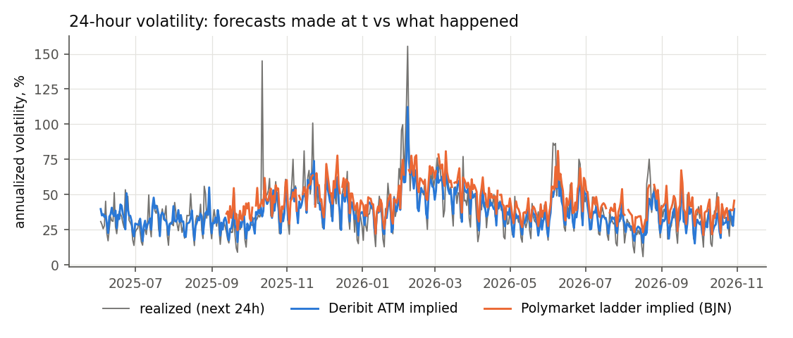
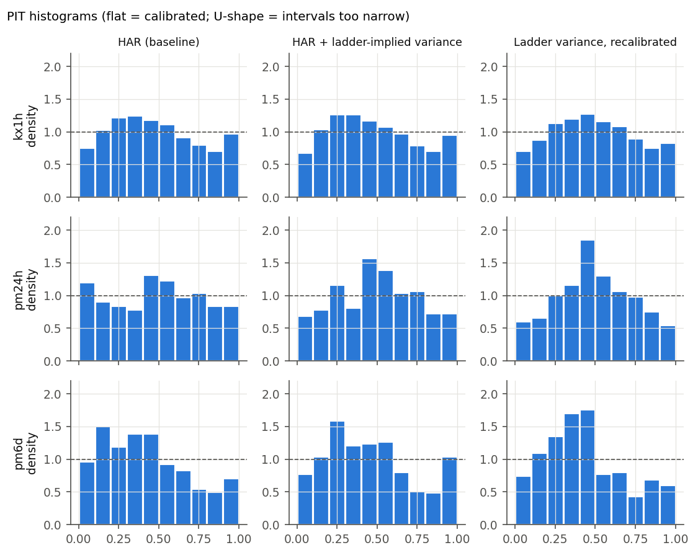
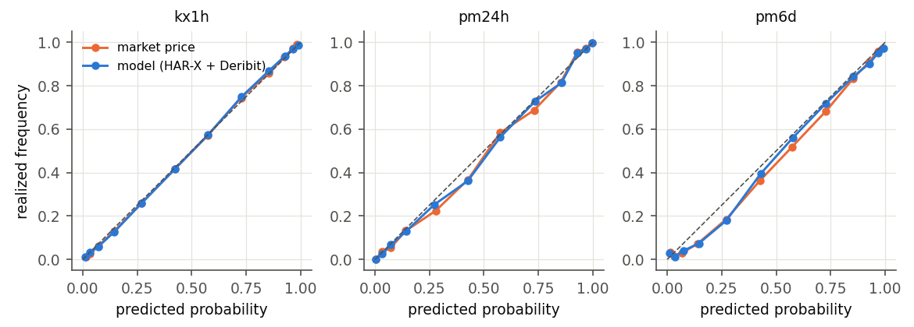
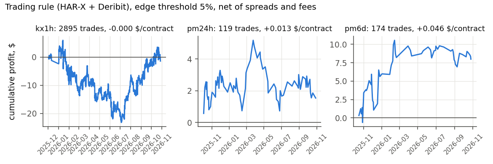

# Forecasting Bitcoin volatility with prediction-market strike ladders

Team: TODO

## 1. Forecasting task

Polymarket and Kalshi list ladders of binary contracts that pay $1 if Bitcoin settles above a strike at a fixed time. A ladder is a strip of digital options, so its prices imply a distribution for the settlement price, and the width of that distribution is the market's forecast of volatility over the window that ends at settlement. We forecast that volatility and compare our forecasts with the ladders and with Deribit options.

* **Target:** realized variance of BTC/USDT over the window [t, T), the sum of squared 1-minute log returns. Models forecast its logarithm.
* **Form:** full predictive density of log realized variance; point forecast = its mean; probabilities for every strike of the ladder derived from the density.
* **Horizons:** 55 minutes (Kalshi hourly ladders, forecast 5 minutes after the open), 24 hours and 6 days (Polymarket daily ladders settling at 12:00 New York time).
* **Evaluation:** QLIKE loss for point forecasts, log score and CRPS for densities, PIT histograms and interval coverage for calibration, Mincer-Zarnowitz regressions, Diebold-Mariano tests with Newey-West variance; Brier score and a trading rule for ladder probabilities.

### From ladder prices to expected realized variance

Ignoring discounting over at most six days, the price of the contract that pays 1 if S_T > K is d(K) = P(S_T > K) under the market's pricing measure. For a price process with continuous paths and forward F, Britten-Jones and Neuberger (2000) show that the expected integrated variance between t and T is determined by option prices across strikes. Written in digital prices:

E[ integral_t^T sigma_s^2 ds ] = 2 E[ S_T/F - 1 - ln(S_T/F) ] = 2 [ int_F^inf d(K)(1/F - 1/K) dK + int_0^F (1 - d(K))(1/K - 1/F) dK ].

Realized variance from 1-minute returns converges to the integrated variance (plus squared jumps), so this model-free ladder variance is the market's forecast of our target, up to three gaps that we handle explicitly: (i) the pricing measure differs from the physical one by a variance risk premium, absorbed by the intercept of a Mincer-Zarnowitz recalibration and of the HAR regression; (ii) jumps make the formula differ from expected quadratic variation by a third-order term; (iii) the ladder quotes only 8-11 strikes $2,000 apart, so between strikes we interpolate the probit of the implied CDF linearly in log K (exact for a lognormal) and beyond the outer informative strikes we extrapolate the same way; a truncated version that integrates only between quoted strikes is reported as a lower bound. Stale tail prices that violate monotonicity are pooled first.

**Windows are aligned with settlement.** Polymarket settles on the close of the Binance BTC/USDT 1-minute candle that opens at 12:00 ET, so the target window runs from the forecast time t to 12:01 ET. Kalshi settles on the average of 60 one-second CF Benchmarks BRTI prints before T; the variance of that average relative to S_t equals the integrated variance up to T - 60 s plus one third of the last minute's, and the Kalshi target is built the same way. Deribit options settle on a 30-minute average of its index, so its quoted IV is converted to a point-price variance rate (sigma^2 = IV^2 tau / (tau - 20 min)) before interpolation to our windows.

## 2. Data

| horizon | occasions | first | last | with_ladder | with_deribit_atm | with_dvol | median_ladder_strikes | eval_occasions |
|---|---|---|---|---|---|---|---|---|
| kx1h | 32761 | 2023-02-01 23:05:00+00:00 | 2026-10-29 01:05:00+00:00 | 6891 | 0 | 32761 | 4 | 14570 |
| pm24h | 1365 | 2023-02-01 17:00:00+00:00 | 2026-10-27 16:00:00+00:00 | 405 | 512 | 1365 | 3 | 606 |
| pm6d | 1360 | 2023-02-01 17:00:00+00:00 | 2026-10-22 16:00:00+00:00 | 411 | 497 | 1360 | 7 | 601 |

Sources (all public, no account needed): [Binance 1-minute candles](https://data.binance.vision/?prefix=data/spot/monthly/klines/BTCUSDT/1m/), [Polymarket Gamma API](https://gamma-api.polymarket.com) and [CLOB price history](https://clob.polymarket.com), [Kalshi trade API, series KXBTCD](https://api.elections.kalshi.com/trade-api/v2/series/KXBTCD), [Deribit trade history](https://history.deribit.com) and [DVOL](https://www.deribit.com/api/v2/public/get_volatility_index_data), [BLS release schedules](https://www.bls.gov/bls/news-release/cpi.htm) and FOMC dates for the macro calendar. Download code: `src/download/`.

Ladder coverage at the forecast time (price history exists for every listed strike; tails are often stale or at the price floor, which is why the number of informative strikes is smaller):

| horizon | snapshots | median_strikes_listed | median_strikes_priced_at_t | share_snapshots_all_strikes_priced | median_informative_strikes | share_with_bjn_variance | share_with_lognormal_fit | share_non_monotone |
|---|---|---|---|---|---|---|---|---|
| pm24h | 415 | 11.00 | 11.00 | 0.98 | 7.00 | 0.98 | 0.86 | 0.22 |
| pm6d | 413 | 11.00 | 11.00 | 0.95 | 11.00 | 1.00 | 1.00 | 0.15 |
| kx1h | 6962 | 11.00 | 6.00 | 0.08 | 6.00 | 0.99 | 0.93 | 0.03 |

## 3. Models

All models are re-estimated on a rolling window using only occasions whose target window had ended before the forecast time (pseudo-out-of-sample from 2025-03-01).

| model | what it uses | why |
|---|---|---|
| Naive | log realized variance of the previous window of the same length | benchmark |
| GARCH(1,1)-t | conditional variance of 24h returns | textbook benchmark (24h and 6d only) |
| HAR-RV | log RV on daily, weekly, monthly log RV (+ intraday seasonal factor at 55 min) | baseline |
| HAR + ladder | HAR with log model-free ladder variance as an extra regressor | the direct test: does the ladder forecast variance beyond the history of returns? |
| HAR-X | HAR + semivariances, jump share, HARQ term, macro-release and weekend dummies | asymmetry, short-lived jumps, measurement error, scheduled news |
| HAR-X + Deribit | adds DVOL and Deribit ATM implied variance for the window | options price scheduled events and positioning before they appear in returns |
| HAR-X + ladder | adds the variance implied by the prediction-market ladder | same, from a retail venue |
| HAR-X + Deribit + ladder | both | encompassing test: does the ladder add anything beyond Deribit? |
| Implied variance, raw / recalibrated | Deribit or ladder variance as is, and after a rolling Mincer-Zarnowitz regression | markets as stand-alone forecasters |
| Combination | equal-weight mixture of HAR-X, recalibrated Deribit, recalibrated ladder | forecast combination usually beats the components |

## 4. Results

### 4.1 Accuracy on the common sample

Every model has a forecast for every occasion in this sample. Lower QLIKE and CRPS are better, higher log score is better; well-calibrated densities have 50% and 90% coverage close to 0.50 and 0.90.

**Kalshi, 55 minutes**

| model | n | qlike | logscore | crps | cov50 | cov90 | mz_b | mz_p |
|---|---|---|---|---|---|---|---|---|
| HAR-X + ladder | 5822 | 0.248 | -0.939 | 0.338 | 0.565 | 0.919 | 0.985 | 0.376 |
| HAR-X + Deribit + ladder | 5822 | 0.248 | -0.938 | 0.337 | 0.568 | 0.918 | 0.976 | 0.026 |
| Ladder variance (BJN), raw | 5822 | 0.252 | -1.072 | 0.391 | 0.557 | 0.935 | 1.007 | 0.000 |
| Ladder variance (BJN), recalibrated | 5822 | 0.254 | -1.002 | 0.359 | 0.590 | 0.926 | 1.013 | 0.203 |
| HAR + ladder variance (BJN) | 5822 | 0.254 | -0.951 | 0.342 | 0.562 | 0.921 | 0.969 | 0.012 |
| gbm_all | 5822 | 0.257 | -0.966 | 0.347 | 0.571 | 0.923 | 1.001 | 0.737 |
| HAR-X + Deribit | 5822 | 0.270 | -0.978 | 0.351 | 0.570 | 0.917 | 0.975 | 0.000 |
| HAR-X | 5822 | 0.270 | -0.980 | 0.353 | 0.562 | 0.917 | 0.982 | 0.054 |
| Equal-weight combination | 5822 | 0.279 | -1.042 | 0.372 | 0.668 | 0.959 | 1.203 | 0.000 |
| Ladder variance (Student-t fit), raw | 5822 | 0.280 | -1.191 | 0.434 | 0.567 | 0.925 | 0.912 | 0.000 |
| HAR-RV (baseline) | 5822 | 0.281 | -0.997 | 0.358 | 0.564 | 0.917 | 0.960 | 0.000 |
| Naive (previous window) | 5822 | 0.409 | -1.166 | 0.429 | 0.553 | 0.914 | 0.726 | 0.000 |
| Deribit IV, raw | 5822 | 0.512 | -1.519 | 0.614 | 0.552 | 0.952 | 1.589 | 0.000 |
| Deribit IV, recalibrated | 5822 | 0.561 | -1.420 | 0.557 | 0.546 | 0.907 | 0.712 | 0.000 |
| Ladder variance (lognormal fit), raw | 5822 | 0.660 | -0.930 | 0.329 | 0.589 | 0.924 | 0.992 | 0.000 |

Lowest QLIKE: HAR-X + ladder (0.248, 12% below HAR-RV).

**Polymarket, 24 hours**

| model | n | qlike | logscore | crps | cov50 | cov90 | mz_b | mz_p |
|---|---|---|---|---|---|---|---|---|
| Deribit IV, recalibrated | 291 | 0.083 | -0.543 | 0.230 | 0.581 | 0.948 | 0.882 | 0.002 |
| HAR-X + Deribit | 291 | 0.083 | -0.531 | 0.228 | 0.584 | 0.948 | 0.890 | 0.002 |
| Deribit IV, raw | 291 | 0.085 | -0.531 | 0.224 | 0.639 | 0.938 | 1.027 | 0.390 |
| HAR-X + Deribit + ladder | 291 | 0.085 | -0.545 | 0.230 | 0.577 | 0.948 | 0.849 | 0.000 |
| Equal-weight combination | 291 | 0.085 | -0.605 | 0.234 | 0.704 | 0.955 | 0.967 | 0.309 |
| Ladder variance (lognormal fit), raw | 291 | 0.085 | -0.532 | 0.224 | 0.625 | 0.955 | 1.083 | 0.192 |
| gbm_all | 291 | 0.087 | -0.587 | 0.234 | 0.670 | 0.952 | 0.933 | 0.042 |
| Ladder variance (BJN), recalibrated | 291 | 0.094 | -0.639 | 0.246 | 0.660 | 0.959 | 0.883 | 0.026 |
| HAR + ladder variance (BJN) | 291 | 0.095 | -0.628 | 0.248 | 0.629 | 0.948 | 0.862 | 0.003 |
| HAR-X + ladder | 291 | 0.102 | -0.621 | 0.248 | 0.595 | 0.948 | 0.839 | 0.000 |
| Ladder variance (BJN), raw | 291 | 0.115 | -0.849 | 0.305 | 0.629 | 0.966 | 1.206 | 0.000 |
| Ladder variance (Student-t fit), raw | 291 | 0.139 | -0.974 | 0.336 | 0.691 | 0.948 | 0.916 | 0.000 |
| HAR-X | 291 | 0.143 | -0.757 | 0.285 | 0.564 | 0.914 | 0.827 | 0.000 |
| HAR-RV (baseline) | 291 | 0.155 | -0.886 | 0.329 | 0.567 | 0.935 | 0.792 | 0.000 |
| GARCH(1,1)-t | 291 | 0.198 | -1.104 | 0.392 | 0.643 | 0.962 | 0.850 | 0.000 |
| Naive (previous window) | 291 | 0.364 | -1.105 | 0.406 | 0.584 | 0.880 | 0.454 | 0.000 |

Lowest QLIKE: Deribit IV, recalibrated (0.083, 47% below HAR-RV).

**Polymarket, 6 days**

| model | n | qlike | logscore | crps | cov50 | cov90 | mz_b | mz_p |
|---|---|---|---|---|---|---|---|---|
| HAR-X | 335 | 0.129 | -0.651 | 0.247 | 0.600 | 0.931 | 0.927 | 0.829 |
| Deribit IV, raw | 335 | 0.132 | -0.640 | 0.242 | 0.618 | 0.937 | 0.965 | 0.940 |
| HAR-X + ladder | 335 | 0.134 | -0.705 | 0.265 | 0.531 | 0.916 | 0.816 | 0.261 |
| HAR-RV (baseline) | 335 | 0.137 | -0.684 | 0.258 | 0.585 | 0.928 | 0.967 | 0.925 |
| Equal-weight combination | 335 | 0.140 | -0.644 | 0.248 | 0.678 | 0.937 | 1.015 | 0.869 |
| Deribit IV, recalibrated | 335 | 0.140 | -0.694 | 0.252 | 0.594 | 0.919 | 0.836 | 0.298 |
| HAR + ladder variance (BJN) | 335 | 0.143 | -0.748 | 0.276 | 0.528 | 0.907 | 0.779 | 0.257 |
| HAR-X + Deribit | 335 | 0.143 | -0.732 | 0.260 | 0.567 | 0.899 | 0.792 | 0.123 |
| Ladder variance (Student-t fit), raw | 335 | 0.144 | -0.849 | 0.291 | 0.621 | 0.943 | 0.640 | 0.002 |
| Ladder variance (BJN), raw | 335 | 0.151 | -0.997 | 0.316 | 0.585 | 0.934 | 0.552 | 0.000 |
| Ladder variance (lognormal fit), raw | 335 | 0.160 | -0.770 | 0.265 | 0.716 | 0.934 | 0.728 | 0.101 |
| Naive (previous window) | 335 | 0.160 | -0.743 | 0.270 | 0.669 | 0.925 | 0.660 | 0.002 |
| gbm_all | 335 | 0.164 | -0.816 | 0.306 | 0.555 | 0.937 | 0.654 | 0.007 |
| Ladder variance (BJN), recalibrated | 335 | 0.175 | -0.947 | 0.303 | 0.594 | 0.907 | 0.504 | 0.047 |
| GARCH(1,1)-t | 335 | 0.191 | -1.052 | 0.386 | 0.475 | 0.955 | 2.311 | 0.000 |
| HAR-X + Deribit + ladder | 335 | 0.342 | -0.893 | 0.281 | 0.552 | 0.904 | 0.580 | 0.018 |

Lowest QLIKE: HAR-X (0.129, 6% below HAR-RV).

### 4.2 Diebold-Mariano tests

Negative statistic: the first model has the lower loss. Newey-West variance, Harvey-Leybourne-Newbold correction; overlapping 6-day windows use 5 lags or more.

| horizon | comparison | loss | n | mean_diff | dm | p |
|---|---|---|---|---|---|---|
| Kalshi, 55 minutes | HAR + ladder-implied variance vs HAR (main test) | qlike | 5822 | -0.027 | -5.995 | < 0.001 |
| Kalshi, 55 minutes | HAR + ladder-implied variance vs HAR (main test) | logscore | 5822 | -0.046 | -12.970 | < 0.001 |
| Kalshi, 55 minutes | HAR vs naive | qlike | 5822 | -0.128 | -13.485 | < 0.001 |
| Kalshi, 55 minutes | HAR vs naive | logscore | 5822 | -0.169 | -26.974 | < 0.001 |
| Kalshi, 55 minutes | time-series extensions | qlike | 5822 | -0.011 | -2.380 | 0.017 |
| Kalshi, 55 minutes | time-series extensions | logscore | 5822 | -0.017 | -4.750 | < 0.001 |
| Kalshi, 55 minutes | adding Deribit | qlike | 5822 | -0.000 | -0.134 | 0.893 |
| Kalshi, 55 minutes | adding Deribit | logscore | 5822 | -0.002 | -1.010 | 0.312 |
| Kalshi, 55 minutes | adding the ladder on top of Deribit (key test) | qlike | 5822 | -0.022 | -6.081 | < 0.001 |
| Kalshi, 55 minutes | adding the ladder on top of Deribit (key test) | logscore | 5822 | -0.040 | -12.077 | < 0.001 |
| Kalshi, 55 minutes | adding the ladder alone | qlike | 5822 | -0.022 | -5.907 | < 0.001 |
| Kalshi, 55 minutes | adding the ladder alone | logscore | 5822 | -0.041 | -12.173 | < 0.001 |
| Kalshi, 55 minutes | ladder vs Deribit as standalone forecasts | qlike | 5822 | -0.307 | -11.069 | < 0.001 |
| Kalshi, 55 minutes | ladder vs Deribit as standalone forecasts | logscore | 5822 | -0.418 | -27.954 | < 0.001 |
| Kalshi, 55 minutes | combination vs best regression | qlike | 5822 | 0.031 | 4.760 | < 0.001 |
| Kalshi, 55 minutes | combination vs best regression | logscore | 5822 | 0.104 | 14.546 | < 0.001 |
| Kalshi, 55 minutes | gradient-boosted trees vs the same features in OLS | qlike | 5822 | 0.008 | 1.938 | 0.053 |
| Kalshi, 55 minutes | gradient-boosted trees vs the same features in OLS | logscore | 5822 | 0.028 | 5.499 | < 0.001 |
| Polymarket, 24 hours | HAR + ladder-implied variance vs HAR (main test) | qlike | 291 | -0.060 | -7.320 | < 0.001 |
| Polymarket, 24 hours | HAR + ladder-implied variance vs HAR (main test) | logscore | 291 | -0.258 | -12.615 | < 0.001 |
| Polymarket, 24 hours | HAR vs naive | qlike | 291 | -0.209 | -5.752 | < 0.001 |
| Polymarket, 24 hours | HAR vs naive | logscore | 291 | -0.219 | -7.809 | < 0.001 |
| Polymarket, 24 hours | HAR vs GARCH | qlike | 291 | -0.043 | -3.045 | 0.003 |
| Polymarket, 24 hours | HAR vs GARCH | logscore | 291 | -0.218 | -7.560 | < 0.001 |
| Polymarket, 24 hours | time-series extensions | qlike | 291 | -0.012 | -0.670 | 0.503 |
| Polymarket, 24 hours | time-series extensions | logscore | 291 | -0.129 | -3.436 | < 0.001 |
| Polymarket, 24 hours | adding Deribit | qlike | 291 | -0.060 | -3.762 | < 0.001 |
| Polymarket, 24 hours | adding Deribit | logscore | 291 | -0.226 | -7.203 | < 0.001 |
| Polymarket, 24 hours | adding the ladder on top of Deribit (key test) | qlike | 291 | 0.002 | 0.816 | 0.415 |
| Polymarket, 24 hours | adding the ladder on top of Deribit (key test) | logscore | 291 | 0.014 | 1.533 | 0.126 |
| Polymarket, 24 hours | adding the ladder alone | qlike | 291 | -0.042 | -3.626 | < 0.001 |
| Polymarket, 24 hours | adding the ladder alone | logscore | 291 | -0.136 | -5.672 | < 0.001 |
| Polymarket, 24 hours | ladder vs Deribit as standalone forecasts | qlike | 291 | 0.012 | 1.757 | 0.080 |
| Polymarket, 24 hours | ladder vs Deribit as standalone forecasts | logscore | 291 | 0.096 | 3.555 | < 0.001 |
| Polymarket, 24 hours | combination vs best regression | qlike | 291 | 0.000 | 0.104 | 0.918 |
| Polymarket, 24 hours | combination vs best regression | logscore | 291 | 0.060 | 3.402 | < 0.001 |
| Polymarket, 24 hours | gradient-boosted trees vs the same features in OLS | qlike | 291 | 0.002 | 0.344 | 0.731 |
| Polymarket, 24 hours | gradient-boosted trees vs the same features in OLS | logscore | 291 | 0.042 | 1.986 | 0.048 |
| Polymarket, 6 days | HAR + ladder-implied variance vs HAR (main test) | qlike | 335 | 0.006 | 0.551 | 0.582 |
| Polymarket, 6 days | HAR + ladder-implied variance vs HAR (main test) | logscore | 335 | 0.064 | 1.365 | 0.173 |
| Polymarket, 6 days | HAR vs naive | qlike | 335 | -0.023 | -0.916 | 0.360 |
| Polymarket, 6 days | HAR vs naive | logscore | 335 | -0.059 | -1.103 | 0.271 |
| Polymarket, 6 days | HAR vs GARCH | qlike | 335 | -0.054 | -1.962 | 0.051 |
| Polymarket, 6 days | HAR vs GARCH | logscore | 335 | -0.367 | -3.610 | < 0.001 |
| Polymarket, 6 days | time-series extensions | qlike | 335 | -0.008 | -1.396 | 0.164 |
| Polymarket, 6 days | time-series extensions | logscore | 335 | -0.033 | -1.827 | 0.069 |
| Polymarket, 6 days | adding Deribit | qlike | 335 | 0.014 | 1.523 | 0.129 |
| Polymarket, 6 days | adding Deribit | logscore | 335 | 0.081 | 1.599 | 0.111 |
| Polymarket, 6 days | adding the ladder on top of Deribit (key test) | qlike | 335 | 0.199 | 0.978 | 0.329 |
| Polymarket, 6 days | adding the ladder on top of Deribit (key test) | logscore | 335 | 0.161 | 1.121 | 0.263 |
| Polymarket, 6 days | adding the ladder alone | qlike | 335 | 0.005 | 0.559 | 0.576 |
| Polymarket, 6 days | adding the ladder alone | logscore | 335 | 0.054 | 1.509 | 0.132 |
| Polymarket, 6 days | ladder vs Deribit as standalone forecasts | qlike | 335 | 0.034 | 1.282 | 0.201 |
| Polymarket, 6 days | ladder vs Deribit as standalone forecasts | logscore | 335 | 0.254 | 1.391 | 0.165 |
| Polymarket, 6 days | combination vs best regression | qlike | 335 | -0.202 | -1.049 | 0.295 |
| Polymarket, 6 days | combination vs best regression | logscore | 335 | -0.249 | -1.624 | 0.105 |
| Polymarket, 6 days | gradient-boosted trees vs the same features in OLS | qlike | 335 | -0.178 | -0.877 | 0.381 |
| Polymarket, 6 days | gradient-boosted trees vs the same features in OLS | logscore | 335 | -0.077 | -0.480 | 0.632 |

Main test, Kalshi, 55 minutes, qlike: adding the ladder variance to HAR changes the loss by -0.0271 (DM = -6.00, p < 0.001), significant at 5%.

Main test, Kalshi, 55 minutes, logscore: adding the ladder variance to HAR changes the loss by -0.0455 (DM = -12.97, p < 0.001), significant at 5%.

Main test, Polymarket, 24 hours, qlike: adding the ladder variance to HAR changes the loss by -0.0605 (DM = -7.32, p < 0.001), significant at 5%.

Main test, Polymarket, 24 hours, logscore: adding the ladder variance to HAR changes the loss by -0.2580 (DM = -12.62, p < 0.001), significant at 5%.

Main test, Polymarket, 6 days, qlike: adding the ladder variance to HAR changes the loss by +0.0062 (DM = 0.55, p = 0.582), not significant at 5%.

Main test, Polymarket, 6 days, logscore: adding the ladder variance to HAR changes the loss by +0.0637 (DM = 1.37, p = 0.173), not significant at 5%.

Key test, Kalshi, 55 minutes: adding the ladder to HAR-X + Deribit changes QLIKE by -0.0215 (DM = -6.08, p < 0.001), significant at 5%.

Key test, Polymarket, 24 hours: adding the ladder to HAR-X + Deribit changes QLIKE by +0.0017 (DM = 0.82, p = 0.415), not significant at 5%.

Key test, Polymarket, 6 days: adding the ladder to HAR-X + Deribit changes QLIKE by +0.1986 (DM = 0.98, p = 0.329), not significant at 5%.

TODO: why does (or doesn't) the ladder add information beyond Deribit?

### 4.3 Are implied variances biased?

Mean of log realized variance minus log implied variance. Negative values mean the implied variance was too high on average (a variance risk premium).

| horizon | implied | n | mean_log_ratio | se | t_stat | implied_over_realized | mean_rv_over_implied | se_ratio | t_ratio_vs_1 |
|---|---|---|---|---|---|---|---|---|---|
| kx1h | DVOL | 14570 | -0.715 | 0.024 | -30.145 | 2.043 | 0.893 | 0.029 | -3.748 |
| kx1h | ladder, model-free (BJN) | 6891 | -0.284 | 0.011 | -26.108 | 1.328 | 0.998 | 0.017 | -0.090 |
| kx1h | ladder, BJN truncated | 6891 | -0.044 | 0.011 | -4.116 | 1.045 | 1.270 | 0.026 | 10.399 |
| kx1h | ladder, lognormal | 6451 | 0.037 | 0.008 | 4.412 | 0.963 | 1.662 | 0.350 | 1.892 |
| kx1h | ladder, Student-t | 6261 | -0.353 | 0.012 | -28.249 | 1.423 | 0.942 | 0.016 | -3.578 |
| pm24h | Deribit ATM | 512 | -0.042 | 0.027 | -1.582 | 1.043 | 1.096 | 0.045 | 2.118 |
| pm24h | DVOL | 606 | -0.338 | 0.044 | -7.627 | 1.403 | 0.923 | 0.052 | -1.488 |
| pm24h | ladder, model-free (BJN) | 405 | -0.379 | 0.038 | -9.872 | 1.461 | 0.796 | 0.038 | -5.353 |
| pm24h | ladder, BJN truncated | 405 | -0.232 | 0.045 | -5.113 | 1.261 | 0.959 | 0.062 | -0.663 |
| pm24h | ladder, lognormal | 355 | 0.034 | 0.031 | 1.104 | 0.967 | 1.169 | 0.065 | 2.603 |
| pm24h | ladder, Student-t | 410 | -0.361 | 0.043 | -8.392 | 1.434 | 0.853 | 0.045 | -3.249 |
| pm6d | Deribit ATM | 497 | -0.037 | 0.043 | -0.873 | 1.038 | 1.096 | 0.068 | 1.402 |
| pm6d | DVOL | 601 | -0.189 | 0.044 | -4.273 | 1.208 | 0.955 | 0.059 | -0.764 |
| pm6d | ladder, model-free (BJN) | 411 | -0.213 | 0.051 | -4.191 | 1.238 | 0.944 | 0.065 | -0.866 |
| pm6d | ladder, BJN truncated | 411 | 0.055 | 0.056 | 0.973 | 0.947 | 1.264 | 0.104 | 2.546 |
| pm6d | ladder, lognormal | 410 | 0.081 | 0.049 | 1.652 | 0.922 | 1.251 | 0.086 | 2.911 |
| pm6d | ladder, Student-t | 409 | -0.160 | 0.048 | -3.301 | 1.173 | 0.995 | 0.069 | -0.067 |

TODO: compare the premium in the ladder (retail) with Deribit (professional market makers).

### 4.4 Ladder probabilities

Model probabilities for each strike come from the predictive density of variance: log S_T is normal given the variance, and the variance itself is uncertain, which fattens the tails without extra parameters.

| horizon | source | n_strikes | n_snapshots | brier_per_strike | logloss_per_strike |
|---|---|---|---|---|---|
| kx1h | market | 41987 | 6555 | 0.101 | 0.328 |
| kx1h | harx | 41987 | 6555 | 0.102 | 0.331 |
| kx1h | harx_d | 41987 | 6555 | 0.102 | 0.331 |
| kx1h | harx_all | 41987 | 6555 | 0.102 | 0.329 |
| pm24h | market | 3783 | 342 | 0.039 | 0.128 |
| pm24h | harx | 3783 | 342 | 0.039 | 0.128 |
| pm24h | harx_d | 3783 | 342 | 0.039 | 0.127 |
| pm24h | harx_all | 3783 | 342 | 0.039 | 0.127 |
| pm6d | market | 3683 | 335 | 0.097 | 0.323 |
| pm6d | harx | 3683 | 335 | 0.096 | 0.324 |
| pm6d | harx_d | 3683 | 335 | 0.097 | 0.328 |
| pm6d | harx_all | 3683 | 335 | 0.097 | 0.325 |

Calibration by bins of the market price (realized = share of contracts that paid out):

| horizon | bin | n | market_p | realized | p_harx | p_harx_d | p_harx_all |
|---|---|---|---|---|---|---|---|
| kx1h | [0.0, 0.02) | 2569 | 0.015 | 0.012 | 0.014 | 0.014 | 0.012 |
| kx1h | [0.02, 0.05) | 4747 | 0.032 | 0.024 | 0.032 | 0.031 | 0.031 |
| kx1h | [0.05, 0.2) | 7486 | 0.109 | 0.097 | 0.112 | 0.110 | 0.112 |
| kx1h | [0.2, 0.5) | 6311 | 0.340 | 0.329 | 0.338 | 0.336 | 0.339 |
| kx1h | [0.5, 0.8) | 6177 | 0.659 | 0.665 | 0.658 | 0.659 | 0.656 |
| kx1h | [0.8, 0.95) | 7084 | 0.890 | 0.894 | 0.882 | 0.884 | 0.882 |
| kx1h | [0.95, 0.98) | 4483 | 0.966 | 0.973 | 0.963 | 0.964 | 0.964 |
| kx1h | [0.98, 1.0) | 3130 | 0.984 | 0.988 | 0.985 | 0.985 | 0.986 |
| pm24h | [0.0, 0.02) | 1334 | 0.004 | 0.001 | 0.003 | 0.002 | 0.002 |
| pm24h | [0.02, 0.05) | 172 | 0.032 | 0.035 | 0.033 | 0.028 | 0.030 |
| pm24h | [0.05, 0.2) | 250 | 0.110 | 0.104 | 0.115 | 0.111 | 0.114 |
| pm24h | [0.2, 0.5) | 212 | 0.346 | 0.264 | 0.339 | 0.340 | 0.342 |
| pm24h | [0.5, 0.8) | 215 | 0.659 | 0.647 | 0.646 | 0.644 | 0.642 |
| pm24h | [0.8, 0.95) | 238 | 0.889 | 0.891 | 0.880 | 0.888 | 0.885 |
| pm24h | [0.95, 0.98) | 171 | 0.968 | 0.971 | 0.969 | 0.977 | 0.976 |
| pm24h | [0.98, 1.0) | 1191 | 0.996 | 0.999 | 0.998 | 0.999 | 0.998 |
| pm6d | [0.0, 0.02) | 338 | 0.013 | 0.033 | 0.011 | 0.009 | 0.010 |
| pm6d | [0.02, 0.05) | 358 | 0.032 | 0.014 | 0.036 | 0.033 | 0.036 |
| pm6d | [0.05, 0.2) | 583 | 0.107 | 0.057 | 0.113 | 0.109 | 0.114 |
| pm6d | [0.2, 0.5) | 549 | 0.338 | 0.271 | 0.326 | 0.324 | 0.326 |
| pm6d | [0.5, 0.8) | 558 | 0.659 | 0.616 | 0.635 | 0.638 | 0.635 |
| pm6d | [0.8, 0.95) | 563 | 0.890 | 0.885 | 0.876 | 0.882 | 0.876 |
| pm6d | [0.95, 0.98) | 373 | 0.967 | 0.968 | 0.966 | 0.970 | 0.968 |
| pm6d | [0.98, 1.0) | 361 | 0.987 | 0.972 | 0.992 | 0.994 | 0.993 |

TODO: is there a favourite-longshot bias in the tails, and is it bigger than the model's own error?

### 4.5 Trading rule

Buy at the ask when the model probability exceeds it by the threshold, sell at the bid in the opposite case; hold to settlement. Kalshi uses recorded bid/ask and its taker fee; Polymarket history has no quotes, so a half-spread of 0.005 is assumed there (the live logger measures it).

| horizon | model | threshold | n_trades | n_snapshots | pnl_per_contract | pnl_total | hit_rate | t_stat_per_snapshot |
|---|---|---|---|---|---|---|---|---|
| kx1h | harx | 0.020 | 12552 | 5110 | -0.009 | -116.139 | 0.429 | -2.535 |
| kx1h | harx | 0.050 | 2867 | 1754 | 0.003 | 10.006 | 0.443 | 0.431 |
| kx1h | harx_d | 0.020 | 12474 | 5073 | -0.007 | -86.816 | 0.451 | -1.863 |
| kx1h | harx_d | 0.050 | 2895 | 1771 | -0.000 | -1.415 | 0.461 | -0.060 |
| pm24h | harx | 0.020 | 690 | 313 | -0.000 | -0.213 | 0.441 | -0.023 |
| pm24h | harx | 0.050 | 223 | 147 | 0.033 | 7.457 | 0.489 | 1.291 |
| pm24h | harx_d | 0.020 | 437 | 251 | 0.019 | 8.495 | 0.513 | 1.095 |
| pm24h | harx_d | 0.050 | 119 | 85 | 0.013 | 1.541 | 0.437 | 0.313 |
| pm6d | harx | 0.020 | 1294 | 342 | 0.033 | 42.797 | 0.419 | 1.220 |
| pm6d | harx | 0.050 | 236 | 103 | 0.086 | 20.193 | 0.403 | 2.222 |
| pm6d | harx_d | 0.020 | 968 | 271 | 0.030 | 29.519 | 0.489 | 1.085 |
| pm6d | harx_d | 0.050 | 174 | 71 | 0.046 | 7.986 | 0.494 | 1.123 |

### 4.6 True out-of-sample forecasts

Forecasts committed to git before settlement since 2026-10-09:

| horizon | model | n | qlike | mse_log | logscore | crps | cov50 | cov90 | mz_a | mz_b | mz_r2 | mz_p |
|---|---|---|---|---|---|---|---|---|---|---|---|---|
| kx1h | combo | 6 | 0.448 | 0.841 | -1.324 | 0.509 | 0.667 | 0.833 |  |  |  |  |
| kx1h | har | 6 | 0.399 | 0.644 | -1.212 | 0.439 | 0.500 | 0.833 |  |  |  |  |
| kx1h | har_m | 6 | 0.408 | 0.626 | -1.243 | 0.434 | 0.500 | 0.833 |  |  |  |  |
| kx1h | harx | 6 | 0.410 | 0.678 | -1.257 | 0.462 | 0.500 | 0.833 |  |  |  |  |
| kx1h | harx_all | 6 | 0.385 | 0.615 | -1.235 | 0.441 | 0.500 | 0.833 |  |  |  |  |
| kx1h | harx_d | 6 | 0.390 | 0.646 | -1.225 | 0.451 | 0.500 | 0.833 |  |  |  |  |
| kx1h | harx_m | 6 | 0.400 | 0.640 | -1.263 | 0.450 | 0.500 | 0.833 |  |  |  |  |
| kx1h | iv_mz | 6 | 0.582 | 1.185 | -1.508 | 0.618 | 0.667 | 0.833 |  |  |  |  |
| kx1h | iv_raw | 6 | 0.706 | 1.344 | -1.622 | 0.686 | 0.500 | 1.000 |  |  |  |  |
| kx1h | mkt_ln_raw | 6 | 0.471 | 0.519 | -1.183 | 0.381 | 0.833 | 0.833 |  |  |  |  |
| kx1h | mkt_mz | 6 | 0.500 | 0.769 | -1.450 | 0.497 | 0.667 | 0.833 |  |  |  |  |
| kx1h | mkt_raw | 6 | 0.408 | 0.603 | -1.279 | 0.463 | 0.500 | 0.833 |  |  |  |  |
| kx1h | mkt_t_raw | 6 | 0.375 | 0.627 | -1.182 | 0.459 | 0.333 | 1.000 |  |  |  |  |
| kx1h | naive | 6 | 0.445 | 0.508 | -1.095 | 0.386 | 0.833 | 0.833 |  |  |  |  |

## 5. Interpretation

TODO: which model wins, by how much, is it significant, and why. Discuss limits: Binance as a proxy for the CF Benchmarks index that settles Kalshi; Polymarket history without quotes; the short live window.
