# Волатильность биткоина по лесенкам Polymarket и Kalshi

_Курсовой проект РЭШ «Introduction to Forecasting» · Александр Шестаков, Александр Шилин · снимок данных 31.10.2026 · сдача 01.11.2026_

**Главный вывод.** На 55 минутах центр лесенки Kalshi — лучший прогноз волатильности (CRPS 0,329 против 0,358 у HAR и 0,614 у Deribit). Лесенка добавляет информацию сверх опционов Deribit (Δ QLIKE −0,0215, DM −6,08). На 24 часах и 6 днях рынок и опционы неразличимы. После комиссий не выживает ни одна из 53 торговых гипотез.

Полная версия с интерактивным графиком и всеми таблицами: **[final_report.html](final_report.html)**.

## 1. Ключевые числа

| Показатель | Значение | Комментарий |
|---|---|---|
| CRPS, 55 мин, центр лесенки | 0,329 | лучший на горизонте |
| CRPS, 55 мин, HAR-X + Deribit + лесенка | 0,337 | лучшая регрессия |
| CRPS, 55 мин, Deribit | 0,614 | худший |
| Δ QLIKE от лесенки сверх Deribit, 55 мин | −0,0215 (DM −6,08) | p < 0,001 |
| Δ QLIKE от лесенки сверх Deribit, 24 ч | +0,0017 (DM +0,82) | незначимо |
| Δ QLIKE от лесенки сверх Deribit, 6 дн | +0,199 (DM +0,98) | незначимо, шум |
| GBM: QLIKE к HAR, 15 мин / 1 час / 1 день | −27% / −23% / +22% | вне выборки 2024–2026 |
| Brier рынка / лучшей модели, 55 мин | 0,10139 / 0,10162 | рынок не хуже (p = 0,069) |
| Живых сделок лаборатории | 2 399 | 28–29.10.2026 |
| Гипотез, прошедших Холма с плюсом | 0 из 53 | — |

## 2. Факт и прогноз волатильности во времени

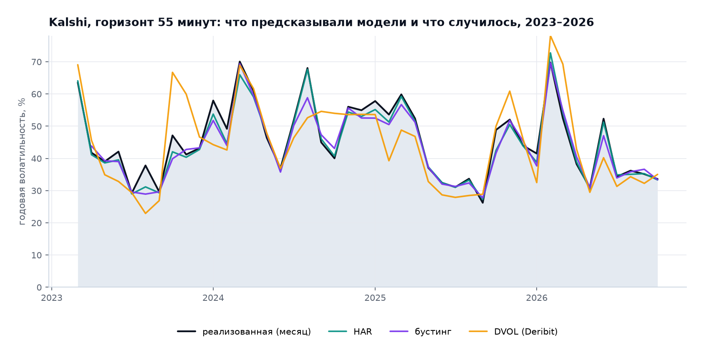

_Рис. 1. Три года, месячные средние: HAR, бустинг и DVOL._

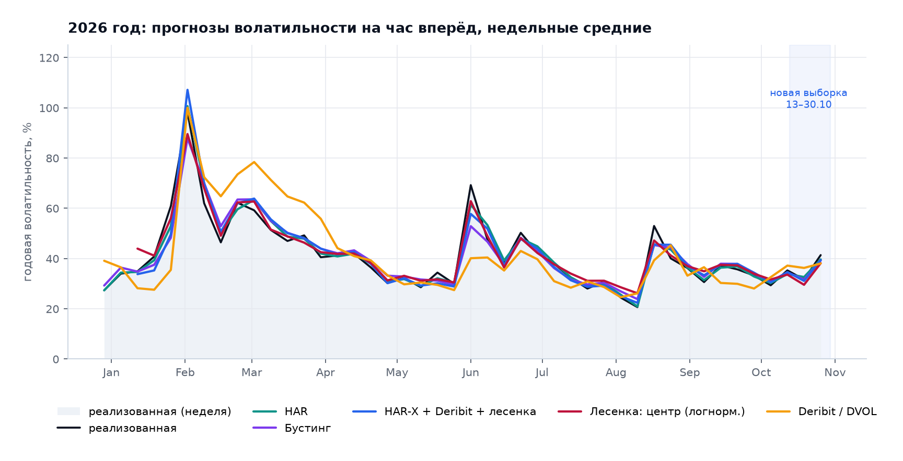

_Рис. 2. 2026 год, недельные средние: все методы против факта._

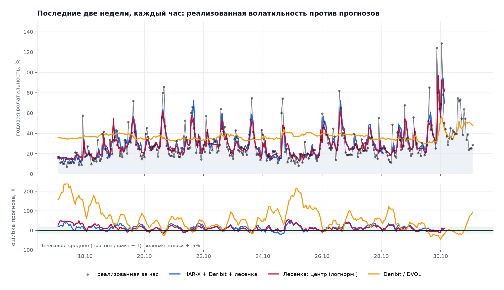

_Рис. 3. Последние две недели по часам: факт, HAR-X + Deribit + лесенка, лесенка, DVOL._

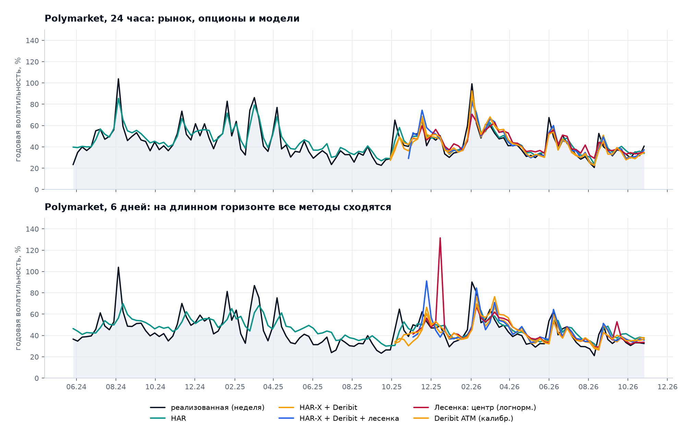

_Рис. 4. Polymarket 24 часа и 6 дней._

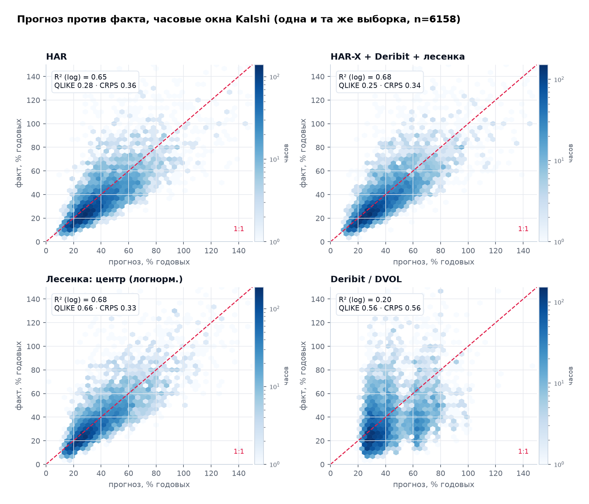

_Рис. 5. Прогноз против факта на общей выборке часов._

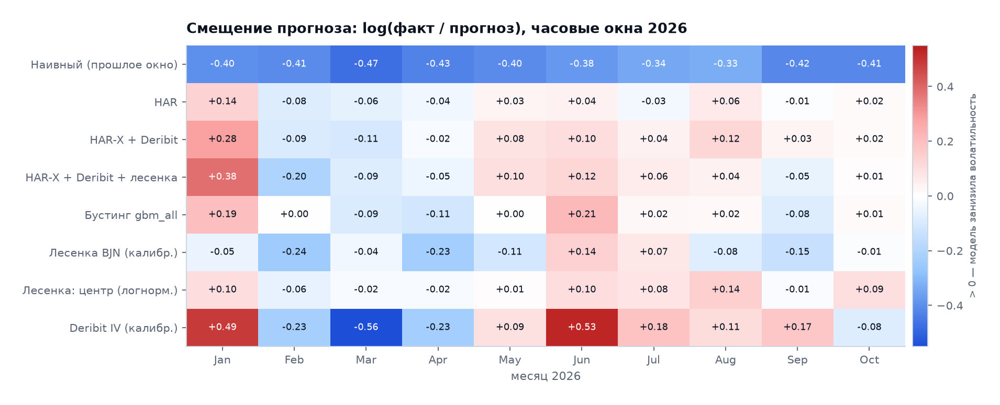

_Рис. 6. Смещение прогнозов по месяцам 2026._


## 3. Кто точнее

### 55 минут, Kalshi (общая выборка 5 822 часа)

| Модель | n | CRPS | QLIKE | Log score | cov50 | cov90 | MZ b | p(MZ) |
|---|---|---|---|---|---|---|---|---|
| Лесенка: центр (логнорм.) | 5822 | 0,329 | 0,660 | −0,930 | 0,589 | 0,924 | 0,992 | < 0,001 |
| HAR-X + Deribit + лесенка | 5822 | 0,337 | 0,248 | −0,938 | 0,568 | 0,918 | 0,976 | 0,026 |
| HAR-X + лесенка | 5822 | 0,338 | 0,248 | −0,939 | 0,565 | 0,919 | 0,985 | 0,376 |
| HAR + лесенка | 5822 | 0,342 | 0,254 | −0,951 | 0,562 | 0,921 | 0,969 | 0,012 |
| Бустинг gbm_all | 5822 | 0,347 | 0,257 | −0,966 | 0,571 | 0,923 | 1,001 | 0,737 |
| HAR-X + Deribit | 5822 | 0,351 | 0,270 | −0,978 | 0,570 | 0,917 | 0,975 | < 0,001 |
| HAR-X | 5822 | 0,353 | 0,270 | −0,980 | 0,562 | 0,917 | 0,982 | 0,054 |
| HAR | 5822 | 0,358 | 0,281 | −0,997 | 0,564 | 0,917 | 0,960 | < 0,001 |
| Лесенка BJN (калибр.) | 5822 | 0,359 | 0,254 | −1,002 | 0,590 | 0,926 | 1,013 | 0,203 |

### 24 часа и 6 дней

**Polymarket, 24 часа**

| Модель | n | CRPS | QLIKE | Log score | cov50 | cov90 |
|---|---|---|---|---|---|---|
| Лесенка: центр (логнорм.) | 291 | 0,224 | 0,085 | −0,532 | 0,625 | 0,955 |
| Deribit IV (как есть) | 291 | 0,224 | 0,085 | −0,531 | 0,639 | 0,938 |
| HAR-X + Deribit | 291 | 0,228 | 0,083 | −0,531 | 0,584 | 0,948 |
| Deribit IV (калибр.) | 291 | 0,230 | 0,083 | −0,543 | 0,581 | 0,948 |
| HAR-X + Deribit + лесенка | 291 | 0,230 | 0,085 | −0,545 | 0,577 | 0,948 |
| Смесь равных весов | 291 | 0,234 | 0,085 | −0,605 | 0,704 | 0,955 |
| Бустинг gbm_all | 291 | 0,234 | 0,087 | −0,587 | 0,670 | 0,952 |
| Лесенка BJN (калибр.) | 291 | 0,246 | 0,094 | −0,639 | 0,660 | 0,959 |

**Polymarket, 6 дней**

| Модель | n | CRPS | QLIKE | Log score | cov50 | cov90 |
|---|---|---|---|---|---|---|
| Deribit IV (как есть) | 335 | 0,242 | 0,132 | −0,640 | 0,618 | 0,937 |
| HAR-X | 335 | 0,247 | 0,129 | −0,651 | 0,600 | 0,931 |
| Смесь равных весов | 335 | 0,248 | 0,140 | −0,644 | 0,678 | 0,937 |
| Deribit IV (калибр.) | 335 | 0,252 | 0,140 | −0,694 | 0,594 | 0,919 |
| HAR | 335 | 0,258 | 0,137 | −0,684 | 0,585 | 0,928 |
| HAR-X + Deribit | 335 | 0,260 | 0,143 | −0,732 | 0,567 | 0,899 |
| Лесенка: центр (логнорм.) | 335 | 0,265 | 0,160 | −0,770 | 0,716 | 0,934 |
| HAR-X + лесенка | 335 | 0,265 | 0,134 | −0,705 | 0,531 | 0,916 |


## 4. Почему лесенка выигрывает на часе

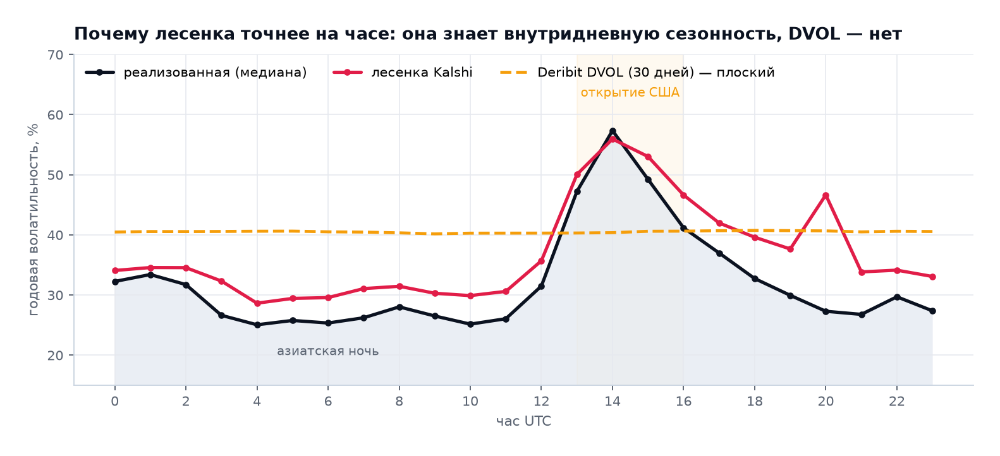

_Рис. 7. Внутридневная сезонность: факт, лесенка и плоский DVOL._

Реализованная волатильность в 14 UTC — 57,3% годовых, в 4 UTC — 25,0% (×2,3). Лесенка повторяет профиль (55,9% и 28,6%), DVOL — нет (40,2–40,7% в любое время суток). Средняя подразумеваемая дисперсия DVOL в 2,04 раза выше факта, у лесенки BJN — в 1,33 раза, у логнормального центра — 0,96.


## 5. Бустинг на трёх годах минут

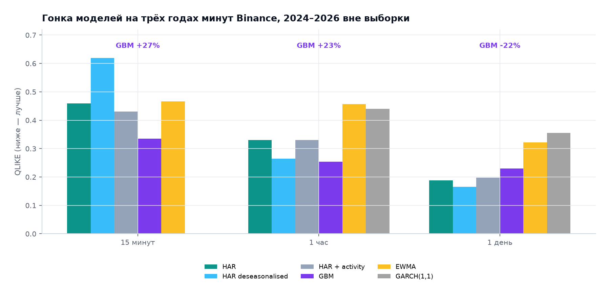

_Рис. 8. QLIKE вне выборки 2024–2026._

| Горизонт | HAR | HAR deseas. | HAR + активность | GBM | GARCH | EWMA | GBM к HAR |
|---|---|---|---|---|---|---|---|
| 15 минут | 0,459 | 0,619 | 0,430 | 0,335 | — | 0,466 | −27% |
| 1 час | 0,330 | 0,265 | 0,331 | 0,253 | 0,440 | 0,457 | −23% |
| 1 день | 0,188 | 0,165 | 0,198 | 0,230 | 0,355 | 0,322 | +22% |

Среднее логарифмов «GBM + центр лесенки» — лучший прогноз 15.01–12.10.2026: CRPS 0,3255 против 0,3335 у лесенки (DM −5,3, 5 744 часа). На новых двух неделях harx_all снова первый (0,3347), а улучшение дисперсии не переносится на Brier страйков.


## 6. Вероятности страйков

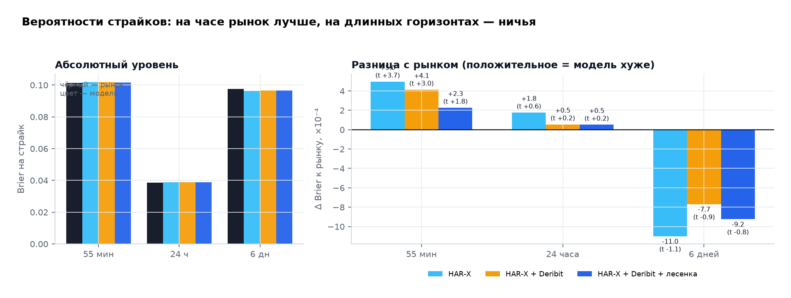

_Рис. 9. Brier на страйк: рынок против моделей._

| Горизонт | Источник | Страйков | Снимков | Brier | Log loss |
|---|---|---|---|---|---|
| kx1h | market | 41987 | 6555 | 0,10139 | 0,32837 |
| kx1h | harx | 41987 | 6555 | 0,10189 | 0,33091 |
| kx1h | harx_d | 41987 | 6555 | 0,10181 | 0,33057 |
| kx1h | harx_all | 41987 | 6555 | 0,10162 | 0,32935 |
| pm24h | market | 3783 | 342 | 0,03864 | 0,12763 |
| pm24h | harx | 3783 | 342 | 0,03882 | 0,12783 |
| pm24h | harx_d | 3783 | 342 | 0,03869 | 0,12730 |
| pm24h | harx_all | 3783 | 342 | 0,03869 | 0,12718 |
| pm6d | market | 3683 | 335 | 0,09743 | 0,32311 |
| pm6d | harx | 3683 | 335 | 0,09633 | 0,32365 |
| pm6d | harx_d | 3683 | 335 | 0,09666 | 0,32752 |
| pm6d | harx_all | 3683 | 335 | 0,09651 | 0,32511 |

На 55 минутах рынок лучше HAR-X (DM +3,67), HAR-X + Deribit (DM +3,01) и не хуже лучшей модели HAR-X + Deribit + лесенка (DM +1,82, p = 0,069). На 24 часах и 6 днях разницы нет.


## 7. Альфа

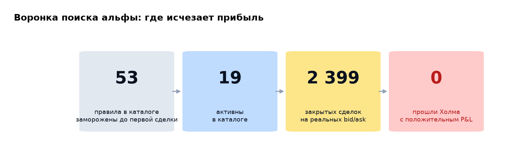

_Рис. 10. 53 правила → 19 активных → 2 399 сделок → 0 выживших._

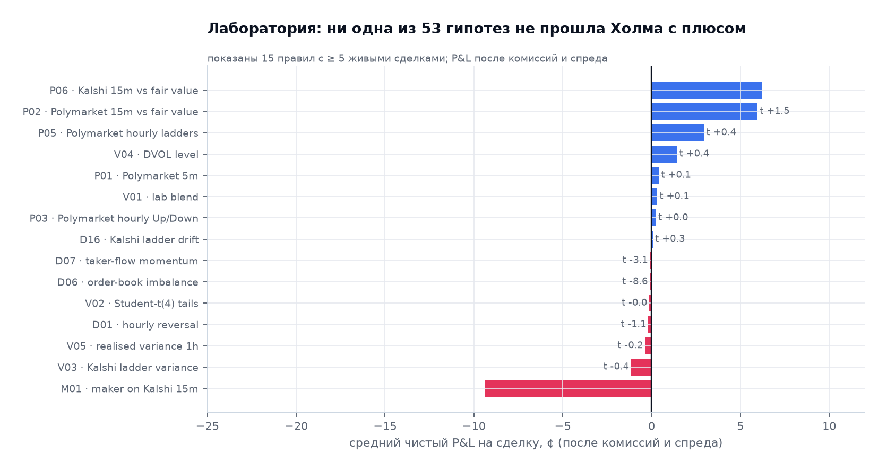

_Рис. 11. Средний чистый P&L на сделку._

| ID | Семейство | Сделок | Средний net, $ | t | Холм p | Вердикт |
|---|---|---|---|---|---|---|
| P06 | P | 5 | 0,062 |  |  | собирает данные |
| P02 | P | 60 | 0,060 | 1,485 | 1,000 | ничего |
| P05 | P | 20 | 0,030 | 0,402 | 1,000 | ничего |
| V04 | V | 111 | 0,014 | 0,357 | 1,000 | ничего |
| P01 | P | 163 | 0,004 | 0,142 | 1,000 | ничего |
| V01 | V | 114 | 0,003 | 0,113 | 1,000 | ничего |
| P03 | P | 16 | 0,003 | 0,035 | 1,000 | ничего |
| D16 | D | 6 | 0,001 | 0,310 |  | собирает данные |
| D07 | D | 31 | −0,001 | −3,071 | 0,023 | убыточно |
| D06 | D | 113 | −0,001 | −8,640 | < 0,001 | убыточно |

Пять «альф» оказались артефактами: устаревший листинг Kalshi, пустая сторона стакана как 0, снимок опционов против живого перпа, один месяц вместо истории и рассинхронизация меток времени на 20–40 с.


## 8. Исследования R1–R21

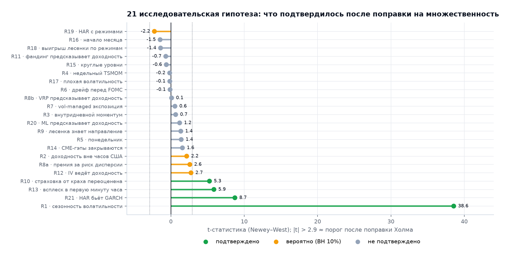

_Рис. 12. t-статистики 22 гипотез._

После Холма подтверждены R1 (сезонность), R10 (переоценка хвостов), R13 (всплеск в первую минуту часа), R21 (HAR лучше GARCH на сутках). R2, R8a, R12, R19 проходят только BH на 10%. Остальные 14 — шум. R10 не торгуется после спреда; R11 cash-and-carry даёт Sharpe 6,0, но это сбор фандинга с ограниченной ёмкостью.


## 9. Ограничения

- Две недели новых наблюдений на 24 часах и 6 днях — не выборка.
- История Polymarket без стакана; торговые тесты на ней — верхняя граница.
- Kalshi рассчитывается по BRTI, у нас минуты Binance; базис модельный.
- Бумажная торговля не учитывает влияние на цену и очередь.
- Один актив (BTC); перенос на ETH не проверен.


## 10. Воспроизводимость

```bash
python reports/final_report_analysis.py   # таблицы и рисунки
python reports/build_final_report.py      # HTML + Markdown
```

Таблицы: `reports/final/tables/*.csv`; рисунки: `reports/final/figures/*.png`. Live-прогнозы: 10 записей, цепочка SHA-256 цела, код совпадает с замороженным.
