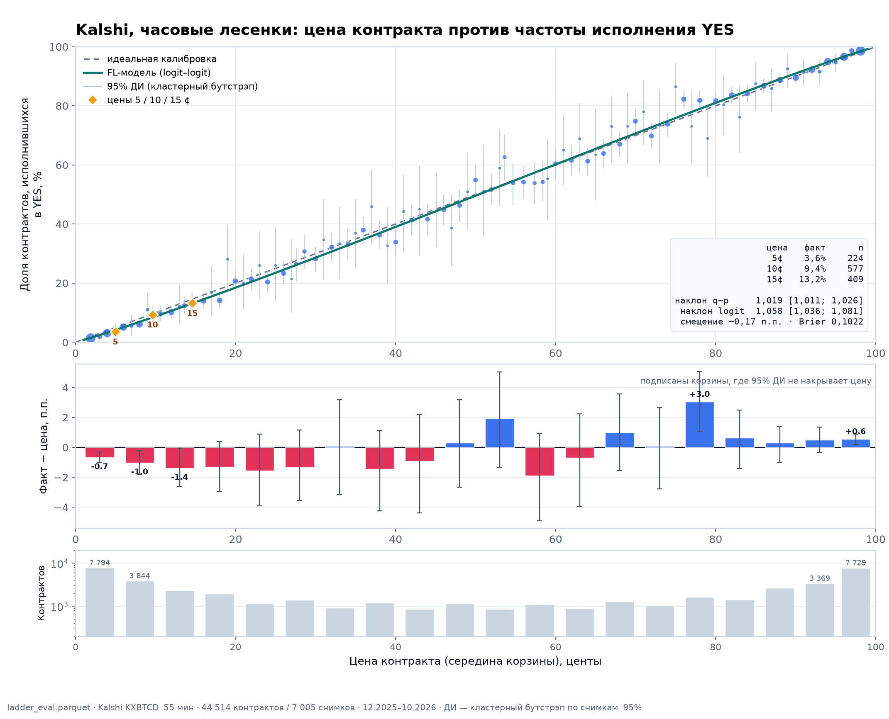

# Калибровка цен Kalshi: как часто контракт за X центов исполняется в YES

Данные: `ladder_eval.parquet`, горизонт `kx1h` (часовые лесенки KXBTCD), **44 514 контрактов / 7 005 снимков**, 2025-12-01 — 2026-10-30.

## Короткий ответ

| Цена контракта | Исполнилось в YES | 95 % ДИ | Наблюдений |
|---:|---:|---:|---:|
| **5¢** | **3,6 %** | 1,3–6,1 % | 224 |
| **10¢** | **9,4 %** | 7,0–11,7 % | 577 |
| **15¢** | **13,2 %** | 10,0–16,6 % | 409 |

То есть контракт за 5¢ исполняется в YES примерно в **3,6 %** случаев, за 10¢ — в **9,4 %**, за 15¢ — в **13,2 %**. Для сравнения: средняя цена в этих корзинах 5,0 / 9,6 / 14,6¢, так что рынок в среднем почти не ошибается, но на дешёвых контрактах факт немного **ниже** цены.

## Калибровка по всем ценам 5…95¢

| Цена | Факт YES | 95 % ДИ | Цена (средняя) | Отклонение | n |
|---:|---:|---:|---:|---:|---:|
| 5¢ | 3,6 % | 1,3–6,1 % | 5,0¢ | −1,41 п.п. | 224 |
| 10¢ | 9,4 % | 7,0–11,7 % | 9,6¢ | −0,27 п.п. | 577 |
| 15¢ | 13,2 % | 10,0–16,6 % | 14,6¢ | −1,39 п.п. | 409 |
| 20¢ | 20,7 % | 17,1–24,1 % | 20,0¢ | 0,74 п.п. | 565 |
| 25¢ | 26,0 % | 14,3–37,9 % | 25,0¢ | 1,00 п.п. | 50 |
| 30¢ | 28,2 % | 24,0–32,5 % | 30,0¢ | −1,78 п.п. | 411 |
| 35¢ | 36,9 % | 25,0–49,2 % | 35,0¢ | 1,92 п.п. | 65 |
| 40¢ | 33,9 % | 28,9–38,7 % | 40,0¢ | −6,11 п.п. | 351 |
| 45¢ | 44,4 % | 33,3–56,7 % | 45,1¢ | −0,69 п.п. | 63 |
| 50¢ | 54,9 % | 49,9–60,2 % | 50,0¢ | 4,90 п.п. | 348 |
| 55¢ | 53,9 % | 47,3–60,2 % | 54,7¢ | −0,81 п.п. | 219 |
| 60¢ | 60,4 % | 55,5–65,9 % | 60,0¢ | 0,40 п.п. | 351 |
| 65¢ | 63,4 % | 48,8–77,8 % | 65,0¢ | −1,59 п.п. | 41 |
| 70¢ | 74,8 % | 70,3–78,9 % | 70,0¢ | 4,83 п.п. | 381 |
| 75¢ | 86,4 % | 77,4–94,7 % | 75,0¢ | 11,44 п.п. | 59 |
| 80¢ | 81,7 % | 78,4–84,9 % | 80,0¢ | 1,65 п.п. | 551 |
| 85¢ | 87,5 % | 79,2–95,1 % | 85,0¢ | 2,50 п.п. | 64 |
| 90¢ | 89,5 % | 87,7–91,4 % | 90,0¢ | −0,49 п.п. | 1 021 |
| 95¢ | 94,7 % | 91,5–97,6 % | 95,0¢ | −0,29 п.п. | 208 |

## Пятицентовые корзины (весь диапазон 1…99¢)

| Диапазон | Факт YES | Средняя цена | Отклонение, п.п. | 95 % ДИ отклонения | n |
|---|---:|---:|---:|---:|---:|
| 1–5¢ | 2,0 % | 2,7¢ | −0,67 | −1,03–−0,31 | 7 794 |
| 6–10¢ | 6,3 % | 7,3¢ | −1,02 | −1,82–−0,22 | 3 844 |
| 11–15¢ | 11,1 % | 12,5¢ | −1,38 | −2,61–−0,07 | 2 308 |
| 16–20¢ | 16,6 % | 17,9¢ | −1,29 | −2,94–0,39 | 1 960 |
| 21–25¢ | 21,3 % | 22,9¢ | −1,55 | −3,90–0,87 | 1 149 |
| 26–30¢ | 26,6 % | 28,0¢ | −1,35 | −3,56–1,15 | 1 382 |
| 31–35¢ | 33,1 % | 33,0¢ | 0,07 | −3,15–3,17 | 906 |
| 36–40¢ | 36,5 % | 37,9¢ | −1,45 | −4,25–1,12 | 1 204 |
| 41–45¢ | 42,0 % | 43,0¢ | −0,92 | −4,37–2,21 | 861 |
| 46–50¢ | 48,3 % | 48,0¢ | 0,29 | −2,68–3,19 | 1 166 |
| 51–55¢ | 55,0 % | 53,0¢ | 1,92 | −1,37–5,03 | 848 |
| 56–60¢ | 56,2 % | 58,1¢ | −1,88 | −4,91–0,94 | 1 100 |
| 61–65¢ | 62,3 % | 63,0¢ | −0,69 | −3,95–2,25 | 893 |
| 66–70¢ | 69,0 % | 68,0¢ | 0,99 | −1,56–3,57 | 1 278 |
| 71–75¢ | 73,1 % | 73,1¢ | 0,08 | −2,77–2,66 | 1 020 |
| 76–80¢ | 81,2 % | 78,1¢ | 3,05 | 1,05–5,06 | 1 609 |
| 81–85¢ | 83,6 % | 83,0¢ | 0,63 | −1,42–2,48 | 1 418 |
| 86–90¢ | 88,6 % | 88,3¢ | 0,30 | −1,01–1,40 | 2 676 |
| 91–95¢ | 93,7 % | 93,2¢ | 0,49 | −0,34–1,34 | 3 369 |
| 96–99¢ | 97,9 % | 97,4¢ | 0,56 | 0,20–0,90 | 7 729 |

## Что здесь видно

1. **В целом рынок калиброван.** Средний факт 49,68 % против средней цены 49,85 % — смещение **−0,17 п.п.**, Brier 0,1022.

2. **Мягкий longshot bias.** Регрессия «факт ~ цена» даёт наклон **1,019** (95 % ДИ 1,011–1,026): дешёвые контракты исполняются чуть реже своей цены (1–15¢: −0,7…−1,4 п.п.), дорогие — чуть чаще (76–80¢: +3,0 п.п.; 96–99¢: +0,6 п.п.). Наклон > 1 означает, что цены слегка «сжаты» к середине — это ровно форма favourite-longshot bias (формальная проверка ниже).

3. **Ликвидность на краях.** На 1–5¢ и 96–99¢ приходится 35 % всех наблюдений; в середине лесенки в отдельном центе всего 40–70 контрактов, поэтому доверительные интервалы там широкие.

4. **Отдельные цены шумят.** Котировки стоят на целой сетке 1¢, а `p` — середина bid/ask, поэтому точки в соседних центах частично «размазывают» одну и ту же котировку (например, 40¢ и 41¢). Пятицентовые корзины и FL-кривая — более надёжная картина; отдельные центы (40¢, 70¢, 75¢) дают большие отклонения, но это скорее микроструктура/устаревание котировок, чем устойчивая стратегия.

## Это просто favourite-longshot bias?

Да — по форме ровно он. Двухпараметрическая модель

`logit(q) = a + b · logit(p)`

по 5-центовым корзинам даёт `a = −0,017` и **b = 1,058, 95 % ДИ 1,036–1,083** (b > 1 во всех 1 000 бутстрэп-повторах). b > 1 — формальный признак FL-эффекта: дешёвые контракты стоят дороже своей частоты, дорогие — дешевле. Зелёная кривая на графике — это и есть модель; она почти совпадает с диагональю в середине и расходится с ней на краях.

Это не артефакт широких спредов: на подвыборках `spread ≤ 2¢` и `spread = 1¢` форма та же, и она воспроизводится в обоих полугодиях. Отдельные «странные» цены (40¢, 70¢, 75¢) после FL-кривой дают остатки в пределах ±2 п.п. — это шум сетки котировок, а не отдельная аномалия.

**Но заработать на нём нельзя.** При покупке YES по ask средний результат лежит между −2,6 и +2,3¢ на контракт: положительный край есть только в 76–80¢ (+2,3¢ до комиссии и десятые доли цента после комиссии ~1–2¢). Покупка NO по bid даёт максимум +1,2¢ до комиссии. То есть FL-эффект статистически реальный, но целиком живёт внутри спреда и комиссии — это свойство книги, а не бесплатный арбитраж.

## Методика

- Цена: `p` — середина YES bid/ask в центах; исход: `outcome` из Kalshi (колонка `expiration_value`).
- ДИ: кластерный бутстрэп по `event` (снимку лесенки), 1 000 повторов, 95 %; строки внутри снимка коррелированы, поэтому обычный Wilson-интервал по строкам занижает дисперсию.
- Наклон: OLS `outcome ~ cents` на уровне контракта, ДИ — тот же кластерный бутстрэп.
- FL-модель: взвешенный МНК `logit(q) ~ logit(p)` по 5-центовым корзинам (вес `n·q·(1−q)`), ДИ — кластерный бутстрэп.

## Файлы

- `reports/kalshi_calibration.py` — расчёт и график.
- `reports/final/figures/fig18_kalshi_price_calibration.png` — график.
- `reports/final/tables/kalshi_calibration_1c.csv` — все 99 цен.
- `reports/final/tables/kalshi_calibration_5c.csv` — 5¢ корзины.
- `reports/final/tables/kalshi_calibration_round.csv` — круглые цены 5…95¢.
- `reports/final/tables/kalshi_calibration_summary.json` — сводные метрики.
