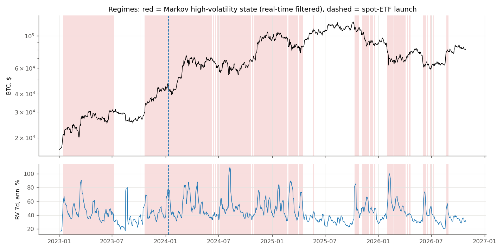
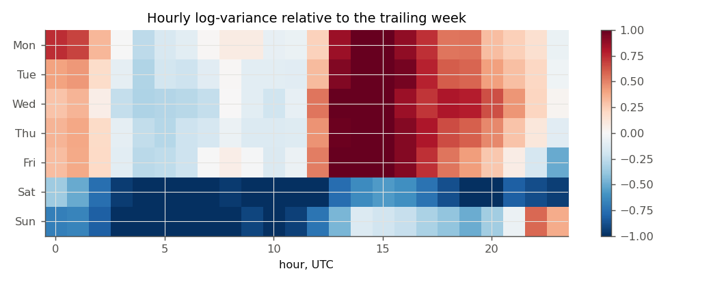
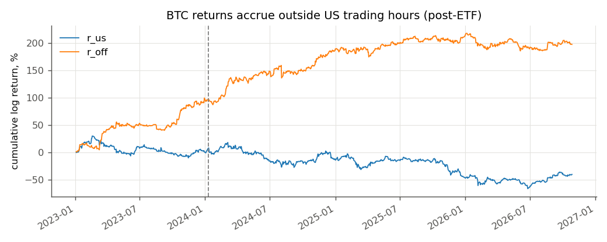
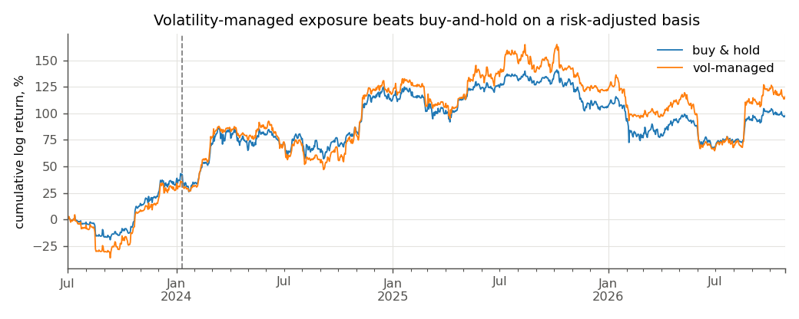
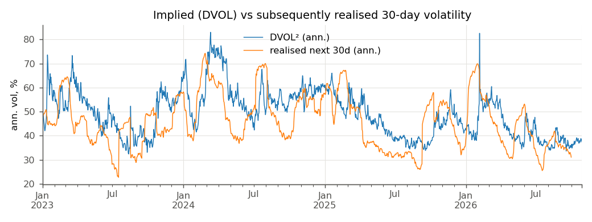
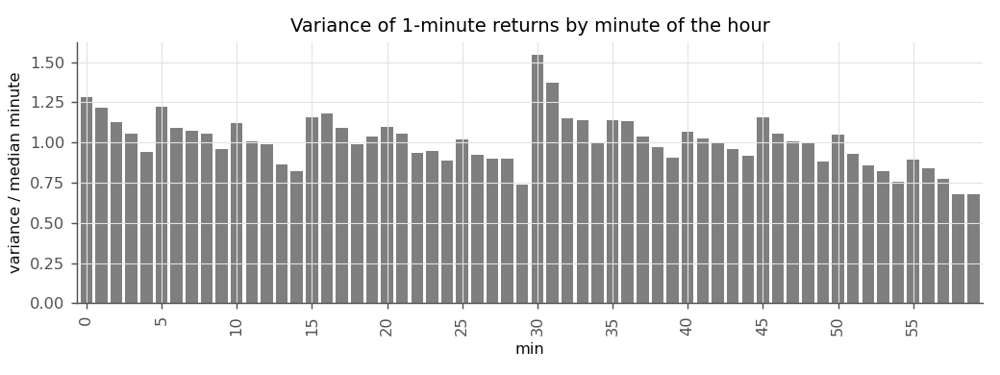
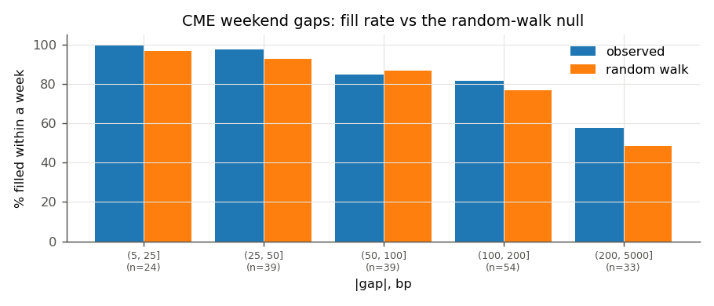

# Quant research: regimes and BTC inefficiencies

_Generated 2026-10-29 06:07 in 2.9 min. Data: Binance 1-minute 2023-01-01 … 2026-10-29 02:10 UTC; hypotheses frozen 2026-10-29. Costs 5 bp per side._

## 1. Verdicts

Primary statistic = mean of the per-observation series, Newey–West t; Holm controls the family-wise error over all hypotheses, BH the false-discovery rate. 'Regime-stable' = same sign in every Markov, trend and ETF-era state with ≥20 observations.

| id | hypothesis | effect | unit | t | p | Holm p | BH q | n | regime-stable sign | verdict | post-freeze effect | post-freeze n |
|---|---|---|---|---|---|---|---|---|---|---|---|---|
| R1 | Intraday/weekly volatility seasonality is stable and predicts out of sample | 0.971 | slope | 38.559 | 0.000 | 0.000 | 0.000 | 24,771 | yes | CONFIRMED (survives Holm) | 0.216 | 3 |
| R2 | BTC returns accrue outside US trading hours (post-ETF) | 21.322 | bp/day | 2.157 | 0.031 | 0.465 | 0.085 | 701 | yes | likely (FDR 10%) | — | 0 |
| R3 | Intraday momentum: the first half hour predicts the last half hour | 0.926 | bp/trade | 0.653 | 0.514 | 1.000 | 0.693 | 958 | 83% of states | not supported | — | 0 |
| R4 | Time-series momentum at the weekly horizon | -6.873 | bp/week | -0.160 | 0.873 | 1.000 | 0.921 | 196 | 33% of states | not supported | -147.300 | 1 |
| R5 | Day-of-week: Monday returns are higher | 30.243 | bp/day | 1.412 | 0.158 | 1.000 | 0.295 | 199 | 83% of states | not supported | — | 0 |
| R6 | Pre-FOMC drift | -3.769 | bp/event | -0.108 | 0.914 | 1.000 | 0.921 | 31 | yes | not supported | — | 0 |
| R7 | Volatility-managed exposure beats buy-and-hold on a risk-adjusted basis | 1.899 | bp/day | 0.556 | 0.578 | 1.000 | 0.707 | 1,216 | 67% of states | not supported | — | 0 |
| R8a | Variance risk premium: implied variance exceeds subsequent realised variance | 314.448 | var. points (ann., ×100²) | 2.582 | 0.010 | 0.167 | 0.036 | 1,369 | 83% of states | likely (FDR 10%) | — | 0 |
| R8b | The variance risk premium predicts returns | 16.361 | bp/30d (per 1 sd) | 0.100 | 0.921 | 1.000 | 0.921 | 1,249 | 50% of states | not supported | — | 0 |
| R9 | Prediction-market ladders know the direction | 0.155 | bp/occasion (per 1 s) | 1.355 | 0.176 | 1.000 | 0.297 | 6,451 | 60% of states | not supported | — | 0 |
| R10 | Crash insurance is overpriced in prediction-market ladders | 2.626 | pp | 5.262 | 1.42e-07 | 2.71e-06 | 7.83e-07 | 6,109 | yes | CONFIRMED (survives Holm) | — | 0 |
| R11 | Perpetual funding predicts returns (crowded longs lose) | -29.389 | bp/7d (per 1 sd) | -0.692 | 0.489 | 1.000 | 0.693 | 1,295 | 50% of states | not supported | — | 0 |
| R12 | Implied-volatility changes lead BTC returns | 1.120 | bp/hour (per 1 sd) | 2.746 | 0.006 | 0.109 | 0.027 | 33,026 | yes | likely (FDR 10%) | -26.593 | 1 |
| R13 | Volatility spikes in the first minute of the hour (and at funding times) | 0.099 | log ratio | 5.870 | 4.36e-09 | 8.72e-08 | 3.20e-08 | 1,398 | 83% of states | CONFIRMED (survives Holm) | -0.469 | 1 |
| R14 | 'CME gaps always fill' | 3.963 | pp | 1.576 | 0.115 | 1.000 | 0.281 | 189 | 83% of states | not supported | — | 0 |
| R15 | Round numbers act as support/resistance | -1.825 | bp/approach | -0.619 | 0.536 | 1.000 | 0.693 | 542 | 50% of states | not supported | — | 0 |
| R16 | Turn-of-the-month effect | -25.926 | bp/day | -1.464 | 0.143 | 1.000 | 0.295 | 46 | yes | not supported | — | 0 |
| R17 | Bad volatility predicts future volatility more than good volatility | -3.76e-04 | QLIKE gain | -0.143 | 0.887 | 1.000 | 0.921 | 1,012 | 60% of states | not supported | — | 0 |
| R18 | Does the ladder's information gain depend on the volatility regime? | -0.005 | CRPS gain | -1.401 | 0.161 | 1.000 | 0.295 | 6,555 | 0% of states | not supported | — | 0 |
| R19 | A regime-aware HAR forecasts daily volatility better | -0.016 | QLIKE gain | -2.245 | 0.025 | 0.396 | 0.078 | 1,012 | yes | likely (FDR 10%) | — | 0 |
| R20 | Machine learning predicts the next-hour BTC return | 0.379 | bp/hour | 1.195 | 0.232 | 1.000 | 0.365 | 24,024 | 80% of states | not supported | 29.221 | 1 |
| R21 | Does anything beat HAR? Daily volatility model zoo | 0.100 | QLIKE | 8.730 | 2.55e-18 | 5.35e-17 | 2.80e-17 | 997 | yes | CONFIRMED (survives Holm) | — | 0 |

## 2. Strategies (all rules tried, net of costs)

DSR = probability that the Sharpe ratio is above the best one expected from 23 unrelated rules with zero true Sharpe (Bailey & López de Prado 2014). DSR > 0.95 is the bar.

| index | strategy | Sharpe gross | Sharpe net | ann. return net | ann. vol | days | PSR(>0) | DSR | post-freeze days | post-freeze return |
|---|---|---|---|---|---|---|---|---|---|---|
| 17 | R11 cash-and-carry (collect funding) | 16.338 | 6.001 | 0.048 | 0.008 | 1,398 | 1.000 | 1.000 | 1 | 6.22e-05 |
| 10 | R7 vol-managed BTC | 0.936 | 0.923 | 0.487 | 0.528 | 1,216 | 0.955 | 0.390 | 0 | — |
| 11 | benchmark: buy & hold | 0.873 | 0.873 | 0.398 | 0.456 | 1,216 | 0.946 | 0.355 | 0 | — |
| 7 | R5 long Monday only | 0.938 | 0.687 | 0.142 | 0.206 | 1,394 | 0.915 | 0.263 | 0 | — |
| 5 | R4b weekly TSMOM (long/flat) | 0.487 | 0.441 | 0.133 | 0.301 | 1,366 | 0.808 | 0.128 | 4 | 0.000 |
| 0 | R2 long off-hours only (post-ETF) | 1.012 | 0.332 | 0.123 | 0.369 | 1,022 | 0.708 | 0.083 | 0 | — |
| 18 | R11b contrarian to funding (daily) | 0.026 | 0.002 | 6.97e-04 | 0.452 | 1,301 | 0.501 | 0.025 | 0 | — |
| 22 | R20 ridge hourly (|pred| > 15 bp) | 0.547 | -0.023 | -0.002 | 0.081 | 907 | 0.485 | 0.023 | 0 | — |
| 4 | R4 weekly TSMOM (long/short) | -0.081 | -0.142 | -0.064 | 0.447 | 1,366 | 0.391 | 0.012 | 4 | -0.015 |
| 8 | R6 pre-FOMC long | -0.056 | -0.204 | -0.011 | 0.056 | 1,366 | 0.343 | 0.008 | 0 | — |
| 20 | R20 gbm hourly (|pred| > 15 bp) | 0.421 | -0.385 | -0.043 | 0.112 | 665 | 0.281 | 0.003 | 0 | — |
| 19 | R16 long turn-of-month only | -0.337 | -0.408 | -0.069 | 0.169 | 1,396 | 0.210 | 0.003 | 0 | — |
| 13 | R9 trade the ladder drift (pm24h) | -0.056 | -0.819 | -0.315 | 0.384 | 442 | 0.184 | 0.002 | 0 | — |
| 9 | R6b post-release continuation | -0.128 | -0.852 | -0.037 | 0.044 | 1,366 | 0.048 | 1.30e-04 | 0 | — |
| 21 | R20 gbm hourly (always in) | 0.750 | -0.942 | -0.419 | 0.445 | 1,002 | 0.058 | 2.01e-04 | 1 | 0.003 |
| 1 | R2 long US hours only (post-ETF) | -0.572 | -1.393 | -0.425 | 0.305 | 1,021 | 0.009 | 7.25e-06 | 0 | — |
| 16 | R10 sell upside tail (kx1h, $1 contracts) | -1.851 | -1.851 | -49.176 | 26.564 | 332 | 0.033 | 5.26e-05 | 0 | — |
| 14 | R9 trade the ladder drift (pm6d) | -2.520 | -2.869 | -0.463 | 0.161 | 442 | 5.98e-04 | 7.39e-08 | 0 | — |
| 2 | R3 intraday momentum (US close) | 0.335 | -3.259 | -0.228 | 0.070 | 1,394 | 3.61e-11 | 7.74e-18 | 0 | — |
| 23 | R20 ridge hourly (always in) | 0.622 | -3.588 | -1.676 | 0.467 | 1,002 | 1.05e-09 | 8.07e-16 | 1 | 0.003 |
| 15 | R10 sell downside tail (kx1h, $1 contracts) | -3.973 | -3.973 | -123.858 | 31.178 | 332 | 4.21e-05 | 1.18e-09 | 0 | — |
| 3 | R3b intraday momentum (UTC day) | -0.443 | -7.781 | -0.387 | 0.050 | 1,396 | 4.77e-52 | 9.38e-66 | 1 | -8.22e-04 |
| 12 | R9 trade the ladder drift (kx1h) | 0.413 | -17.350 | -6.932 | 0.400 | 332 | 9.75e-27 | 5.73e-33 | 0 | — |
| 6 | R4c hourly reversal | 1.050 | -20.163 | -8.320 | 0.413 | 1,398 | 4.67e-129 | 5.62e-142 | 1 | -0.013 |

## 3. Regimes

| ann. vol, low state % | ann. vol, high state % | sd of log RV low / high | P(stay low) | P(stay high) | mean duration low, days | mean duration high, days | share of days high (real-time) | last estimation |
|---|---|---|---|---|---|---|---|---|
| 29.587 | 49.956 | 0.82 / 0.76 | 0.959 | 0.955 | 24.379 | 22.401 | 0.629 | 2026-10-28 |

Volatility regimes dated by an optimal (BIC) segmentation of weekly log RV:

| from | to | weeks | ann. vol % |
|---|---|---|---|
| 2023-01-01 | 2023-07-02 | 27 | 38.0 |
| 2023-07-09 | 2023-10-15 | 15 | 24.9 |
| 2023-10-22 | 2025-04-13 | 78 | 44.2 |
| 2025-04-20 | 2025-10-05 | 25 | 29.5 |
| 2025-10-12 | 2026-07-05 | 39 | 41.0 |
| 2026-07-12 | 2026-11-01 | 17 | 29.5 |

Days per state:

| index | bear | bull | high | high-vol | low | low-vol | mid | post-ETF | pre-ETF |
|---|---|---|---|---|---|---|---|---|---|
| ms | 0 | 0 | 0 | 879 | 0 | 517 | 0 | 0 | 0 |
| trend | 460 | 787 | 0 | 0 | 0 | 0 | 0 | 0 | 0 |
| era | 0 | 0 | 0 | 0 | 0 | 0 | 0 | 1,022 | 375 |
| vol_tercile | 0 | 0 | 394 | 0 | 481 | 0 | 432 | 0 | 0 |

## 4. Hypotheses in detail

### R1. Intraday/weekly volatility seasonality is stable and predicts out of sample

*Source:* Andersen & Bollerslev (1997, 1998); for crypto Eross et al. (2019); Hansen et al. (2024)  
*Prediction (fixed in advance):* the hour-of-week volatility profile of year y predicts the profile of year y+1 (slope > 0)

**Primary:** effect = 0.971 slope, t = 38.56, p = 0.0000, n = 24771 → **CONFIRMED (survives Holm)**

*year-on-year stability*

| year | corr(profile y-1, y) | OOS R2 hourly log-RV |
|---|---|---|
| 2,024 | 0.968 | 0.369 |
| 2,025 | 0.967 | 0.390 |
| 2,026 | 0.955 | 0.393 |

*variance shares*

| year | US cash hours: share of variance | US cash hours: share of time | weekend: share of variance | weekend: share of time |
|---|---|---|---|---|
| 2,023 | 0.318 | 0.171 | 0.151 | 0.288 |
| 2,024 | 0.312 | 0.172 | 0.135 | 0.284 |
| 2,025 | 0.310 | 0.171 | 0.142 | 0.285 |
| 2,026 | 0.311 | 0.172 | 0.163 | 0.286 |

*by regime* (effect in slope)

| regime | state | mean | t | p | n |
|---|---|---|---|---|---|
| ms | high-vol | 0.908 | 29.439 | 1.75e-190 | 15,000 |
| ms | low-vol | 1.066 | 25.584 | 2.31e-144 | 9,768 |
| ms | differ? (Kruskal p) | — | — | 0.002 | 24,768 |
| vol_tercile | mid | 0.956 | 25.797 | 9.46e-147 | 8,112 |
| vol_tercile | high | 0.827 | 23.549 | 1.29e-122 | 8,232 |
| vol_tercile | low | 1.125 | 24.254 | 5.94e-130 | 8,424 |
| vol_tercile | differ? (Kruskal p) | — | — | 2.46e-20 | 24,768 |
| trend | bull | 0.952 | 30.098 | 5.10e-199 | 15,144 |
| trend | bear | 0.999 | 24.085 | 3.63e-128 | 9,624 |
| trend | differ? (Kruskal p) | — | — | 0.752 | 24,768 |
| era | pre-ETF | 0.979 | 5.572 | 2.52e-08 | 240 |
| era | post-ETF | 0.971 | 38.265 | 0.000 | 24,528 |
| era | differ? (Kruskal p) | — | — | 0.227 | 24,768 |
| dvol_regime | IV high | 0.852 | 26.053 | 1.24e-149 | 10,080 |
| dvol_regime | IV low | 1.052 | 29.674 | 1.66e-193 | 14,688 |
| dvol_regime | differ? (Kruskal p) | — | — | 5.37e-10 | 24,768 |
| year | 2024 | 0.916 | 24.034 | 1.21e-127 | 8,784 |
| year | 2025 | 0.999 | 23.092 | 5.52e-118 | 8,760 |
| year | 2026 | 1.003 | 19.937 | 1.93e-88 | 7,224 |
| year | differ? (Kruskal p) | — | — | 0.167 | 24,768 |
| sample | history | 0.972 | 38.131 | 0.000 | 24,384 |
| sample | new data | 0.894 | 6.944 | 3.81e-12 | 384 |
| sample | differ? (Kruskal p) | — | — | 0.127 | 24,768 |

### R2. BTC returns accrue outside US trading hours (post-ETF)

*Source:* Lou, Polk & Skouras (2019) 'A tug of war: overnight vs intraday'; 2024 market commentary on spot-ETF hours  
*Prediction (fixed in advance):* after the ETF launch, mean return 16:00→9:30 ET minus 9:30→16:00 ET > 0

**Primary:** effect = 21.322 bp/day, t = 2.16, p = 0.0310, n = 701 → **likely (FDR 10%)**

*session returns*

| sample | leg | mean bp | t | n | ann. return | ann. vol |
|---|---|---|---|---|---|---|
| pre-ETF | r_us | 3.126 | 0.282 | 257 | 0.079 | 0.306 |
| pre-ETF | r_off | 37.758 | 2.550 | 257 | 0.952 | 0.368 |
| pre-ETF | diff | 34.632 | 1.868 | 257 | 0.873 | 0.475 |
| post-ETF | r_us | -6.943 | -1.003 | 701 | -0.175 | 0.305 |
| post-ETF | r_off | 14.379 | 1.791 | 701 | 0.362 | 0.369 |
| post-ETF | diff | 21.322 | 2.157 | 701 | 0.537 | 0.483 |
| all | r_us | -4.242 | -0.727 | 958 | -0.107 | 0.305 |
| all | r_off | 20.651 | 2.897 | 958 | 0.520 | 0.369 |
| all | diff | 24.893 | 2.835 | 958 | 0.627 | 0.481 |

*by regime* (effect in bp/day)

| regime | state | mean | t | p | n |
|---|---|---|---|---|---|
| ms | high-vol | 35.128 | 2.481 | 0.013 | 413 |
| ms | low-vol | 1.524 | 0.110 | 0.913 | 288 |
| ms | differ? (Kruskal p) | — | — | 0.328 | 701 |
| vol_tercile | high | 43.053 | 1.990 | 0.047 | 260 |
| vol_tercile | mid | 16.740 | 0.989 | 0.323 | 247 |
| vol_tercile | low | -1.966 | -0.124 | 0.901 | 194 |
| vol_tercile | differ? (Kruskal p) | — | — | 0.457 | 701 |
| trend | bull | 28.067 | 2.251 | 0.024 | 425 |
| trend | bear | 10.936 | 0.669 | 0.504 | 276 |
| trend | differ? (Kruskal p) | — | — | 0.263 | 701 |
| era | post-ETF | 21.322 | 2.157 | 0.031 | 701 |
| dvol_regime | IV high | 38.177 | 2.433 | 0.015 | 289 |
| dvol_regime | IV low | 9.499 | 0.779 | 0.436 | 412 |
| dvol_regime | differ? (Kruskal p) | — | — | 0.953 | 701 |
| year | 2024 | 46.953 | 2.619 | 0.009 | 245 |
| year | 2025 | 23.300 | 1.415 | 0.157 | 250 |
| year | 2026 | -11.561 | -0.762 | 0.446 | 206 |
| year | differ? (Kruskal p) | — | — | 0.072 | 701 |
| sample | history | 22.877 | 2.290 | 0.022 | 690 |
| sample | new data | -76.224 | -4.295 | 1.75e-05 | 11 |
| sample | differ? (Kruskal p) | — | — | 0.200 | 701 |

> A 'hold only off-hours' rule trades twice a day: 10 bp/day of costs ≈ 25%/year — the effect would have to be enormous to survive.

### R3. Intraday momentum: the first half hour predicts the last half hour

*Source:* Gao, Han, Li & Zhou (2018, JFE) 'Market intraday momentum'; for crypto Wen, Bouri, Xu & Zhao (2022) — momentum and reversal at the UTC day  
*Prediction (fixed in advance):* sign(r 16:00 prev→10:00 ET) × r(15:30→16:00 ET) > 0

**Primary:** effect = 0.926 bp/trade, t = 0.65, p = 0.5141, n = 958 → **not supported**

*GHLZ regression r_last30 on r_first30, r_15:00-15:30*

| index | coef | t | p |
|---|---|---|---|
| const | -1.92e-04 | -1.392 | 0.164 |
| r_first | 0.003 | 0.373 | 0.709 |
| r_12th | 0.070 | 0.788 | 0.431 |

*crypto variant (UTC day) r_23:30-24:00 on r_00:00-00:30*

| index | coef | t | p |
|---|---|---|---|
| const | -4.26e-05 | -0.603 | 0.547 |
| r_first | 0.004 | 0.138 | 0.890 |

*by regime* (effect in bp/trade)

| regime | state | mean | t | p | n |
|---|---|---|---|---|---|
| ms | low-vol | 1.386 | 0.901 | 0.368 | 369 |
| ms | high-vol | 0.638 | 0.302 | 0.762 | 589 |
| ms | differ? (Kruskal p) | — | — | 0.953 | 958 |
| vol_tercile | low | -0.316 | -0.168 | 0.867 | 271 |
| vol_tercile | high | 0.428 | 0.168 | 0.867 | 305 |
| vol_tercile | mid | -0.393 | -0.160 | 0.873 | 321 |
| vol_tercile | differ? (Kruskal p) | — | — | 0.827 | 897 |
| trend | bull | 2.019 | 1.099 | 0.272 | 541 |
| trend | bear | -2.633 | -1.603 | 0.109 | 316 |
| trend | differ? (Kruskal p) | — | — | 0.075 | 857 |
| era | pre-ETF | 2.751 | 0.845 | 0.398 | 256 |
| era | post-ETF | 0.260 | 0.172 | 0.863 | 702 |
| era | differ? (Kruskal p) | — | — | 0.127 | 958 |
| dvol_regime | IV high | -0.136 | -0.058 | 0.954 | 353 |
| dvol_regime | IV low | -0.062 | -0.040 | 0.968 | 544 |
| dvol_regime | differ? (Kruskal p) | — | — | 0.942 | 897 |
| year | 2023 | 3.528 | 1.072 | 0.284 | 249 |
| year | 2024 | 3.038 | 1.064 | 0.287 | 252 |
| year | 2025 | 0.546 | 0.199 | 0.842 | 250 |
| year | 2026 | -4.316 | -2.387 | 0.017 | 207 |
| year | differ? (Kruskal p) | — | — | 0.053 | 958 |
| sample | history | 0.957 | 0.667 | 0.505 | 946 |
| sample | new data | -1.558 | -0.404 | 0.686 | 12 |
| sample | differ? (Kruskal p) | — | — | 0.759 | 958 |

### R4. Time-series momentum at the weekly horizon

*Source:* Liu & Tsyvinski (2021, RFS) 'Risks and returns of cryptocurrency'; Moskowitz, Ooi & Pedersen (2012)  
*Prediction (fixed in advance):* sign(past-week return) × next-week return > 0

**Primary:** effect = -6.873 bp/week, t = -0.16, p = 0.8732, n = 196 → **not supported**

*weekly regression r_{w+1} on r_w, r_{w-3..w}*

| index | coef | t | p |
|---|---|---|---|
| const | 0.005 | 1.137 | 0.256 |
| r_w | -0.012 | -0.191 | 0.849 |
| r_4w | 0.049 | 1.593 | 0.111 |

*Lo-MacKinlay variance ratios*

| returns | q | VR | z* (robust) | p |
|---|---|---|---|---|
| 1 min | 2 | 0.999 | -0.324 | 0.746 |
| 1 min | 4 | 0.991 | -1.619 | 0.105 |
| 1 min | 8 | 0.977 | -2.783 | 0.005 |
| 1 min | 16 | 0.962 | -3.446 | 5.69e-04 |
| 5 min | 2 | 0.983 | -2.493 | 0.013 |
| 5 min | 4 | 0.962 | -3.316 | 9.14e-04 |
| 5 min | 8 | 0.949 | -3.296 | 9.80e-04 |
| 5 min | 16 | 0.932 | -3.453 | 5.55e-04 |
| 1 hour | 2 | 0.982 | -1.729 | 0.084 |
| 1 hour | 4 | 0.973 | -1.459 | 0.145 |
| 1 hour | 8 | 0.970 | -1.114 | 0.265 |
| 1 hour | 16 | 0.974 | -0.715 | 0.475 |
| 1 day | 2 | 0.967 | -0.838 | 0.402 |
| 1 day | 4 | 0.990 | -0.146 | 0.884 |
| 1 day | 8 | 1.030 | 0.300 | 0.764 |
| 1 day | 16 | 1.037 | 0.261 | 0.794 |

*hourly reversal (gross)*

| mean | se | t | p | n |
|---|---|---|---|---|
| 0.495 | 0.240 | 2.063 | 0.039 | 33,528 |

*by regime* (effect in bp/week)

| regime | state | mean | t | p | n |
|---|---|---|---|---|---|
| ms | high-vol | 34.717 | 0.547 | 0.584 | 119 |
| ms | low-vol | -70.145 | -1.426 | 0.154 | 76 |
| ms | differ? (Kruskal p) | — | — | 0.162 | 195 |
| vol_tercile | low | 10.093 | 0.243 | 0.808 | 155 |
| vol_tercile | mid | -97.068 | -0.459 | 0.646 | 19 |
| vol_tercile | high | 154.994 | 0.638 | 0.523 | 13 |
| vol_tercile | differ? (Kruskal p) | — | — | 0.602 | 187 |
| trend | bull | 16.241 | 0.271 | 0.786 | 112 |
| trend | bear | 14.011 | 0.208 | 0.835 | 66 |
| trend | differ? (Kruskal p) | — | — | 0.964 | 178 |
| era | pre-ETF | -59.427 | -0.738 | 0.461 | 49 |
| era | post-ETF | 11.727 | 0.231 | 0.817 | 146 |
| era | differ? (Kruskal p) | — | — | 0.697 | 195 |
| dvol_regime | IV high | 111.385 | 1.436 | 0.151 | 66 |
| dvol_regime | IV low | -46.416 | -0.867 | 0.386 | 121 |
| dvol_regime | differ? (Kruskal p) | — | — | 0.090 | 187 |
| year | 2023 | -52.712 | -0.646 | 0.519 | 48 |
| year | 2024 | 4.275 | 0.045 | 0.964 | 52 |
| year | 2025 | 30.136 | 0.420 | 0.674 | 52 |
| year | 2026 | -10.673 | -0.113 | 0.910 | 43 |
| year | differ? (Kruskal p) | — | — | 0.995 | 195 |
| sample | history | -8.504 | -0.194 | 0.846 | 193 |
| sample | new data | — | — | — | 2 |

### R5. Day-of-week: Monday returns are higher

*Source:* Caporale & Plastun (2019, Finance Research Letters) 'The day of the week effect in the cryptocurrency market'; Aharon & Qadan (2019)  
*Prediction (fixed in advance):* Monday return minus the mean of the other six days of the week > 0

**Primary:** effect = 30.243 bp/day, t = 1.41, p = 0.1579, n = 199 → **not supported**

*by weekday*

| era | day | mean bp | t | n | ann. vol |
|---|---|---|---|---|---|
| pre-ETF | Mon | 30.292 | 0.742 | 54 | 0.501 |
| pre-ETF | Tue | 73.703 | 2.680 | 54 | 0.473 |
| pre-ETF | Wed | 29.923 | 0.821 | 54 | 0.521 |
| pre-ETF | Thu | -37.671 | -1.095 | 53 | 0.521 |
| pre-ETF | Fri | 45.475 | 1.339 | 53 | 0.447 |
| pre-ETF | Sat | 11.280 | 0.784 | 53 | 0.309 |
| pre-ETF | Sun | 39.253 | 1.727 | 53 | 0.321 |
| post-ETF | Mon | 39.523 | 1.724 | 146 | 0.546 |
| post-ETF | Tue | -28.805 | -1.383 | 146 | 0.512 |
| post-ETF | Wed | 38.297 | 1.729 | 146 | 0.507 |
| post-ETF | Thu | -29.815 | -1.372 | 146 | 0.507 |
| post-ETF | Fri | 7.356 | 0.330 | 146 | 0.544 |
| post-ETF | Sat | -0.463 | -0.046 | 146 | 0.308 |
| post-ETF | Sun | 11.984 | 0.714 | 146 | 0.368 |

*weekend volatility*

| era | weekend RV / Tue-Thu RV | 90% CI low | 90% CI high |
|---|---|---|---|
| pre-ETF | 0.386 | 0.286 | 0.510 |
| post-ETF | 0.445 | 0.386 | 0.515 |

*by regime* (effect in bp/day)

| regime | state | mean | t | p | n |
|---|---|---|---|---|---|
| ms | low-vol | -16.010 | -0.645 | 0.519 | 87 |
| ms | high-vol | 66.173 | 2.066 | 0.039 | 112 |
| ms | differ? (Kruskal p) | — | — | 0.049 | 199 |
| vol_tercile | low | -22.715 | -0.936 | 0.349 | 121 |
| vol_tercile | mid | 188.339 | 3.955 | 7.65e-05 | 44 |
| vol_tercile | high | 34.274 | 0.404 | 0.686 | 21 |
| vol_tercile | differ? (Kruskal p) | — | — | 8.25e-05 | 186 |
| trend | bull | 43.557 | 1.424 | 0.155 | 111 |
| trend | bear | 32.423 | 1.012 | 0.312 | 66 |
| trend | differ? (Kruskal p) | — | — | 0.935 | 177 |
| era | pre-ETF | 6.919 | 0.163 | 0.871 | 54 |
| era | post-ETF | 38.930 | 1.588 | 0.112 | 145 |
| era | differ? (Kruskal p) | — | — | 0.193 | 199 |
| dvol_regime | IV high | 87.520 | 2.151 | 0.031 | 74 |
| dvol_regime | IV low | -1.949 | -0.085 | 0.933 | 112 |
| dvol_regime | differ? (Kruskal p) | — | — | 0.062 | 186 |
| year | 2023 | -18.004 | -0.480 | 0.632 | 52 |
| year | 2024 | 71.775 | 1.420 | 0.156 | 53 |
| year | 2025 | -3.289 | -0.088 | 0.930 | 52 |
| year | 2026 | 79.086 | 2.016 | 0.044 | 42 |
| year | differ? (Kruskal p) | — | — | 0.206 | 199 |
| sample | history | 30.320 | 1.409 | 0.159 | 198 |
| sample | new data | — | — | — | 1 |

### R6. Pre-FOMC drift

*Source:* Lucca & Moench (2015, JF) 'The pre-FOMC announcement drift'; Savor & Wilson (2013) announcement-day premium  
*Prediction (fixed in advance):* return from 24 h to 15 min before the FOMC statement > 0

**Primary:** effect = -3.769 bp/event, t = -0.11, p = 0.9138, n = 31 → **not supported**

*benchmark*

| mean 24h return, all days, bp | mean pre-FOMC 24h, bp | share of FOMC with positive drift | n FOMC |
|---|---|---|---|
| 11.372 | -3.769 | 0.613 | 31 |

*macro releases*

| event | n | vol 30 min after / normal (x) | t (log ratio) | announcement-day return bp | other days bp | t (Welch, day return) | first 5 min → next 55 min (bp, sign-aligned) | t (persistence) |
|---|---|---|---|---|---|---|---|---|
| CPI | 44 | 7.686 | 15.677 | 62.680 | 10.819 | 1.523 | 11.709 | 1.040 |
| FOMC | 31 | 5.539 | 14.036 | 9.258 | 10.819 | -0.030 | -5.377 | -0.333 |
| NFP | 44 | 5.327 | 12.951 | -19.302 | 10.819 | -0.809 | -12.630 | -1.254 |

*by regime* (effect in bp/event)

| regime | state | mean | t | p | n |
|---|---|---|---|---|---|
| ms | high-vol | -27.014 | -0.528 | 0.598 | 17 |
| ms | low-vol | 24.456 | 0.551 | 0.582 | 14 |
| ms | differ? (Kruskal p) | — | — | 0.968 | 31 |
| vol_tercile | mid | 26.216 | 0.681 | 0.496 | 14 |
| vol_tercile | low | 32.454 | 0.951 | 0.342 | 6 |
| vol_tercile | high | -86.610 | -0.914 | 0.361 | 9 |
| vol_tercile | differ? (Kruskal p) | — | — | 0.375 | 29 |
| trend | bull | -2.199 | -0.046 | 0.963 | 19 |
| trend | bear | -24.953 | -0.396 | 0.692 | 9 |
| trend | differ? (Kruskal p) | — | — | 0.572 | 28 |
| era | pre-ETF | 58.322 | 2.402 | 0.016 | 8 |
| era | post-ETF | -25.366 | -0.560 | 0.575 | 23 |
| era | differ? (Kruskal p) | — | — | 0.240 | 31 |
| dvol_regime | IV low | 30.314 | 0.905 | 0.365 | 22 |
| dvol_regime | IV high | -126.377 | -1.292 | 0.196 | 7 |
| dvol_regime | differ? (Kruskal p) | — | — | 0.285 | 29 |
| year | 2023 | 58.322 | 2.402 | 0.016 | 8 |
| year | 2024 | -35.256 | -0.365 | 0.715 | 8 |
| year | 2025 | 14.001 | 0.218 | 0.827 | 8 |
| year | 2026 | -59.055 | -0.919 | 0.358 | 7 |
| year | differ? (Kruskal p) | — | — | 0.596 | 31 |
| sample | history | -4.872 | -0.136 | 0.892 | 30 |
| sample | new data | — | — | — | 1 |

### R7. Volatility-managed exposure beats buy-and-hold on a risk-adjusted basis

*Source:* Moreira & Muir (2017, JF) 'Volatility-managed portfolios'; critique: Cederburg, O'Doherty, Wang & Yan (2020, JFE)  
*Prediction (fixed in advance):* alpha of the vol-managed BTC position on buy-and-hold > 0 (net of costs)

**Primary:** effect = 1.899 bp/day, t = 0.56, p = 0.5782, n = 1216 → **not supported**

*spanning regression r_vm on r_bh*

| index | coef | t | p |
|---|---|---|---|
| const | 1.90e-04 | 0.563 | 0.573 |
| r_bh | 1.049 | 20.859 | 1.27e-96 |

*monthly Moreira-Muir version: r_vm on r_bh*

| index | coef | t | p |
|---|---|---|---|
| const | -0.002 | -0.228 | 0.820 |
| r_bh | 1.210 | 6.143 | 8.10e-10 |

*performance*

| strategy | Sharpe (ann.) | ann. return | ann. vol | max drawdown (log) | mean weight |
|---|---|---|---|---|---|
| buy & hold | 0.873 | 0.398 | 0.456 | -0.754 | 1.000 |
| vol-managed (daily, net) | 0.923 | 0.487 | 0.528 | -1.002 | 1.208 |

*by regime* (effect in bp/day)

| regime | state | mean | t | p | n |
|---|---|---|---|---|---|
| ms | high-vol | 0.645 | 0.196 | 0.844 | 711 |
| ms | low-vol | 3.665 | 0.533 | 0.594 | 505 |
| ms | differ? (Kruskal p) | — | — | 0.802 | 1,216 |
| vol_tercile | high | 4.027 | 0.723 | 0.470 | 378 |
| vol_tercile | low | 8.079 | 1.525 | 0.127 | 441 |
| vol_tercile | mid | -6.992 | -1.410 | 0.159 | 397 |
| vol_tercile | differ? (Kruskal p) | — | — | 0.501 | 1,216 |
| trend | bull | 5.110 | 1.177 | 0.239 | 756 |
| trend | bear | -3.378 | -0.691 | 0.489 | 460 |
| trend | differ? (Kruskal p) | — | — | 0.397 | 1,216 |
| era | pre-ETF | -3.222 | -0.483 | 0.629 | 194 |
| era | post-ETF | 2.871 | 0.743 | 0.457 | 1,022 |
| era | differ? (Kruskal p) | — | — | 0.424 | 1,216 |
| dvol_regime | IV low | 3.362 | 0.681 | 0.496 | 726 |
| dvol_regime | IV high | -0.267 | -0.068 | 0.946 | 490 |
| dvol_regime | differ? (Kruskal p) | — | — | 0.791 | 1,216 |
| year | 2023 | -1.985 | -0.285 | 0.776 | 184 |
| year | 2024 | 1.689 | 0.293 | 0.769 | 366 |
| year | 2025 | 4.213 | 0.687 | 0.492 | 365 |
| year | 2026 | 1.724 | 0.210 | 0.834 | 301 |
| year | differ? (Kruskal p) | — | — | 0.851 | 1,216 |
| sample | history | 1.971 | 0.570 | 0.568 | 1,200 |
| sample | new data | -3.496 | -0.264 | 0.792 | 16 |
| sample | differ? (Kruskal p) | — | — | 0.978 | 1,216 |

### R8a. Variance risk premium: implied variance exceeds subsequent realised variance

*Source:* Carr & Wu (2009, RFS); for BTC Alexander & Imeraj (2021) 'The Bitcoin VIX and its variance risk premium'  
*Prediction (fixed in advance):* DVOL² − realised variance over the next 30 days > 0

**Primary:** effect = 314.448 var. points (ann., ×100²), t = 2.58, p = 0.0098, n = 1369 → **likely (FDR 10%)**

*levels*

| mean DVOL (ann. vol %) | mean realised next 30d (ann. vol %) | share of days IV² > RV | mean log(IV²/RV) |
|---|---|---|---|
| 50.221 | 47.231 | 0.688 | 0.170 |

*by regime* (effect in var. points (ann., ×100²))

| regime | state | mean | t | p | n |
|---|---|---|---|---|---|
| ms | low-vol | -64.307 | -0.421 | 0.674 | 489 |
| ms | high-vol | 525.534 | 3.669 | 2.44e-04 | 879 |
| ms | differ? (Kruskal p) | — | — | 1.33e-28 | 1,368 |
| vol_tercile | mid | 221.869 | 1.641 | 0.101 | 419 |
| vol_tercile | low | 188.063 | 1.639 | 0.101 | 467 |
| vol_tercile | high | 508.820 | 3.082 | 0.002 | 393 |
| vol_tercile | differ? (Kruskal p) | — | — | 2.67e-07 | 1,279 |
| trend | bull | 346.460 | 2.206 | 0.027 | 759 |
| trend | bear | 125.784 | 0.600 | 0.548 | 460 |
| trend | differ? (Kruskal p) | — | — | 0.008 | 1,219 |
| era | pre-ETF | 547.131 | 2.950 | 0.003 | 375 |
| era | post-ETF | 226.665 | 1.522 | 0.128 | 994 |
| era | differ? (Kruskal p) | — | — | 3.30e-06 | 1,369 |
| dvol_regime | IV high | 738.615 | 5.294 | 1.19e-07 | 500 |
| dvol_regime | IV low | 14.694 | 0.105 | 0.916 | 779 |
| dvol_regime | differ? (Kruskal p) | — | — | 1.29e-37 | 1,279 |
| year | 2023 | 512.751 | 2.713 | 0.007 | 365 |
| year | 2024 | 574.257 | 2.127 | 0.033 | 366 |
| year | 2025 | 152.051 | 0.789 | 0.430 | 365 |
| year | 2026 | -81.874 | -0.290 | 0.772 | 273 |
| year | differ? (Kruskal p) | — | — | 4.02e-21 | 1,369 |
| sample | history | 314.448 | 2.582 | 0.010 | 1,369 |

### R8b. The variance risk premium predicts returns

*Source:* Bollerslev, Tauchen & Zhou (2009, RFS)  
*Prediction (fixed in advance):* z(VRP_t) × return over the next 30 days > 0, VRP_t = DVOL²_t − RV(past 30 days)

**Primary:** effect = 16.361 bp/30d (per 1 sd), t = 0.10, p = 0.9207, n = 1249 → **not supported**

*predictive regressions*

| index | coef | t | p | horizon_days |
|---|---|---|---|---|
| const | 0.004 | 1.195 | 0.232 | 7 |
| VRP | 0.075 | 1.799 | 0.072 | 7 |
| const | 0.025 | 1.493 | 0.135 | 30 |
| VRP | 0.120 | 0.757 | 0.449 | 30 |

*out-of-sample R2 (Campbell-Thompson)*

| R2_oos | n |
|---|---|
| -0.034 | 974 |

*by regime* (effect in bp/30d (per 1 sd))

| regime | state | mean | t | p | n |
|---|---|---|---|---|---|
| ms | high-vol | 38.873 | 0.157 | 0.875 | 774 |
| ms | low-vol | -20.323 | -0.358 | 0.720 | 475 |
| ms | differ? (Kruskal p) | — | — | 0.034 | 1,249 |
| vol_tercile | mid | -13.715 | -0.056 | 0.955 | 403 |
| vol_tercile | low | 55.873 | 0.407 | 0.684 | 456 |
| vol_tercile | high | 1.240 | 0.009 | 0.993 | 390 |
| vol_tercile | differ? (Kruskal p) | — | — | 0.591 | 1,249 |
| trend | bull | 91.708 | 0.372 | 0.710 | 757 |
| trend | bear | -100.366 | -1.070 | 0.285 | 460 |
| trend | differ? (Kruskal p) | — | — | 2.16e-07 | 1,217 |
| era | pre-ETF | 127.406 | 0.774 | 0.439 | 257 |
| era | post-ETF | -12.408 | -0.062 | 0.951 | 992 |
| era | differ? (Kruskal p) | — | — | 0.007 | 1,249 |
| dvol_regime | IV low | -172.067 | -0.813 | 0.416 | 758 |
| dvol_regime | IV high | 307.252 | 1.240 | 0.215 | 491 |
| dvol_regime | differ? (Kruskal p) | — | — | 0.019 | 1,249 |
| year | 2023 | 159.236 | 0.975 | 0.330 | 247 |
| year | 2024 | -92.757 | -0.187 | 0.852 | 366 |
| year | 2025 | 140.548 | 0.647 | 0.518 | 365 |
| year | 2026 | -133.756 | -1.965 | 0.049 | 271 |
| year | differ? (Kruskal p) | — | — | 5.93e-06 | 1,249 |
| sample | history | 16.361 | 0.100 | 0.921 | 1,249 |

### R9. Prediction-market ladders know the direction

*Source:* new (this project); related: Wolfers & Zitzewitz (2004) on prediction-market efficiency  
*Prediction (fixed in advance):* implied drift of the Kalshi hourly ladder (median + s²/2 − log spot, in units of s) × next-hour return > 0

**Primary:** effect = 0.155 bp/occasion (per 1 s), t = 1.35, p = 0.1756, n = 6451 → **not supported**

*regression r(t→T) on implied drift*

| index | coef | t | p | horizon | n | R2 |
|---|---|---|---|---|---|---|
| const | 3.73e-05 | 0.498 | 0.619 | kx1h | 6,451 | 1.89e-04 |
| drift/s | 2.73e-04 | 1.349 | 0.177 | kx1h | 6,451 | 1.89e-04 |
| const | -0.001 | -0.884 | 0.377 | pm24h | 355 | 0.003 |
| drift/s | 0.011 | 1.139 | 0.255 | pm24h | 355 | 0.003 |
| const | -0.003 | -0.460 | 0.646 | pm6d | 410 | 0.007 |
| drift/s | -0.085 | -1.605 | 0.109 | pm6d | 410 | 0.007 |

*by regime* (effect in bp/occasion (per 1 s))

| regime | state | mean | t | p | n |
|---|---|---|---|---|---|
| ms | low-vol | 0.271 | 1.825 | 0.068 | 3,865 |
| ms | high-vol | -0.017 | -0.097 | 0.923 | 2,586 |
| ms | differ? (Kruskal p) | — | — | 0.269 | 6,451 |
| vol_tercile | low | 0.153 | 0.865 | 0.387 | 2,076 |
| vol_tercile | high | 0.131 | 0.568 | 0.570 | 2,111 |
| vol_tercile | mid | 0.179 | 0.973 | 0.331 | 2,264 |
| vol_tercile | differ? (Kruskal p) | — | — | 0.087 | 6,451 |
| trend | bear | 0.223 | 1.629 | 0.103 | 4,971 |
| trend | bull | -0.074 | -0.388 | 0.698 | 1,480 |
| trend | differ? (Kruskal p) | — | — | 0.336 | 6,451 |
| era | post-ETF | 0.155 | 1.355 | 0.176 | 6,451 |
| dvol_regime | IV high | -0.005 | -0.026 | 0.979 | 2,278 |
| dvol_regime | IV low | 0.243 | 1.768 | 0.077 | 4,173 |
| dvol_regime | differ? (Kruskal p) | — | — | 0.329 | 6,451 |
| year | 2025 | -0.348 | -1.747 | 0.081 | 157 |
| year | 2026 | 0.168 | 1.430 | 0.153 | 6,294 |
| year | differ? (Kruskal p) | — | — | 0.411 | 6,451 |
| sample | history | 0.148 | 1.295 | 0.195 | 6,104 |
| sample | new data | 0.278 | 0.399 | 0.690 | 347 |
| sample | differ? (Kruskal p) | — | — | 0.872 | 6,451 |

> Ladder prices are in USD (Kalshi: CF BRTI; Polymarket: Binance BTC/USDT), spot is Binance BTC/USDT: the USDT premium and the index basis enter the drift as noise.

### R10. Crash insurance is overpriced in prediction-market ladders

*Source:* options analogue: Bollen & Whaley (2004), Bakshi, Kapadia & Madan (2003); favourite–longshot bias (Snowberg & Wolfers 2010)  
*Prediction (fixed in advance):* Kalshi hourly: implied P(fall > 1 s) − realised frequency > 0

**Primary:** effect = 2.626 pp, t = 5.26, p = 1.42e-07, n = 6109 → **CONFIRMED (survives Holm)**

*tail pricing (mid quotes)*

| horizon | tail | implied % | realised % | lognormal % | overpricing pp | t | n |
|---|---|---|---|---|---|---|---|
| kx1h | rise > 1 s | 14.443 | 11.331 | 15.866 | 3.112 | 7.673 | 6,054 |
| kx1h | fall > 1 s | 22.154 | 19.529 | 15.866 | 2.626 | 5.262 | 6,109 |
| kx1h | down minus up overpricing | — | — | — | -0.560 | -0.804 | 6,018 |
| pm24h | rise > 1 s | 18.919 | 11.966 | 15.866 | 6.953 | 4.112 | 351 |
| pm24h | fall > 1 s | 19.143 | 16.768 | 15.866 | 2.375 | 1.102 | 328 |
| pm24h | down minus up overpricing | — | — | — | -4.444 | -1.469 | 324 |
| pm6d | rise > 1 s | 16.305 | 10.448 | 15.866 | 5.858 | 2.259 | 402 |
| pm6d | fall > 1 s | 16.433 | 17.544 | 15.866 | -1.111 | -0.290 | 399 |
| pm6d | down minus up overpricing | — | — | — | -6.711 | -1.265 | 394 |

*tradeable: nearest real strike, real bid/ask, Kalshi fee*

| horizon | trade | mean price ¢ | mean P&L after fee ¢ | t | n | hit rate |
|---|---|---|---|---|---|---|
| kx1h | sell downside tail | 19.785 | -1.998 | -3.861 | 5,639 | 0.797 |
| kx1h | sell upside tail | 12.770 | -0.790 | -1.835 | 5,662 | 0.876 |

*by regime* (effect in pp)

| regime | state | mean | t | p | n |
|---|---|---|---|---|---|
| ms | low-vol | 2.203 | 3.298 | 9.73e-04 | 3,630 |
| ms | high-vol | 3.245 | 4.367 | 1.26e-05 | 2,479 |
| ms | differ? (Kruskal p) | — | — | 1.25e-52 | 6,109 |
| vol_tercile | low | 2.044 | 2.156 | 0.031 | 1,879 |
| vol_tercile | high | 2.949 | 3.595 | 3.25e-04 | 2,045 |
| vol_tercile | mid | 2.823 | 3.393 | 6.92e-04 | 2,185 |
| vol_tercile | differ? (Kruskal p) | — | — | 5.89e-41 | 6,109 |
| trend | bear | 2.396 | 4.163 | 3.14e-05 | 4,666 |
| trend | bull | 3.367 | 3.372 | 7.47e-04 | 1,443 |
| trend | differ? (Kruskal p) | — | — | 0.035 | 6,109 |
| era | post-ETF | 2.626 | 5.262 | 1.42e-07 | 6,109 |
| dvol_regime | IV high | 2.689 | 3.380 | 7.25e-04 | 2,191 |
| dvol_regime | IV low | 2.590 | 4.059 | 4.94e-05 | 3,918 |
| dvol_regime | differ? (Kruskal p) | — | — | 1.85e-48 | 6,109 |
| year | 2025 | 0.744 | 0.236 | 0.813 | 148 |
| year | 2026 | 2.672 | 5.289 | 1.23e-07 | 5,961 |
| year | differ? (Kruskal p) | — | — | 1.98e-23 | 6,109 |
| sample | history | 2.728 | 5.349 | 8.83e-08 | 5,764 |
| sample | new data | 0.907 | 0.389 | 0.697 | 345 |
| sample | differ? (Kruskal p) | — | — | 7.63e-26 | 6,109 |

> s is the ladder's own lognormal width, so the test asks whether the ladder's tails are consistent with its own centre — no volatility model involved. Tradeable P&L is per $1 contract (pays $1), so its Sharpe is not comparable to a BTC position.

### R11. Perpetual funding predicts returns (crowded longs lose)

*Source:* He, Manela, Ross & von Wachter (2022) 'Fundamentals of perpetual futures'; Christin et al. (2023)  
*Prediction (fixed in advance):* −z(funding over the past 7 days) × return over the next 7 days > 0

**Primary:** effect = -29.389 bp/7d (per 1 sd), t = -0.69, p = 0.4888, n = 1295 → **not supported**

*regression r(t→t+7d) on funding(t−7d→t)*

| index | coef | t | p |
|---|---|---|---|
| const | 0.006 | 1.140 | 0.254 |
| funding_7d | 1.566 | 0.647 | 0.517 |

*funding level*

| mean annualised funding % | share of positive prints | n prints |
|---|---|---|
| 7.176 | 0.864 | 4,192 |

*by regime* (effect in bp/7d (per 1 sd))

| regime | state | mean | t | p | n |
|---|---|---|---|---|---|
| ms | high-vol | -95.571 | -1.515 | 0.130 | 797 |
| ms | low-vol | 76.530 | 2.172 | 0.030 | 498 |
| ms | differ? (Kruskal p) | — | — | 2.08e-05 | 1,295 |
| vol_tercile | mid | -67.659 | -1.326 | 0.185 | 427 |
| vol_tercile | low | 55.610 | 1.651 | 0.099 | 475 |
| vol_tercile | high | -90.541 | -1.069 | 0.285 | 393 |
| vol_tercile | differ? (Kruskal p) | — | — | 0.026 | 1,295 |
| trend | bull | -81.135 | -1.242 | 0.214 | 780 |
| trend | bear | 51.111 | 1.339 | 0.181 | 460 |
| trend | differ? (Kruskal p) | — | — | 0.001 | 1,240 |
| era | pre-ETF | 8.507 | 0.084 | 0.933 | 280 |
| era | post-ETF | -39.843 | -0.861 | 0.389 | 1,015 |
| era | differ? (Kruskal p) | — | — | 0.437 | 1,295 |
| dvol_regime | IV high | -145.106 | -1.507 | 0.132 | 495 |
| dvol_regime | IV low | 42.212 | 1.434 | 0.152 | 800 |
| dvol_regime | differ? (Kruskal p) | — | — | 0.168 | 1,295 |
| year | 2023 | 35.653 | 0.398 | 0.691 | 270 |
| year | 2024 | -151.037 | -1.239 | 0.215 | 366 |
| year | 2025 | 29.790 | 0.946 | 0.344 | 365 |
| year | 2026 | -11.151 | -0.276 | 0.782 | 294 |
| year | differ? (Kruskal p) | — | — | 0.049 | 1,295 |
| sample | history | -29.433 | -0.688 | 0.491 | 1,286 |
| sample | new data | -23.017 | -1.006 | 0.314 | 9 |
| sample | differ? (Kruskal p) | — | — | 0.419 | 1,295 |

### R12. Implied-volatility changes lead BTC returns

*Source:* Granger tests as in Bollerslev, Litvinova & Tauchen (2006); 'inverted' leverage effect in BTC: Bouri, Azzi & Dyhrberg (2017)  
*Prediction (fixed in advance):* z(ΔDVOL in hour h) × return in hour h+1 ≠ 0

**Primary:** effect = 1.120 bp/hour (per 1 sd), t = 2.75, p = 0.0060, n = 33026 → **likely (FDR 10%)**

*Granger: r_{h+1} on ΔlogDVOL_h, r_h*

| index | coef | t | p |
|---|---|---|---|
| const | 4.79e-05 | 1.784 | 0.074 |
| dlogDVOL_h | 0.012 | 2.760 | 0.006 |
| r_h | -0.015 | -1.673 | 0.094 |

*Granger: ΔlogDVOL_{h+1} on r_h, ΔlogDVOL_h*

| index | coef | t | p |
|---|---|---|---|
| const | 2.47e-06 | 0.053 | 0.958 |
| r_h | -0.023 | -0.924 | 0.355 |
| dlogDVOL_h | 0.037 | 2.800 | 0.005 |

*leverage effect by regime*

| regime | state | corr(r_h, ΔlogDVOL_h) | n hours | corr(r_h−, Δ) down hours | corr(r_h+, Δ) up hours |
|---|---|---|---|---|---|
| trend | bull | 0.020 | 18,887 | -0.181 | 0.215 |
| trend | bear | -0.378 | 11,040 | -0.470 | -0.154 |
| ms | low-vol | -0.156 | 12,407 | -0.372 | 0.116 |
| ms | high-vol | -0.102 | 21,096 | -0.247 | 0.073 |
| era | pre-ETF | 0.067 | 8,998 | -0.173 | 0.276 |
| era | post-ETF | -0.188 | 24,527 | -0.309 | 0.009 |
| year | 2023 | 0.068 | 8,758 | -0.174 | 0.282 |
| year | 2024 | -0.011 | 8,784 | -0.202 | 0.152 |
| year | 2025 | -0.204 | 8,759 | -0.306 | -0.022 |
| year | 2026 | -0.402 | 7,224 | -0.502 | -0.175 |

*by regime* (effect in bp/hour (per 1 sd))

| regime | state | mean | t | p | n |
|---|---|---|---|---|---|
| ms | high-vol | 1.360 | 2.586 | 0.010 | 20,906 |
| ms | low-vol | 0.709 | 1.188 | 0.235 | 12,119 |
| ms | differ? (Kruskal p) | — | — | 0.207 | 33,025 |
| vol_tercile | mid | 1.048 | 1.968 | 0.049 | 10,367 |
| vol_tercile | low | 0.059 | 0.107 | 0.915 | 11,544 |
| vol_tercile | high | 1.741 | 1.889 | 0.059 | 9,456 |
| vol_tercile | differ? (Kruskal p) | — | — | 0.867 | 31,367 |
| trend | bull | 0.946 | 1.774 | 0.076 | 18,887 |
| trend | bear | 0.907 | 1.398 | 0.162 | 11,040 |
| trend | differ? (Kruskal p) | — | — | 0.104 | 29,927 |
| era | pre-ETF | 1.710 | 1.781 | 0.075 | 8,498 |
| era | post-ETF | 0.917 | 2.099 | 0.036 | 24,527 |
| era | differ? (Kruskal p) | — | — | 0.024 | 33,025 |
| dvol_regime | IV high | 1.221 | 1.686 | 0.092 | 12,000 |
| dvol_regime | IV low | 0.689 | 1.484 | 0.138 | 19,367 |
| dvol_regime | differ? (Kruskal p) | — | — | 0.561 | 31,367 |
| year | 2023 | 1.823 | 1.851 | 0.064 | 8,258 |
| year | 2024 | 0.042 | 0.062 | 0.950 | 8,784 |
| year | 2025 | 1.790 | 2.188 | 0.029 | 8,759 |
| year | 2026 | 0.818 | 1.107 | 0.268 | 7,224 |
| year | differ? (Kruskal p) | — | — | 0.045 | 33,025 |
| sample | history | 1.140 | 2.764 | 0.006 | 32,641 |
| sample | new data | -0.484 | -0.320 | 0.749 | 384 |
| sample | differ? (Kruskal p) | — | — | 0.970 | 33,025 |

### R13. Volatility spikes in the first minute of the hour (and at funding times)

*Source:* market-microstructure folklore on candle closes / algorithmic rebalancing; funding at 00/08/16 UTC  
*Prediction (fixed in advance):* log(variance of minute :00 / mean variance of minutes :01–:59), per day, > 0

**Primary:** effect = 0.099 log ratio, t = 5.87, p = 4.36e-09, n = 1398 → **CONFIRMED (survives Holm)**

*minute :00 spike: funding hours (00/08/16 UTC) vs other hours*

| spike in funding hours (x) | spike in other hours (x) | difference t | n days |
|---|---|---|---|
| 0.685 | 1.103 | -12.681 | 1,397 |

*minute-of-hour*

| minute | variance / median minute | same, macro-release days dropped |
|---|---|---|
| 30 | 1.546 | 1.325 |
| 31 | 1.369 | 1.329 |
| 0 | 1.282 | 1.247 |
| 5 | 1.223 | 1.223 |
| 1 | 1.219 | 1.209 |
| 16 | 1.180 | 1.159 |
| 15 | 1.159 | 1.147 |
| 45 | 1.154 | 1.154 |

*US open (minute 9:30 ET) vs average minute*

| ratio | n |
|---|---|
| 4.857 | 959 |

*by regime* (effect in log ratio)

| regime | state | mean | t | p | n |
|---|---|---|---|---|---|
| ms | low-vol | 0.164 | 5.739 | 9.54e-09 | 517 |
| ms | high-vol | 0.060 | 2.940 | 0.003 | 879 |
| ms | differ? (Kruskal p) | — | — | 3.18e-04 | 1,396 |
| vol_tercile | mid | 0.128 | 4.706 | 2.52e-06 | 432 |
| vol_tercile | low | 0.152 | 4.422 | 9.76e-06 | 481 |
| vol_tercile | high | 0.032 | 1.197 | 0.231 | 394 |
| vol_tercile | differ? (Kruskal p) | — | — | 0.005 | 1,307 |
| trend | bull | 0.098 | 4.381 | 1.18e-05 | 787 |
| trend | bear | 0.136 | 4.653 | 3.26e-06 | 460 |
| trend | differ? (Kruskal p) | — | — | 0.205 | 1,247 |
| era | pre-ETF | -0.030 | -1.022 | 0.307 | 375 |
| era | post-ETF | 0.147 | 7.716 | 1.20e-14 | 1,022 |
| era | differ? (Kruskal p) | — | — | 3.04e-07 | 1,397 |
| dvol_regime | IV high | 0.059 | 2.464 | 0.014 | 500 |
| dvol_regime | IV low | 0.138 | 5.926 | 3.11e-09 | 807 |
| dvol_regime | differ? (Kruskal p) | — | — | 0.006 | 1,307 |
| year | 2023 | -0.036 | -1.189 | 0.234 | 365 |
| year | 2024 | 0.038 | 1.389 | 0.165 | 366 |
| year | 2025 | 0.202 | 6.303 | 2.91e-10 | 365 |
| year | 2026 | 0.214 | 6.282 | 3.35e-10 | 301 |
| year | differ? (Kruskal p) | — | — | 2.61e-11 | 1,397 |
| sample | history | 0.096 | 5.654 | 1.57e-08 | 1,381 |
| sample | new data | 0.423 | 5.303 | 1.14e-07 | 16 |
| sample | differ? (Kruskal p) | — | — | 0.012 | 1,397 |

### R14. 'CME gaps always fill'

*Source:* trader folklore; tested here against the exact reflection-principle null for a driftless random walk (Broadie–Glasserman continuity correction)  
*Prediction (fixed in advance):* share of weekend gaps revisited before the next Friday close − probability under the null > 0

**Primary:** effect = 3.963 pp, t = 1.58, p = 0.1150, n = 189 → **not supported**

*gap fills*

| weeks | filled % | null % | Poisson-binomial z | median hours to fill | gaps >1%: n | gaps >1%: filled % | gaps >1%: null % |
|---|---|---|---|---|---|---|---|
| 189 | 83.598 | 79.634 | 1.523 | 11.758 | 87 | 72.414 | 65.936 |

*by regime* (effect in pp)

| regime | state | mean | t | p | n |
|---|---|---|---|---|---|
| ms | high-vol | 3.020 | 0.955 | 0.339 | 120 |
| ms | low-vol | 5.605 | 1.421 | 0.155 | 69 |
| ms | differ? (Kruskal p) | — | — | 0.270 | 189 |
| vol_tercile | low | 4.083 | 1.384 | 0.166 | 146 |
| vol_tercile | mid | 1.687 | 0.212 | 0.832 | 19 |
| vol_tercile | high | 6.093 | 0.628 | 0.530 | 13 |
| vol_tercile | differ? (Kruskal p) | — | — | 0.555 | 178 |
| trend | bull | 4.893 | 1.615 | 0.106 | 108 |
| trend | bear | 2.511 | 0.535 | 0.593 | 61 |
| trend | differ? (Kruskal p) | — | — | 0.310 | 169 |
| era | pre-ETF | -2.229 | -0.387 | 0.699 | 49 |
| era | post-ETF | 6.131 | 2.283 | 0.022 | 140 |
| era | differ? (Kruskal p) | — | — | 0.176 | 189 |
| dvol_regime | IV high | 1.487 | 0.362 | 0.718 | 66 |
| dvol_regime | IV low | 5.440 | 1.684 | 0.092 | 112 |
| dvol_regime | differ? (Kruskal p) | — | — | 0.689 | 178 |
| year | 2023 | -2.328 | -0.396 | 0.692 | 48 |
| year | 2024 | -0.819 | -0.196 | 0.844 | 51 |
| year | 2025 | 10.265 | 2.239 | 0.025 | 52 |
| year | 2026 | 9.705 | 2.081 | 0.037 | 38 |
| year | differ? (Kruskal p) | — | — | 0.131 | 189 |
| sample | history | 3.916 | 1.550 | 0.121 | 188 |
| sample | new data | — | — | — | 1 |

### R15. Round numbers act as support/resistance

*Source:* Osler (2000, 2003) 'Currency orders and exchange-rate dynamics'; Mitchell (2001)  
*Prediction (fixed in advance):* continuation through a $1,000 level − continuation through placebo levels ($250/$500/$750 offsets) < 0 (round levels repel)

**Primary:** effect = -1.825 bp/approach, t = -0.62, p = 0.5356, n = 542 → **not supported**

*approaches*

| grid | approaches | mean continuation 1h, bp | t | share going through |
|---|---|---|---|---|
| $1000 (round) | 542 | -0.631 | -0.219 | 0.439 |
| $1000 + 250 (placebo) | 561 | 1.870 | 0.628 | 0.474 |
| $1000 + 500 (placebo) | 495 | -2.349 | -0.767 | 0.444 |
| $1000 + 750 (placebo) | 598 | -2.384 | -0.803 | 0.405 |

*by regime* (effect in bp/approach)

| regime | state | mean | t | p | n |
|---|---|---|---|---|---|
| ms | high-vol | -3.561 | -0.986 | 0.324 | 403 |
| ms | low-vol | 3.207 | 0.715 | 0.475 | 139 |
| ms | differ? (Kruskal p) | — | — | 0.208 | 542 |
| vol_tercile | low | 0.187 | 0.037 | 0.970 | 131 |
| vol_tercile | high | -2.311 | -0.466 | 0.641 | 230 |
| vol_tercile | mid | 4.041 | 0.782 | 0.434 | 143 |
| vol_tercile | differ? (Kruskal p) | — | — | 0.937 | 504 |
| trend | bull | 2.397 | 0.612 | 0.541 | 267 |
| trend | bear | -0.747 | -0.160 | 0.873 | 221 |
| trend | differ? (Kruskal p) | — | — | 0.352 | 488 |
| era | pre-ETF | -13.420 | -1.872 | 0.061 | 102 |
| era | post-ETF | 0.863 | 0.270 | 0.787 | 440 |
| era | differ? (Kruskal p) | — | — | 0.007 | 542 |
| dvol_regime | IV high | 0.698 | 0.160 | 0.873 | 278 |
| dvol_regime | IV low | -0.545 | -0.138 | 0.890 | 226 |
| dvol_regime | differ? (Kruskal p) | — | — | 0.697 | 504 |
| year | 2023 | -14.835 | -2.015 | 0.044 | 98 |
| year | 2024 | 6.107 | 1.173 | 0.241 | 179 |
| year | 2025 | -1.074 | -0.189 | 0.850 | 113 |
| year | 2026 | -3.336 | -0.607 | 0.544 | 152 |
| year | differ? (Kruskal p) | — | — | 0.018 | 542 |
| sample | history | -2.083 | -0.706 | 0.480 | 539 |
| sample | new data | — | — | — | 3 |

### R16. Turn-of-the-month effect

*Source:* Lakonishok & Smidt (1988); Ariel (1987); for BTC flows: ETF creations and month-end rebalancing  
*Prediction (fixed in advance):* mean daily return in [last day, first 3 days] − other days > 0

**Primary:** effect = -25.926 bp/day, t = -1.46, p = 0.1431, n = 46 → **not supported**

*by era*

| era | TOM mean bp | t | other mean bp | n TOM days |
|---|---|---|---|---|
| pre-ETF | 1.859 | 0.069 | 31.576 | 50 |
| post-ETF | -17.169 | -0.762 | 8.793 | 132 |

*by regime* (effect in bp/day)

| regime | state | mean | t | p | n |
|---|---|---|---|---|---|
| ms | high-vol | -37.760 | -1.649 | 0.099 | 29 |
| ms | low-vol | -2.272 | -0.071 | 0.943 | 16 |
| ms | differ? (Kruskal p) | — | — | 0.355 | 45 |
| vol_tercile | mid | -33.162 | -1.011 | 0.312 | 16 |
| vol_tercile | low | -32.909 | -0.886 | 0.376 | 17 |
| vol_tercile | high | 9.601 | 0.506 | 0.613 | 10 |
| vol_tercile | differ? (Kruskal p) | — | — | 0.603 | 43 |
| trend | bull | -6.488 | -0.285 | 0.775 | 27 |
| trend | bear | -49.730 | -1.556 | 0.120 | 14 |
| trend | differ? (Kruskal p) | — | — | 0.364 | 41 |
| era | pre-ETF | -25.888 | -1.418 | 0.156 | 13 |
| era | post-ETF | -25.941 | -1.094 | 0.274 | 33 |
| era | differ? (Kruskal p) | — | — | 0.386 | 46 |
| dvol_regime | IV high | -8.985 | -0.332 | 0.740 | 14 |
| dvol_regime | IV low | -29.940 | -1.276 | 0.202 | 29 |
| dvol_regime | differ? (Kruskal p) | — | — | 0.407 | 43 |
| year | 2023 | -28.966 | -1.579 | 0.114 | 12 |
| year | 2024 | -97.515 | -2.596 | 0.009 | 12 |
| year | 2025 | 38.276 | 1.863 | 0.062 | 12 |
| year | 2026 | -13.415 | -0.393 | 0.694 | 10 |
| year | differ? (Kruskal p) | — | — | 0.078 | 46 |
| sample | history | -25.926 | -1.464 | 0.143 | 46 |

### R17. Bad volatility predicts future volatility more than good volatility

*Source:* Patton & Sheppard (2015, REStat) 'Good volatility, bad volatility'; Barndorff-Nielsen et al. (2010)  
*Prediction (fixed in advance):* out-of-sample QLIKE(HAR) − QLIKE(HAR with semivariances) > 0 (daily, 1-day ahead)

**Primary:** effect = -3.76e-04 QLIKE gain, t = -0.14, p = 0.8866, n = 1012 → **not supported**

*in-sample HAR-RS (levels)*

| index | coef | t | p |
|---|---|---|---|
| const | 2.24e-04 | 4.303 | 1.68e-05 |
| RS+ | 0.484 | 2.663 | 0.008 |
| RS- | 0.048 | 0.443 | 0.658 |
| RV_week | 0.319 | 4.633 | 3.60e-06 |
| RV_month | 0.049 | 0.610 | 0.542 |

*by regime* (effect in QLIKE gain)

| regime | state | mean | t | p | n |
|---|---|---|---|---|---|
| ms | high-vol | -8.19e-04 | -0.199 | 0.842 | 605 |
| ms | low-vol | 2.82e-04 | 0.111 | 0.912 | 407 |
| ms | differ? (Kruskal p) | — | — | 0.285 | 1,012 |
| vol_tercile | low | 0.004 | 2.934 | 0.003 | 350 |
| vol_tercile | high | -0.004 | -0.559 | 0.576 | 330 |
| vol_tercile | mid | -0.002 | -0.636 | 0.525 | 332 |
| vol_tercile | differ? (Kruskal p) | — | — | 0.003 | 1,012 |
| trend | bull | 5.94e-04 | 0.153 | 0.879 | 611 |
| trend | bear | -0.002 | -0.645 | 0.519 | 401 |
| trend | differ? (Kruskal p) | — | — | 0.150 | 1,012 |
| era | post-ETF | -3.76e-04 | -0.143 | 0.887 | 1,012 |
| dvol_regime | IV low | -0.001 | -0.410 | 0.682 | 609 |
| dvol_regime | IV high | 9.42e-04 | 0.178 | 0.858 | 403 |
| dvol_regime | differ? (Kruskal p) | — | — | 0.778 | 1,012 |
| year | 2024 | -0.005 | -0.921 | 0.357 | 346 |
| year | 2025 | 0.002 | 0.391 | 0.696 | 365 |
| year | 2026 | 0.003 | 0.793 | 0.428 | 301 |
| year | differ? (Kruskal p) | — | — | 0.799 | 1,012 |
| sample | history | -4.02e-04 | -0.150 | 0.881 | 996 |
| sample | new data | 0.001 | 0.266 | 0.790 | 16 |
| sample | differ? (Kruskal p) | — | — | 0.706 | 1,012 |

### R18. Does the ladder's information gain depend on the volatility regime?

*Source:* regime-dependent forecast evaluation: Giacomini & Rossi (2010) fluctuation test idea; this project  
*Prediction (fixed in advance):* Kalshi hourly: CRPS(HAR) − CRPS(HAR-X with ladder) is larger in the high-vol Markov state

**Primary:** effect = -0.005 CRPS gain, t = -1.40, p = 0.1611, n = 6555 → **not supported**

*interaction: gain on high-vol dummy*

| index | coef | t | p |
|---|---|---|---|
| const | 0.022 | 9.024 | 1.82e-19 |
| high-vol | -0.005 | -1.401 | 0.161 |

*CRPS gain by Markov state*

| horizon | model | state | CRPS gain vs HAR | t | n | relative gain % |
|---|---|---|---|---|---|---|
| kx1h | naive | low-vol | -0.066 | -28.858 | 9,336 | -18.034 |
| kx1h | naive | high-vol | -0.075 | -23.890 | 5,232 | -21.859 |
| kx1h | harx | low-vol | 0.004 | 5.353 | 9,336 | 1.215 |
| kx1h | harx | high-vol | 0.004 | 4.866 | 5,232 | 1.257 |
| kx1h | harx_d | low-vol | 0.006 | 6.606 | 9,336 | 1.749 |
| kx1h | harx_d | high-vol | 0.005 | 3.929 | 5,232 | 1.411 |
| kx1h | har_m | low-vol | 0.016 | 8.562 | 4,057 | 4.376 |
| kx1h | har_m | high-vol | 0.014 | 7.225 | 2,498 | 4.055 |
| kx1h | harx_m | low-vol | 0.020 | 8.313 | 4,057 | 5.592 |
| kx1h | harx_m | high-vol | 0.017 | 8.071 | 2,498 | 5.098 |
| kx1h | harx_all | low-vol | 0.022 | 8.980 | 4,057 | 5.924 |
| kx1h | harx_all | high-vol | 0.017 | 6.338 | 2,498 | 4.908 |
| kx1h | mkt_mz | low-vol | -0.006 | -1.143 | 4,057 | -1.767 |
| kx1h | mkt_mz | high-vol | -0.006 | -1.070 | 2,498 | -1.672 |
| kx1h | combo | low-vol | -0.020 | -6.015 | 4,057 | -5.449 |
| kx1h | combo | high-vol | -0.014 | -2.969 | 2,498 | -4.032 |
| kx1h | gbm_all | low-vol | -5.27e-04 | -0.236 | 9,336 | -0.144 |
| kx1h | gbm_all | high-vol | -0.001 | -0.532 | 5,232 | -0.398 |
| pm24h | naive | low-vol | -0.061 | -7.468 | 388 | -16.182 |
| pm24h | naive | high-vol | -0.041 | -3.481 | 218 | -11.869 |
| pm24h | harx | low-vol | 0.072 | 6.842 | 388 | 19.065 |
| pm24h | harx | high-vol | 0.050 | 3.567 | 218 | 14.235 |
| pm24h | harx_d | low-vol | 0.115 | 6.250 | 226 | 30.424 |
| pm24h | harx_d | high-vol | 0.114 | 7.615 | 165 | 32.761 |
| pm24h | har_m | low-vol | 0.116 | 7.257 | 203 | 30.816 |
| pm24h | har_m | high-vol | 0.088 | 6.841 | 141 | 25.136 |
| pm24h | harx_m | low-vol | 0.128 | 7.097 | 203 | 34.077 |
| pm24h | harx_m | high-vol | 0.079 | 4.849 | 141 | 22.675 |
| pm24h | harx_all | low-vol | 0.136 | 7.244 | 203 | 36.042 |
| pm24h | harx_all | high-vol | 0.107 | 6.616 | 139 | 30.533 |
| pm24h | mkt_mz | low-vol | 0.114 | 6.744 | 203 | 30.363 |
| pm24h | mkt_mz | high-vol | 0.095 | 6.863 | 141 | 27.269 |
| pm24h | combo | low-vol | 0.125 | 8.653 | 203 | 33.054 |
| pm24h | combo | high-vol | 0.109 | 8.806 | 139 | 31.329 |
| pm24h | gbm_all | low-vol | 0.093 | 6.818 | 388 | 24.736 |
| pm24h | gbm_all | high-vol | 0.079 | 5.438 | 218 | 22.519 |
| pm6d | naive | low-vol | 0.012 | 1.003 | 383 | 4.275 |
| pm6d | naive | high-vol | -0.053 | -2.272 | 218 | -20.213 |
| pm6d | harx | low-vol | 0.001 | 0.245 | 383 | 0.502 |
| pm6d | harx | high-vol | 0.025 | 3.598 | 218 | 9.790 |
| pm6d | harx_d | low-vol | 0.007 | 0.541 | 212 | 2.410 |
| pm6d | harx_d | high-vol | -0.037 | -2.029 | 159 | -14.235 |
| pm6d | har_m | low-vol | -0.027 | -1.157 | 198 | -9.191 |
| pm6d | har_m | high-vol | -0.037 | -2.196 | 148 | -14.231 |
| pm6d | harx_m | low-vol | -0.016 | -0.860 | 198 | -5.373 |
| pm6d | harx_m | high-vol | -0.026 | -1.398 | 148 | -10.073 |
| pm6d | harx_all | low-vol | -0.005 | -0.217 | 195 | -1.780 |
| pm6d | harx_all | high-vol | -0.049 | -1.440 | 140 | -18.730 |
| pm6d | mkt_mz | low-vol | -0.067 | -2.073 | 198 | -23.208 |
| pm6d | mkt_mz | high-vol | -0.019 | -0.986 | 148 | -7.325 |
| pm6d | combo | low-vol | 0.006 | 0.748 | 195 | 2.007 |
| pm6d | combo | high-vol | 0.014 | 1.114 | 140 | 5.279 |
| pm6d | gbm_all | low-vol | -0.050 | -2.372 | 383 | -17.249 |
| pm6d | gbm_all | high-vol | -0.060 | -3.826 | 218 | -22.894 |

*by regime* (effect in CRPS gain)

| regime | state | mean | t | p | n |
|---|---|---|---|---|---|
| ms | low-vol | 0.022 | 8.980 | 2.71e-19 | 4,057 |
| ms | high-vol | 0.017 | 6.338 | 2.33e-10 | 2,498 |
| ms | differ? (Kruskal p) | — | — | 0.081 | 6,555 |
| vol_tercile | low | 0.017 | 5.878 | 4.15e-09 | 2,264 |
| vol_tercile | mid | 0.027 | 8.892 | 6.03e-19 | 2,255 |
| vol_tercile | high | 0.015 | 4.464 | 8.04e-06 | 2,036 |
| vol_tercile | differ? (Kruskal p) | — | — | 0.020 | 6,555 |
| trend | bear | 0.016 | 8.369 | 5.81e-17 | 4,991 |
| trend | bull | 0.033 | 7.600 | 2.95e-14 | 1,564 |
| trend | differ? (Kruskal p) | — | — | 7.28e-06 | 6,555 |
| era | post-ETF | 0.020 | 10.880 | 1.43e-27 | 6,555 |
| dvol_regime | IV low | 0.023 | 9.651 | 4.86e-22 | 4,371 |
| dvol_regime | IV high | 0.013 | 5.336 | 9.51e-08 | 2,184 |
| dvol_regime | differ? (Kruskal p) | — | — | 0.002 | 6,555 |
| year | 2026 | 0.020 | 10.880 | 1.43e-27 | 6,555 |
| sample | history | 0.019 | 10.528 | 6.42e-26 | 6,200 |
| sample | new data | 0.033 | 3.000 | 0.003 | 355 |
| sample | differ? (Kruskal p) | — | — | 0.078 | 6,555 |

### R19. A regime-aware HAR forecasts daily volatility better

*Source:* Markov-switching HAR: Raggi & Bordignon (2012); McAleer & Medeiros (2008); Corsi (2009) baseline  
*Prediction (fixed in advance):* out-of-sample QLIKE(HAR) − QLIKE(HAR with coefficients interacted with the real-time Markov probability) > 0

**Primary:** effect = -0.016 QLIKE gain, t = -2.24, p = 0.0248, n = 1012 → **likely (FDR 10%)**

*same comparison on squared log errors*

| MSE(log) gain | t | n |
|---|---|---|
| -0.017 | -1.941 | 1,012 |

*by regime* (effect in QLIKE gain)

| regime | state | mean | t | p | n |
|---|---|---|---|---|---|
| ms | high-vol | -0.001 | -0.388 | 0.698 | 605 |
| ms | low-vol | -0.037 | -2.420 | 0.016 | 407 |
| ms | differ? (Kruskal p) | — | — | 4.30e-05 | 1,012 |
| vol_tercile | low | -0.022 | -2.251 | 0.024 | 350 |
| vol_tercile | high | -0.008 | -1.386 | 0.166 | 330 |
| vol_tercile | mid | -0.016 | -1.128 | 0.260 | 332 |
| vol_tercile | differ? (Kruskal p) | — | — | 0.310 | 1,012 |
| trend | bull | -0.023 | -2.320 | 0.020 | 611 |
| trend | bear | -0.004 | -0.583 | 0.560 | 401 |
| trend | differ? (Kruskal p) | — | — | 0.677 | 1,012 |
| era | post-ETF | -0.016 | -2.245 | 0.025 | 1,012 |
| dvol_regime | IV low | -0.027 | -2.437 | 0.015 | 609 |
| dvol_regime | IV high | 0.002 | 0.493 | 0.622 | 403 |
| dvol_regime | differ? (Kruskal p) | — | — | 0.035 | 1,012 |
| year | 2024 | -5.75e-04 | -0.204 | 0.838 | 346 |
| year | 2025 | -0.033 | -2.033 | 0.042 | 365 |
| year | 2026 | -0.011 | -1.007 | 0.314 | 301 |
| year | differ? (Kruskal p) | — | — | 1.39e-04 | 1,012 |
| sample | history | -0.015 | -2.200 | 0.028 | 996 |
| sample | new data | -0.019 | -5.222 | 1.77e-07 | 16 |
| sample | differ? (Kruskal p) | — | — | 0.017 | 1,012 |

### R20. Machine learning predicts the next-hour BTC return

*Source:* Gu, Kelly & Xiu (2020, RFS) 'Empirical asset pricing via machine learning'; for crypto Akyildirim et al. (2021)  
*Prediction (fixed in advance):* walk-forward gradient-boosted trees (20 price/volume/calendar features, retrained monthly on the past year): sign(prediction) × next-hour return > 0

**Primary:** effect = 0.379 bp/hour, t = 1.19, p = 0.2322, n = 24024 → **not supported**

*walk-forward results*

| model | hours | rank IC | sign × r, bp | t | hit rate | trades |pred|>15bp | mean per trade gross bp |
|---|---|---|---|---|---|---|---|
| gbm | 24,024 | 0.013 | 0.379 | 1.195 | 0.506 | 158 | 5.045 |
| ridge | 24,024 | 0.010 | 0.334 | 1.048 | 0.500 | 109 | 9.567 |

*by regime* (effect in bp/hour)

| regime | state | mean | t | p | n |
|---|---|---|---|---|---|
| ms | high-vol | 0.814 | 1.750 | 0.080 | 14,255 |
| ms | low-vol | -0.258 | -0.670 | 0.503 | 9,768 |
| ms | differ? (Kruskal p) | — | — | 0.026 | 24,023 |
| vol_tercile | high | 0.841 | 1.204 | 0.228 | 7,823 |
| vol_tercile | mid | 0.249 | 0.493 | 0.622 | 7,872 |
| vol_tercile | low | 0.064 | 0.151 | 0.880 | 8,328 |
| vol_tercile | differ? (Kruskal p) | — | — | 0.373 | 24,023 |
| trend | bull | 0.503 | 1.255 | 0.209 | 14,399 |
| trend | bear | 0.191 | 0.368 | 0.713 | 9,624 |
| trend | differ? (Kruskal p) | — | — | 0.841 | 24,023 |
| era | post-ETF | 0.378 | 1.191 | 0.234 | 24,023 |
| dvol_regime | IV low | -0.007 | -0.021 | 0.983 | 14,351 |
| dvol_regime | IV high | 0.949 | 1.565 | 0.118 | 9,672 |
| dvol_regime | differ? (Kruskal p) | — | — | 0.036 | 24,023 |
| year | 2024 | 1.477 | 2.357 | 0.018 | 8,039 |
| year | 2025 | -0.491 | -0.994 | 0.320 | 8,760 |
| year | 2026 | 0.208 | 0.401 | 0.688 | 7,224 |
| year | differ? (Kruskal p) | — | — | 0.037 | 24,023 |
| sample | history | 0.381 | 1.187 | 0.235 | 23,639 |
| sample | new data | 0.162 | 0.101 | 0.920 | 384 |
| sample | differ? (Kruskal p) | — | — | 0.975 | 24,023 |

> Decisions every hour on the hour, model refitted each month on the previous 365 days only.

### R21. Does anything beat HAR? Daily volatility model zoo

*Source:* Hansen & Lunde (2005) 'Does anything beat a GARCH(1,1)?'; Andersen, Bollerslev, Diebold & Labys (2003); Corsi (2009)  
*Prediction (fixed in advance):* 1-day-ahead QLIKE(GARCH(1,1)) − QLIKE(HAR) > 0 (realised-measure models beat GARCH)

**Primary:** effect = 0.100 QLIKE, t = 8.73, p = 2.55e-18, n = 997 → **CONFIRMED (survives Holm)**

*1-day-ahead out-of-sample*

| index | model | days | QLIKE | MSE log | QLIKE − HAR(log) | t |
|---|---|---|---|---|---|---|
| 1 | HAR (log) + weekday | 997 | 0.190 | 0.360 | -0.080 | -6.576 |
| 8 | GBM | 997 | 0.193 | 0.339 | -0.077 | -5.976 |
| 0 | HAR (log) | 997 | 0.270 | 0.658 | 0.000 | 0.000 |
| 2 | HAR (levels) | 997 | 0.295 | 0.706 | 0.025 | 3.182 |
| 7 | DVOL | 997 | 0.320 | 0.806 | 0.050 | 4.904 |
| 3 | EWMA | 997 | 0.349 | 0.759 | 0.080 | 3.983 |
| 4 | GARCH(1,1) | 997 | 0.369 | 0.999 | 0.100 | 8.730 |
| 5 | GJR | 997 | 0.381 | 1.040 | 0.112 | 7.242 |
| 9 | naive | 997 | 0.429 | 0.741 | 0.160 | 9.061 |
| 6 | EGARCH | 997 | 0.431 | 1.329 | 0.161 | 7.781 |

*by regime* (effect in QLIKE)

| regime | state | mean | t | p | n |
|---|---|---|---|---|---|
| ms | high-vol | 0.098 | 6.065 | 1.32e-09 | 590 |
| ms | low-vol | 0.103 | 7.015 | 2.29e-12 | 407 |
| ms | differ? (Kruskal p) | — | — | 0.020 | 997 |
| vol_tercile | low | 0.168 | 9.726 | 2.33e-22 | 346 |
| vol_tercile | mid | 0.059 | 4.634 | 3.59e-06 | 326 |
| vol_tercile | high | 0.068 | 3.110 | 0.002 | 325 |
| vol_tercile | differ? (Kruskal p) | — | — | 1.05e-14 | 997 |
| trend | bull | 0.104 | 7.026 | 2.12e-12 | 596 |
| trend | bear | 0.093 | 5.486 | 4.11e-08 | 401 |
| trend | differ? (Kruskal p) | — | — | 0.421 | 997 |
| era | post-ETF | 0.100 | 8.730 | 2.55e-18 | 997 |
| dvol_regime | IV low | 0.107 | 7.603 | 2.89e-14 | 594 |
| dvol_regime | IV high | 0.089 | 4.828 | 1.38e-06 | 403 |
| dvol_regime | differ? (Kruskal p) | — | — | 0.047 | 997 |
| year | 2024 | 0.097 | 4.571 | 4.85e-06 | 331 |
| year | 2025 | 0.106 | 5.506 | 3.67e-08 | 365 |
| year | 2026 | 0.095 | 5.164 | 2.42e-07 | 301 |
| year | differ? (Kruskal p) | — | — | 0.511 | 997 |
| sample | history | 0.101 | 8.724 | 2.69e-18 | 981 |
| sample | new data | 0.012 | 1.035 | 0.301 | 16 |
| sample | differ? (Kruskal p) | — | — | 0.054 | 997 |

