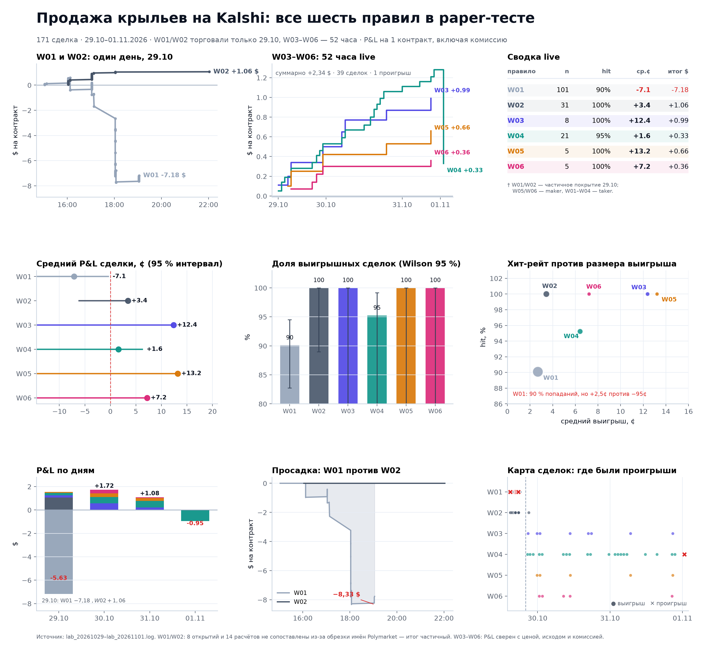
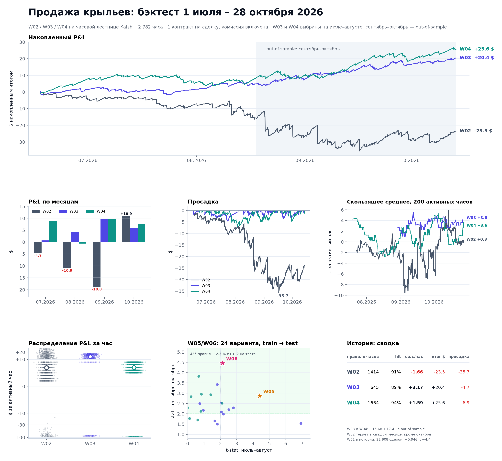
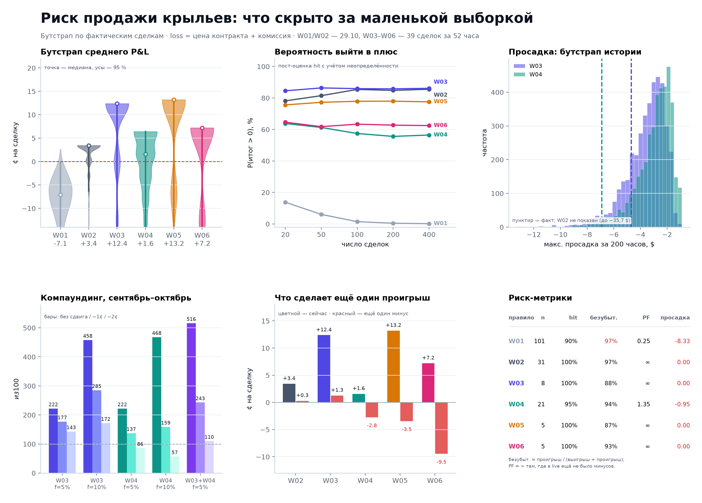

# Продажа крыльев на Kalshi: полный разбор

**01.11.2026** · 171 live-сделка (W01–W06) · бэктест 1 июля – 28 октября · риск и компаундинг

Источник: `lab_20261029.log`–`lab_20261101.log`, `results/studies/wings_equity.csv`,
`results/studies/wings_improve.csv`, `results/studies/wings_summary.md`, `reports/kalshi_calibration.md`.
Код: `reports/wings_deep.py`, `reports/build_wings_report.py`. HTML-версия: `reports/wings_report.html`.

## Коротко

- В логах **171 сделка**, а не 39: добавились W01 (101) и W02 (31), торговавшие только 29.10.
- **W01 потерял −$7,18**: 90,1 % попаданий, но 10 потерь по −95…−98¢. Девять из десяти — в один час
  16:43–17:43 UTC 29.10; при бэктестовой частоте 4 % вероятность такого — 0,73 %.
- **W02** (edge ≥ 1¢) в тот же день дал 31/31 и +$1,06, но история — 5 707 сделок и −$23,5.
- **W03–W06**: +$2,34 за 52 часа, 39 сделок, hit 97,4 % [86,8; 99,5]; один проигрыш −$0,95.
- С бэктестом согласуется только **W04**: +1,57¢ live против +1,8¢ OOS. W03/W05/W06 выглядят лучше
  истории, но на 8 и 5 сделках это шум.
- Ещё один проигрыш обнуляет W03 (+1,3¢) и уводит W04/W05/W06 в минус (−2,8 / −3,5 / −9,5¢).

## 1. Live: все шесть правил

| Правило | Сделок | Hit, % | Ср. P&L, ¢ | 95 % интервал | Итог, $ | Выигрыш / проигрыш, ¢ | Безубыт. hit, % | PF | Макс. просадка, $ |
|---|---|---|---|---|---|---|---|---|---|
| W01 | 101 | 90,1 | −7,11 | [−16,9; −0,3] | −7,18 | +2,7 / −96,3 | 97,3 | 0,25 | −8,33 |
| W02 | 31 | 100,0 | +3,42 | [−6,3; 3,4] | +1,06 | +3,4 / −96,7 | 96,6 | ∞ | 0,00 |
| W03 | 8 | 100,0 | +12,38 | [−25,1; 12,4] | +0,99 | +12,4 / −87,6 | 87,6 | ∞ | 0,00 |
| W04 | 21 | 95,2 | +1,57 | [−22,6; 6,4] | +0,33 | +6,4 / −95,0 | 93,7 | 1,35 | −0,95 |
| W05 | 5 | 100,0 | +13,20 | [−46,8; 13,2] | +0,66 | +13,2 / −86,8 | 86,8 | ∞ | 0,00 |
| W06 | 5 | 100,0 | +7,20 | [−52,8; 7,2] | +0,36 | +7,2 / −92,8 | 92,8 | ∞ | 0,00 |

W01/W02 — только 29.10 (3,7 и 6 часов), W03–W06 — 52 часа. У W01 8 открытий и 14 расчётов не
сопоставлены (обрезка имён Polymarket и позиции до начала лога), итог частичный. P&L на 1 контракт, комиссия Kalshi включена.

## 2. W01: анатомия убытка

| Открыта (UTC) | Расчёт | Рынок | Цена | P&L, $ |
|---|---|---|---|---|
| 29.10 14:58 | 16:07 | BTC > 79 600 | 0,95 | −0,981 |
| 29.10 16:43 | 17:08 | BTC > 80 000 | 0,97 | −0,972 |
| 29.10 16:44 | 17:02 | KXBTCD · 80 199.99 | 0,94 | −0,950 |
| 29.10 17:01 | 18:02 | BTC > 81 000 | 0,96 | −0,963 |
| 29.10 17:01 | 18:02 | KXBTCD · 80 899.99 | 0,94 | −0,950 |
| 29.10 17:01 | 18:02 | KXBTCD · 80 999.99 | 0,96 | −0,970 |
| 29.10 17:07 | 18:02 | KXBTCD · 80 799.99 | 0,94 | −0,950 |
| 29.10 17:34 | 18:02 | BTC > 80 400 | 0,96 | −0,981 |
| 29.10 17:37 | 18:04 | BTC > 80 800 | 0,96 | −0,963 |
| 29.10 17:43 | 18:02 | KXBTCD · 80 699.99 | 0,96 | −0,950 |

Средний выигрыш +2,69¢, средний проигрыш −96,3¢, безубыточный hit 97,3 % при фактических 90,1 %.
Девять потерь открыты в 16:43–17:43 UTC — один импульс BTC через страйки 79 600–81 000, одновременно
Kalshi и Polymarket. Бэктест W01 (22 908 сделок) давно показывал −0,94¢ и t −4,4.

## 3. Live против бэктеста

| Правило | Live, сделок | Live, ¢/сделку | Бэктест, ¢/сделку | Бэктест, сделок |
|---|---|---|---|---|
| W01 | 101 | −7,11 | −0,94 | 22 908 |
| W02 | 31 | +3,42 | −0,41 | 5 707 |
| W03 | 8 | +12,38 | +3,6 (OOS) | 427 |
| W04 | 21 | +1,57 | +1,8 (OOS) | 980 |
| W05 | 5 | +13,20 | +4,6 (OOS) | 318 |
| W06 | 5 | +7,20 | +3,5 (OOS) | 496 |

W03/W05/W06 в live выглядят в 2–3,5 раза лучше истории, но их интервалы широки; W04 — единственное совпадение точечных оценок.
W05/W06 — maker-first, поэтому их плюс к taker-бэктесту ожидаем, но 5 сделок ничего не доказывают.

## 4. История: июль–октябрь

| Правило | Активных часов | Hit, % | Ср. ¢/час | Итог, $ | Макс. просадка, $ | Худший месяц, $ | Sep–Oct OOS, $ |
|---|---|---|---|---|---|---|---|
| W02 | 1 414 | 91,3 | −1,66 | −23,5 | −35,7 | −18,8 | −7,9 |
| W03 | 645 | 89,5 | +3,17 | +20,4 | −4,7 | +0,7 | +15,6 |
| W04 | 1 664 | 94,4 | +1,59 | +25,6 | −6,9 | −0,6 | +17,4 |

| Месяц | W02, $ | W03, $ | W04, $ | Сумма, $ |
|---|---|---|---|---|
| 07.2026 | −4,7 | +0,7 | +8,9 | +4,8 |
| 08.2026 | −10,9 | +4,1 | −0,6 | −7,4 |
| 09.2026 | −18,8 | +9,6 | +9,8 | +0,7 |
| 10.2026 | +10,9 | +6,0 | +7,5 | +24,3 |

W03: 645 часов, +3,17¢/час, t 2,6, OOS +$15,6. W04: 1 664 часа, +1,59¢/час, t 2,7, OOS +$17,4.
W02 теряет в трёх месяцах из четырёх; октябрь (+$10,9) не перекрывает сентябрь (−$18,8).

## 5. Риск и капитал

Вероятность выйти в плюс (пост-оценка hit, 20 000 симуляций):

| Правило | 20 сделок | 100 сделок | 400 сделок |
|---|---|---|---|
| W01 | 13,8 | 1,4 | 0,1 |
| W02 | 78,1 | 85,4 | 85,5 |
| W03 | 84,5 | 85,9 | 86,1 |
| W04 | 63,8 | 57,4 | 56,4 |
| W05 | 75,6 | 77,9 | 77,5 |
| W06 | 64,6 | 63,3 | 62,4 |

$100 капитала, компаундинг, сентябрь–октябрь OOS:

| Стратегия | Без сдвига | −1¢ | −2¢ | Макс. просадка |
|---|---|---|---|---|
| W03 · f=5% | $222 | $177 | $143 | −19% |
| W03 · f=10% | $458 | $285 | $172 | −37% |
| W04 · f=5% | $222 | $137 | $86 | −25% |
| W04 · f=10% | $468 | $159 | $57 | −45% |
| W03+W04 · 5% each | $516 | $243 | $110 | −34% |

Базовый сценарий — не «без сдвига», а −1¢: maker-филлы не бесплатны. При −2¢ W04 уходит ниже $100,
W03 едва держится.

## 6. Разрезы

- **Исполнение:** maker 10 сделок, 100 %, +10,2¢, +$1,02; taker 161, 93,2 %, −2,98¢, −$4,80.
  Maker — это W05/W06, taker — W01–W04; сравнение смешивает правило и исполнение.
- **Edge (W02–W04):** W04 при edge < 0,5¢ даёт −4,8¢ (9 сделок), 0,5–1,5¢ — +6,1¢, > 1,5¢ — +7,0¢.
- **Цена крыла:** W01 в 6–10¢ — 11 сделок, −$2,44; W03 монотонно улучшается: 10–15¢ +11,3¢ (4),
  15–20¢ +15,0¢ (3).

## 7. Данные и оговорки

- W03–W06 сверены точно: максимальное расхождение логированного P&L с пересчётом — 0,000000.
- W01/W02: 8 открытий и 14 расчётов не сопоставлены; итог W01 — частичный (несопоставленные расчёты могут сдвинуть его в любую сторону).
- 110 ошибок `markets kalshi failed` (HTTP 403) за три дня — на расчёты не повлияло, но фид нужно чинить.
- `data/lab/ledger.csv` не использован: там 11 OPEN W01 и 2 OPEN W02, без SETTLE/WINGS.

## 8. Что дальше

1. W01 — выключить; W02 — оставить выключенным.
2. W03/W04 — ядро, 1 сделка в час, размер из бюджета «один минус ≤ 2–3 % капитала».
3. W05/W06 — paper до 100+ сделок.
4. Базовая оценка — со сдвигом −1¢; при −2¢ W04 не масштабируется.
5. Вердикт — после 300–400 сделок W03–W06 (примерно месяц).
6. Починить фид Kalshi (110 ошибок 403 за три дня).

**Итог одной фразой.** Продажа крыльев зарабатывает на переоценке дешёвых контрактов, но платит
редкими −95¢; W01 показывает, что без фильтра хвост съедает премию, а W03/W04 — что с фильтром премия
остаётся, но её размер (2–4¢ на сделку) требует сотен сделок и терпимости к просадке.
