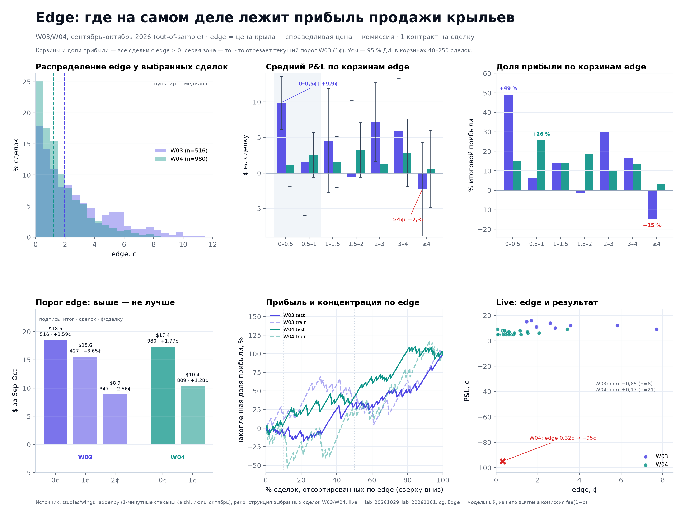
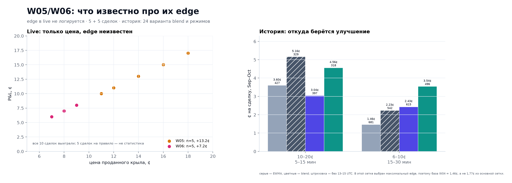

# Edge: сколько прибыли приносят разные преимущества (W03–W06)

**Короткий ответ.** Прибыль не сосредоточена в сделках с максимальным преимуществом. Наоборот: у W03
корзина `edge ≥ 4¢` — 23,6 % сделок и **−14,8 %** итоговой прибыли (на train она давала +58 %, то есть знак
переворачивается), у W04 — 9,5 % сделок и 3,3 % прибыли. Основная прибыль лежит в полосе **0–3¢**: у W03 это
66 % сделок и 98 % прибыли, у W04 — 68 % сделок и 73 % прибыли. Поднимать минимальный edge и «ждать
максимум» невыгодно: число сделок падает быстрее, чем растёт их качество, а суммарный P&L на тесте
сокращается в 1,7–2,1 раза. Edge работает как **фильтр от отрицательных значений**, а не как ранжирование
«чем больше, тем лучше».

## 1. Что и как считали

* **W03/W04** — точный edge на уровне сделки из бэктеста `studies/wings_ladder.py`:
  `edge = c_bid − c_fair − fee(1 − c_bid)`, `fee(p) = ceil(round(0.07·p(1−p)·100, 6))/100`.
  Выбор сделки — как в правиле: самый дорогой страйк в свой час (сортировка `T`, `ts`, `c_bid` desc),
  один страйк в час. Тест — **1 сентября — 28 октября 2026**, 58 дней; train — июль–август.
* **Корзины** — по edge в центах; в таблицах и на рис. 25 показаны **все сделки с edge ≥ 0** (для W04 это
  и есть текущее правило; у W03 текущий порог 1¢ отрезает первую корзину — на рисунке она затенена).
* **W05/W06** — edge в live **не логируется** (в `lab_2026*.log` в строках `WINGS` нет ни `edge`, ни `fair`),
  поэтому для них — только цена, live-P&L и историческая сетка `wings_improve.csv`; см. раздел 8.
* Комиссия уже вычтена из edge; P&L — на 1 контракт, без капитала и проскальзывания сверх стакана.

## 2. W03: где лежит прибыль

Тест, 516 сделок, **+$18,53**, +3,59¢ на сделку, hit 90 %.

| edge, ¢ | сделок | % сделок | ¢/сделку (95 % ДИ) | всего, ¢ | % прибыли | hit, % | train, ¢/сделку |
|---:|---:|---:|---:|---:|---:|---:|---:|
| 0–0,5 | 92 | 17,8 | **+9,9** (+6,1…+13,6) | +9,1 | **49,0** | 96,7 | +8,2 |
| 0,5–1 | 73 | 14,1 | +1,6 (−6,0…+9,1) | +1,2 | 6,2 | 87,7 | +7,1 |
| 1–1,5 | 57 | 11,0 | +4,6 (−2,8…+11,9) | +2,6 | 14,0 | 91,2 | +1,7 |
| 1,5–2 | 42 | 8,1 | −0,5 (−11,3…+10,2) | −0,2 | −1,2 | 85,7 | −6,3 |
| 2–3 | 78 | 15,1 | +7,2 (+1,7…+12,7) | +5,6 | 30,2 | 93,6 | −1,3 |
| 3–4 | 52 | 10,1 | +6,0 (−1,4…+13,3) | +3,1 | 16,7 | 92,3 | −2,8 |
| ≥4 | 122 | 23,6 | **−2,3** (−8,8…+4,3) | −2,7 | **−14,8** | 83,6 | +6,9 |

* Половина прибыли — в корзине **0–0,5¢**, где модель почти согласна с рынком. Это не «дешёвые» крылья:
  средняя цена в корзинах почти одинакова (14,3–15,4¢), так что эффект не объясняется ценой.
* Худшая корзина — **самый высокий edge**. Там же самый низкий hit: 83,6 % против 93,6 % в полосе 2–3¢.
  Высокий edge означает не «рынок ошибается», а «модель сильнее всего расходится с рынком»; в этом сэмпле
  чаще прав оказывался рынок.
* Train и тест расходятся по знаку в верхних корзинах: `≥4¢` +6,9¢ на train и −2,3¢ на тесте. Это признак
  нестабильного сигнала, а не устойчивой премии за «максимальное преимущество».

Если смотреть только на сделки, которые W03 **реально берёт** (порог 1¢, 427 сделок, +$15,59):

| edge, ¢ | сделок | ¢/сделку | % прибыли | hit, % |
|---:|---:|---:|---:|---:|
| 1–1,5 | 77 | +5,5 | 27 | 92,2 |
| 1,5–2 | 57 | +3,3 | 12 | 89,5 |
| 2–3 | 96 | +8,3 | 51 | 94,8 |
| 3–4 | 67 | +4,7 | 20 | 91,0 |
| ≥4 | 130 | −1,3 | −11 | 84,6 |

Картина та же: половина прибыли — в 2–3¢, верхняя корзина убыточна. Но порог 1¢ отрезает корзину 0–0,5¢,
которая на полной выборке дала 49 % прибыли, — поэтому итог правила ниже, чем у порога 0¢.

## 3. W04: прибыль размазана, верхняя корзина не выделяется

Тест, 980 сделок, **+$17,36**, +1,77¢ на сделку, hit 95 %.

| edge, ¢ | сделок | % сделок | ¢/сделку (95 % ДИ) | всего, ¢ | % прибыли | hit, % | train, ¢/сделку |
|---:|---:|---:|---:|---:|---:|---:|---:|
| 0–0,5 | 246 | 25,1 | +1,1 (−1,8…+4,0) | +2,6 | 15,0 | 94,3 | +2,3 |
| 0,5–1 | 172 | 17,6 | +2,6 (−0,6…+5,7) | +4,4 | 25,6 | 95,3 | +2,8 |
| 1–1,5 | 151 | 15,4 | +1,6 (−2,0…+5,2) | +2,4 | 13,8 | 94,7 | +0,8 |
| 1,5–2 | 100 | 10,2 | +3,3 (−0,6…+7,1) | +3,3 | 18,8 | 96,0 | +5,5 |
| 2–3 | 136 | 13,9 | +1,3 (−2,6…+5,2) | +1,8 | 10,1 | 94,1 | −0,7 |
| 3–4 | 82 | 8,4 | +2,8 (−1,9…+7,6) | +2,3 | 13,4 | 95,1 | +0,8 |
| ≥4 | 93 | 9,5 | +0,6 (−4,8…+6,0) | +0,6 | 3,3 | 92,5 | −3,2 |

* 0–2¢ дают **73 %** прибыли на 68 % сделок; `≥4¢` — 3 % прибыли на 10 % сделок.
* Разброс между корзинами (1,1–3,3¢) меньше ширины доверительных интервалов: монотонного роста нет.
* Train и тест снова расходятся: `≥4¢` −3,2¢ на train, +0,6¢ на тесте.

## 4. Что если поднять порог: «ждать максимум» стоит денег

Тест, сетка `wings_ladder_grid.csv` (тот же выбор «самый дорогой страйк в час»):

| правило | порог | сделок | ¢/сделку | всего $ | t | hit | сделок/день | $/день |
|---|---:|---:|---:|---:|---:|---:|---:|---:|
| W03 | 0¢ | 516 | +3,59 | **18,5** | 2,71 | 90 % | 8,9 | 0,32 |
| W03 | **1¢ (сейчас)** | 427 | +3,65 | 15,6 | 2,51 | 90 % | 7,4 | 0,27 |
| W03 | 2¢ | 347 | +2,56 | 8,9 | 1,51 | 89 % | 6,0 | 0,15 |
| W04 | **0¢ (сейчас)** | 980 | +1,77 | **17,4** | 2,45 | 95 % | 16,9 | 0,30 |
| W04 | 1¢ | 809 | +1,28 | 10,4 | 1,53 | 94 % | 13,9 | 0,18 |

* W03: порог 2¢ **выглядел лучшим на train** (+4,88¢, t = 2,24), но на тесте дал +2,56¢ (t = 1,51) и
  вдвое меньший итог. Классическая ловушка выбора порога по train.
* W04: порог 1¢ снижает и ¢/сделку, и итог; текущий 0¢ лучше.
* W03: порог 1¢ не улучшает ¢/сделку (+3,65 против +3,59 — в пределах шума), но отрезает 17 % сделок и
  $2,9 прибыли. С точки зрения суммы текущий порог W03 неоправдан; с точки зрения экспозиции — это выбор
  «меньше сделок при том же качестве», а не источник прибыли.

## 5. Если выбирать не цену, а максимальный edge (стиль W05/W06)

Тот же временной слот, но сделка выбирается по максимальному edge, а не по максимальной цене; число
сделок принудительно то же, что у правила (427 и 980):

| правило | выбор | ¢/сделку | всего $ | `≥4¢`: сделок / ¢ / доля прибыли |
|---|---|---:|---:|---|
| W03 | цена (текущий) | +3,65 | **15,59** | 130 / −1,3 / −11 % |
| W03 | max edge | +2,59 | 11,07 | 186 / +0,8 / 14 % |
| W04 | цена (текущий) | +1,77 | 17,36 | 93 / +0,6 / 3 % |
| W04 | max edge | **+2,80** | **27,43** | 189 / +5,8 / 40 % |

Один и тот же приём **ухудшает** 10–20-оконное правило и **улучшает** 6–10-оконное. Универсального
«жди максимальный edge» нет: эффект зависит от окна и от того, насколько модель ошибается именно в этом
режиме. Для W04-окна max-edge действительно концентрирует прибыль в верхней корзине (40 %), но это
свойство конкретной полосы цен, а не общий закон.

## 6. Концентрация: прибыль не держится на топе

Если отсортировать сделки по edge и брать только верхнюю долю:

| доля сделок по edge | W03 тест | W03 train | W04 тест | W04 train |
|---|---:|---:|---:|---:|
| топ-10 % | **−8 %** | +43 % | +6 % | −6 % |
| топ-20 % | −13 % | +43 % | +20 % | −18 % |
| топ-30 % | −6 % | +75 % | +31 % | +4 % |
| топ-50 % | +24 % | +128 % | +42 % | +20 % |

Знак концентрации нестабилен даже между половинами одной выборки. Для W03 на тесте верхние 10 % по edge
**убыточны**; на train они дают +43 %. Это ещё один аргумент против «ждать максимум»: ранжирование по edge
не переносится из train в test.

## 7. Live: 29 сделок W03/W04

| правило | n | edge, ¢ (min–max) | средний edge | P&L, ¢/сделку | corr(edge, P&L) |
|---|---:|---:|---:|---:|---:|
| W03 | 8 | 1,47–7,70 | 3,45 | +12,4 | **−0,65** |
| W04 | 21 | 0,07–3,42 | 0,84 | +1,57 | +0,17 |

* W03: самые высокие edge (5,8–7,7¢) дали 9–12¢, а сделка с edge 1,9¢ — 11¢; связи нет, корреляция
  отрицательная (n = 8 — это иллюстрация, не статистика).
* W04: единственный убыток (−95¢, крыло исполнилось) имел edge 0,32¢ — низкий, а не высокий. Все
  прибыльные сделки — 5–9¢ при edge 0,07–3,42¢.
* Вывод тот же: в live высокий edge не отделяет лучшие сделки.

## 8. W05/W06: точного ответа нет, но косвенные данные есть

**Проблема.** В live W05/W06 edge считается, но не пишется в лог: в `WINGS`-строках нет `edge`/`fair`,
`gbm_long` не сериализуется, ledger хранит только W01/W02. Поэтому разложить их 5 + 5 live-сделок по edge
нельзя. Всё, что есть:

| правило | live | цена крыла | P&L | edge |
|---|---:|---:|---:|---|
| W05 | 5 | 13–18¢ | +13,2¢/сделку | не логируется |
| W06 | 5 | 6–9¢ | +7,2¢/сделку | не логируется |

**История (`wings_improve.csv`, тест, выбор максимального edge в этой сетке):**

| окно | EWMA, все часы | EWMA, без 13–15 UTC | blend, все часы | blend, без 13–15 UTC |
|---|---:|---:|---:|---:|
| 10–20¢ / 5–15 мин | 3,60¢ (427) | **5,16¢** (329) | 3,04¢ (397) | 4,56¢ (318) |
| 6–10¢ / 15–30 мин | 1,46¢ (681) | 2,23¢ (542) | 2,43¢ (615) | **3,54¢** (496) |

* Главный вклад даёт **отказ от 13–15 UTC**: +1,56¢ для 10–20-окна и +0,77…+1,11¢ для 6–10-окна —
  при обеих справедливых ценах.
* Blend не универсален: для 10–20-окна он **хуже** EWMA (3,04 против 3,60; 4,56 против 5,16), для
  6–10-окна — лучше (2,43 против 1,46; 3,54 против 2,23). То есть улучшение W06 — это blend + фильтр часов,
  а W05 — прежде всего фильтр часов; max-edge сам по себе для 10–20-окна хуже (раздел 5).
* Живые +13,2¢/+7,2¢ на 5 сделках не противоречат этому, но и не подтверждают: это не статистика.

## 9. Оговорки

* **Модельный edge, а не истинное преимущество.** Fair value — прогноз дисперсии; в верхних корзинах
  ошибка модели и создаёт «большой edge». Hit 83,6 % в `≥4¢` против 93,6 % в 2–3¢ — прямое указание, что
  модель там чаще ошибается, а не рынок.
* **Широкие интервалы.** В корзинах 40–250 сделок; ДИ в таблицах перекрываются, поэтому наиболее устойчивы
  только крупные эффекты: отсутствие монотонности, провал верхней корзины W03, падение итога при росте порога.
* **Низкая корзина неоднородна по цене.** В срезе 13–16¢ корзина 0–1¢ даёт +10,8¢, в 10–13¢ — +1,8¢,
  в 16–20¢ — +6,6¢. Поэтому «0–0,5¢ — лучшая корзина» — свойство конкретного среза, а не правило; надёжнее
  вывод об отсутствии монотонности и о провале верхней корзины.
* **Два месяца теста, посчитанные после факта корзины.** Границы корзин и пороги выбраны не априори;
  train-тест расхождения — часть результата, а не шум, который можно убрать.
* **W05/W06** — без live-edge; max-edge контрфактуал в разделе 5 посчитан на лабораторном fair, а не на
  blend, поэтому к W05/W06 применим только качественно.
* Live W05/W06 — мейкерские сделки, бэктест — тейкерский; сравнивать абсолютные ¢ напрямую нельзя.

## 10. Что делать

1. **Не поднимать пороги.** W03: 0¢ даёт больше прибыли при том же качестве, 1¢ — разумный компромисс по
   экспозиции, 2¢ — уже потеря. W04: держать 0¢.
2. **Edge — только фильтр.** Использовать его, чтобы не брать edge ≤ 0; не использовать как «уверенность»
   и не ждать максимум.
3. **Логировать edge/fair/market в WINGS-строках W05/W06.** Одна строка в `lab/wings.py` закроет
   единственный пробел в этом разборе; без неё live-декомпозиция W05/W06 невозможна.
4. **W05-окно:** проверить EWMA + отказ от 13–15 UTC (5,16¢) против текущего blend (4,56¢). **W06-окно:**
   blend + фильтр часов уже лучший вариант (3,54¢).
5. **Max-edge не делать универсальным:** для 10–20¢ он хуже, для 6–10¢ — лучше; это свойство окна.

---

Данные: `results/studies/wings_ladder_grid.csv`, `wings_improve.csv`, `reports/final/tables/wings_all_live_trades.csv`.
Код: `reports/wings_edge.py`. Таблицы: `reports/final/tables/wings_edge_*.csv`.
Рисунки: `reports/final/figures/fig25_wings_edge.png`, `fig26_wings_w05_w06.png`.
