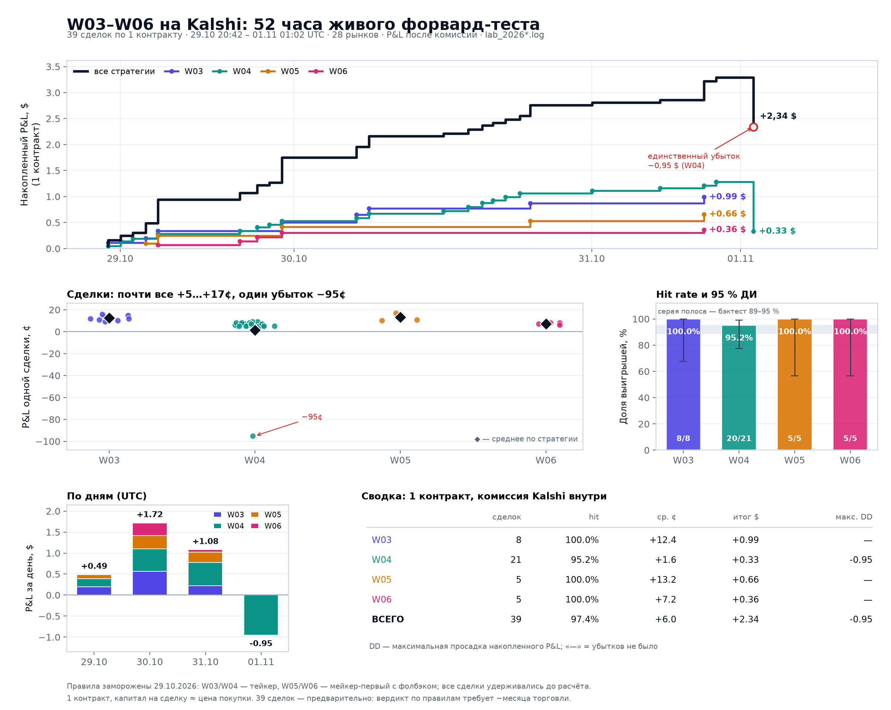
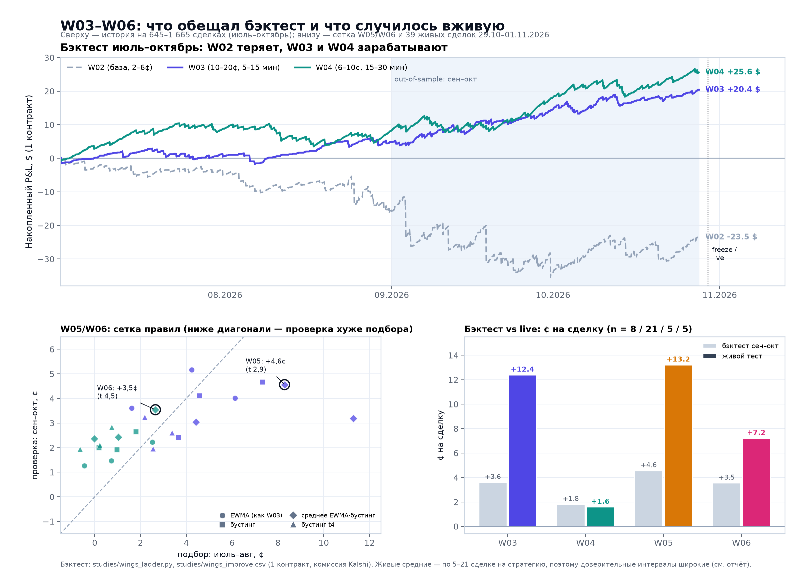
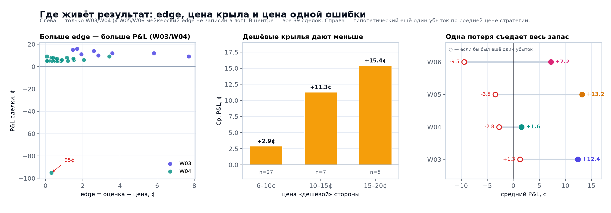

# W03–W06: живой форвард-тест на Kalshi, 29.10–01.11.2026

**Коротко.** 39 сделок по 1 контракту, 38 выигрышей и 1 убыток, **+2,34 $** после комиссии (6,0¢ на сделку, 6,6 % на вложенный капитал). W04 ведёт себя как в бэктесте; W03/W05/W06 выглядят заметно лучше, но на 5–8 сделках это ещё не результат: одна потеря почти обнуляет запас W03 и уводит W05/W06 в минус.

Период: 29.10.2026 20:42 — 01.11.2026 01:02 UTC (52 часа, 4 календарных дня). Данные: `lab_20261029.log` … `lab_20261101.log`.

Слева: сделки с edge < 0,5¢ дали в среднем −4,8¢ (включая единственный убыток), с edge > 1,5¢ — +10,5¢. В центре: чем дешевле крыло, тем меньше премия за сделку. Справа: ещё один убыток по средней цене превращает W05 и W06 в минус.

## По стратегиям

| Стратегия | Сделок | Выигрышей | Hit rate, 95 % ДИ | Ср. P&L, ¢ (ДИ) | Итог, $ | Ср. выигрыш | Убыток | Profit factor | Макс. DD | ROI |
|---|---:|---:|---:|---:|---:|---:|---:|---:|---:|---:|
| **W03** | 8 | 8 | 100,0 % (67,6…100,0) | 12,4 (−25,1…12,4) | 0,99 | 12,4 | — | ∞ | — | 14,3 % |
| **W04** | 21 | 20 | 95,2 % (77,3…99,2) | 1,6 (−17,7…6,4) | 0,33 | 6,4 | −95,0 | 1,35 | −0,95 | 1,7 % |
| **W05** | 5 | 5 | 100,0 % (56,6…100,0) | 13,2 (−46,8…13,2) | 0,66 | 13,2 | — | ∞ | — | 15,4 % |
| **W06** | 5 | 5 | 100,0 % (56,6…100,0) | 7,2 (−52,8…7,2) | 0,36 | 7,2 | — | ∞ | — | 7,8 % |
| **ВСЕГО** | 39 | 38 | 97,4 % (86,8…99,5) | 6,0 (−7,3…8,7) | 2,34 | 8,7 | −95,0 | 3,46 | −0,95 | 6,6 % |

Разброс P&L по всем сделкам: медиана 8,0¢, минимум −95,0¢, максимум 17,0¢; среднее 6,0¢.

«ДИ» у среднего — не обычный t-интервал, а симуляция с риском ещё не встреченного убытка: вероятность выигрыша ~ Beta(выигрыши+½, убытки+½), размер убытка — фактическая цена покупки + комиссия. Для 5/5 и 8/8 это честнее, чем узкий интервал, который «не видит» хвост.

## По дням (UTC)

| Дата | Сделок | Выигрышей | P&L, $ | Накопленно, $ |
|---|---:|---:|---:|---:|
| 29.10 | 6 | 6 | 0,49 | 0,49 |
| 30.10 | 18 | 18 | 1,72 | 2,21 |
| 31.10 | 14 | 14 | 1,08 | 3,29 |
| 01.11 | 1 | 0 | −0,95 | 2,34 |

## Разрезы

| Разрез | Сделок | Hit | Ср. P&L, ¢ | Итог, $ |
|---|---:|---:|---:|---:|
| Цена крыла: 6–10¢ | 27 | 96,3 % | 2,9 | 0,78 |
| Цена крыла: 10–15¢ | 7 | 100,0 % | 11,3 | 0,79 |
| Цена крыла: 15–20¢ | 5 | 100,0 % | 15,4 | 0,77 |
| Edge (оценка − цена): < 0,5¢ | 9 | 88,9 % | −4,8 | −0,43 |
| Edge (оценка − цена): 0,5–1,5¢ | 10 | 100,0 % | 7,0 | 0,70 |
| Edge (оценка − цена): > 1,5¢ | 10 | 100,0 % | 10,5 | 1,05 |
| Исполнение: maker | 10 | 100,0 % | 10,2 | 1,02 |
| Исполнение: taker | 29 | 96,6 % | 4,6 | 1,32 |
| Наша сторона: no | 34 | 97,1 % | 5,9 | 2,02 |
| Наша сторона: yes | 5 | 100,0 % | 6,4 | 0,32 |

Крайняя левая колонка — цена «дешёвой» стороны, которую мы продаём (покупая противоположную). У W03/W05 это 10–20¢, у W04/W06 — 6–10¢.

## Что это значит

1. **Хит-рейт 97,4 %** (38/39, 95 % ДИ 86,8…99,5): выборка согласуется с бэктестовыми 89–95 %, но интервал накрывает и 90 %, и 99 %.

2. **Весь убыток — одна сделка W04** 01.11 в 00:35 UTC: страйк 77 499,99, NO не исполнился, −0,95 $. После неё накопленный P&L упал с 3,29 до 2,34 $.

3. **W04 ближе всех к бэктесту:** 1,6¢ против +1,8¢ на 980 сделках проверки; хит-рейт 95,2 % против 94 %. Это единственная стратегия с достаточным числом живых сделок, чтобы говорить о совпадении, а не о везении.

4. **W03/W05/W06 — идеальные серии 18/18,** средние +7…+13¢. Но если бы в каждой из них случился один убыток, средние стали бы 1,3 / −3,5 / −9,5¢. Именно поэтому их нельзя считать подтверждением: при бэктестовой частоте выигрыша ожидание W03 ≈ +1,3¢, а не +12¢.

5. **Edge работает как фильтр:** сделки с edge < 0,5¢ дали −4,8¢ в среднем (включая единственный убыток), с edge > 1,5¢ — 10,5¢. Знак правильный, но это 39 наблюдений.

6. **Мейкер-первый работает:** 10/10 мейкерских сделок W05/W06 выиграли, 10,2¢ на сделку против 4,6¢ у тейкера. Экономия на спреде — главное объяснение, почему live W05/W06 выше тейкеровского бэктеста (+4,6 / +3,5¢).

## Бэктест vs живой тест

| Стратегия | Бэктест сен–окт, ¢ | Сделок | Живой тест, ¢ | 95 % ДИ | Сделок |
|---|---:|---:|---:|---:|---:|
| W03 | 3,60 | 427 | 12,4 | −25,1…12,4 | 8 |
| W04 | 1,80 | 980 | 1,6 | −17,7…6,4 | 21 |
| W05 | 4,56 | 318 | 13,2 | −46,8…13,2 | 5 |
| W06 | 3,54 | 496 | 7,2 | −52,8…7,2 | 5 |

W03/W04 — исторические значения из `results/studies/wings_summary.md`; W05/W06 — лучшие строки `wings_improve.csv` (blend + no US open, тейкер). Живые W05/W06 — мейкерские, поэтому сравнивать нужно с поправкой на спред.

## Все сделки

| # | Открытие (UTC) | Стратегия | Рынок | Сторона | Цена покупки | P&L, ¢ |
|---:|---|---|---|---:|---:|---:|
| 1 | 29.10 20:42 | W04 | KXBTCD-26OCT2914-T81099.99 | no | 94,0 | 5,0 |
| 2 | 29.10 20:52 | W03 | KXBTCD-26OCT2914-T80799.99 | no | 88,0 | 11,0 |
| 3 | 29.10 21:30 | W04 | KXBTCD-26OCT2915-T80899.99 | no | 90,0 | 9,0 |
| 4 | 29.10 22:30 | W04 | KXBTCD-26OCT2916-T80999.99 | no | 94,0 | 5,0 |
| 5 | 29.10 23:49 | W03 | KXBTCD-26OCT2917-T79499.99 | no | 90,0 | 9,0 |
| 6 | 29.10 23:50 | W05 | KXBTCD-26OCT2917-T79499.99 | no | 89,0 | 10,0 |
| 7 | 30.10 00:30 | W04 | KXBTCD-26OCT2918-T79799.99 | no | 90,0 | 9,0 |
| 8 | 30.10 00:31 | W06 | KXBTCD-26OCT2918-T79899.99 | no | 92,0 | 7,0 |
| 9 | 30.10 00:45 | W03 | KXBTCD-26OCT2918-T79399.99 | no | 85,0 | 14,0 |
| 10 | 30.10 00:46 | W05 | KXBTCD-26OCT2918-T79399.99 | no | 84,0 | 15,0 |
| 11 | 30.10 01:30 | W04 | KXBTCD-26OCT2919-T78299.99 | yes | 93,0 | 6,0 |
| 12 | 30.10 01:33 | W06 | KXBTCD-26OCT2919-T78299.99 | yes | 92,0 | 7,0 |
| 13 | 30.10 08:30 | W04 | KXBTCD-26OCT3002-T78799.99 | no | 92,0 | 7,0 |
| 14 | 30.10 08:33 | W06 | KXBTCD-26OCT3002-T78799.99 | no | 91,0 | 8,0 |
| 15 | 30.10 09:30 | W04 | KXBTCD-26OCT3003-T78899.99 | no | 94,0 | 5,0 |
| 16 | 30.10 10:35 | W04 | KXBTCD-26OCT3004-T78499.99 | no | 92,0 | 7,0 |
| 17 | 30.10 10:44 | W06 | KXBTCD-26OCT3004-T78299.99 | no | 91,0 | 8,0 |
| 18 | 30.10 10:46 | W03 | KXBTCD-26OCT3004-T78299.99 | no | 83,0 | 16,0 |
| 19 | 30.10 10:47 | W05 | KXBTCD-26OCT3004-T78299.99 | no | 82,0 | 17,0 |
| 20 | 30.10 16:33 | W04 | KXBTCD-26OCT3010-T77599.99 | no | 93,0 | 6,0 |
| 21 | 30.10 16:47 | W03 | KXBTCD-26OCT3010-T77099.99 | no | 84,0 | 15,0 |
| 22 | 30.10 17:30 | W04 | KXBTCD-26OCT3011-T77299.99 | no | 91,0 | 8,0 |
| 23 | 30.10 17:50 | W03 | KXBTCD-26OCT3011-T77299.99 | no | 87,0 | 12,0 |
| 24 | 30.10 23:38 | W04 | KXBTCD-26OCT3017-T76499.99 | yes | 94,0 | 5,0 |
| 25 | 31.10 01:34 | W04 | KXBTCD-26OCT3019-T76599.99 | yes | 91,0 | 8,0 |
| 26 | 31.10 02:34 | W04 | KXBTCD-26OCT3020-T77399.99 | no | 91,0 | 8,0 |
| 27 | 31.10 03:30 | W04 | KXBTCD-26OCT3021-T77399.99 | no | 94,0 | 5,0 |
| 28 | 31.10 04:30 | W04 | KXBTCD-26OCT3022-T76999.99 | yes | 93,0 | 6,0 |
| 29 | 31.10 05:31 | W04 | KXBTCD-26OCT3023-T77399.99 | no | 92,0 | 7,0 |
| 30 | 31.10 06:46 | W03 | KXBTCD-26OCT3100-T77199.99 | no | 89,0 | 10,0 |
| 31 | 31.10 06:47 | W05 | KXBTCD-26OCT3100-T77199.99 | no | 88,0 | 11,0 |
| 32 | 31.10 11:41 | W04 | KXBTCD-26OCT3105-T77299.99 | no | 94,0 | 5,0 |
| 33 | 31.10 15:30 | W04 | KXBTCD-26OCT3109-T77599.99 | no | 94,0 | 5,0 |
| 34 | 31.10 20:30 | W04 | KXBTCD-26OCT3114-T77599.99 | no | 94,0 | 5,0 |
| 35 | 31.10 20:31 | W06 | KXBTCD-26OCT3114-T77599.99 | no | 93,0 | 6,0 |
| 36 | 31.10 20:46 | W03 | KXBTCD-26OCT3114-T77599.99 | no | 87,0 | 12,0 |
| 37 | 31.10 20:47 | W05 | KXBTCD-26OCT3114-T77599.99 | no | 86,0 | 13,0 |
| 38 | 31.10 21:30 | W04 | KXBTCD-26OCT3115-T77699.99 | no | 92,0 | 7,0 |
| 39 | 01.11 00:35 | W04 | KXBTCD-26OCT3118-T77499.99 | no | 94,0 | −95,0 |

## Бэктест по месяцам (для контекста)

| Стратегия | июл | авг | сен | окт | всего |
|---|---:|---:|---:|---:|---:|
| W02 | −4,7 | −10,9 | −18,8 | 10,9 | −23,5 |
| W03 | 0,7 | 4,1 | 9,6 | 6,0 | 20,4 |
| W04 | 8,9 | −0,6 | 9,8 | 7,5 | 25,6 |

Источник: `results/studies/wings_summary.md` (1 контракт, комиссия Kalshi, июль–октябрь 2026). У W03/W04 сентябрь–октябрь — out-of-sample; живой тест начался 29.10.

## Целостность данных

- 39 строк `OPEN`/`WINGS` и 39 `SETTLE`, без незакрытых позиций; пересчёт P&L по цене, исходу и комиссии совпал с логом во всех 39 случаях.
- 28 уникальных рынков; 8 рынков торговались 2–4 стратегиями одновременно (W03∩W05, W04∩W06, W03∩W04, W05∩W06), поэтому исходы не независимы.
- За 52 часа в логах 110 ошибок `markets kalshi failed: HTTP 403` — в эти минуты сигналы могли не считаться, так что «отсутствие сделки» не равно «не было сигнала».
- Комиссия: тейкер 7 %·p(1−p), мейкер 1,75 %·p(1−p), округление вверх до цента. На этих ценах — 1¢ с обеих сторон.
- Время удержания в логах иногда больше часа (задержка распознавания расчёта), поэтому в статистике использовано время открытия, а не длительность.

## Что дальше

- Продолжать тест до ~200 сделок на стратегию (примерно месяц): только тогда нижняя граница ДИ среднего перестанет накрывать ноль.
- W04 уже ведёт себя как в бэктесте (+1,6¢ против +1,8¢); W03/W05/W06 пока нельзя отличить от «повезло» — 18/18 без единого убытка.
- Отдельно проверить мейкерские исполнения W05/W06 на реальной бирже: в бумажном режиме очередь учитывается моделью, но не проверена живыми ордерами.

## Ограничения

1. **39 сделок за 52 часа** — это не вердикт. По плану (`wings_summary.md`) для вердикта нужен ~месяц.
2. Один убыток на 39 сделок — редкое событие; его оценка хвоста опирается на модель, а не на данные.
3. W05/W06 — мейкерские: 10 сделок, все выиграли; реальные очереди и частичные исполнения в бумажном режиме учтены моделью, но не проверены на бирже.
4. Период совпал с несколькими сбоями Kalshi (403), что могло отфильтровать часть сигналов.

## Файлы

- `reports/wings_live.py` — парсер логов, статистика и графики.
- `reports/final/figures/fig19_wings_live.png` — дашборд живого теста.
- `reports/final/figures/fig20_wings_history.png` — бэктест, сетка W05/W06 и сравнение с живыми.
- `reports/final/tables/wings_live_trades.csv` — все 39 сделок.
- `reports/final/tables/wings_live_summary.csv` — сводка по стратегиям.
- `reports/final/tables/wings_live_daily.csv`, `wings_live_buckets.csv`, `wings_live_vs_backtest.csv`.
- `reports/final/tables/wings_live_summary.json` — машинная сводка.
