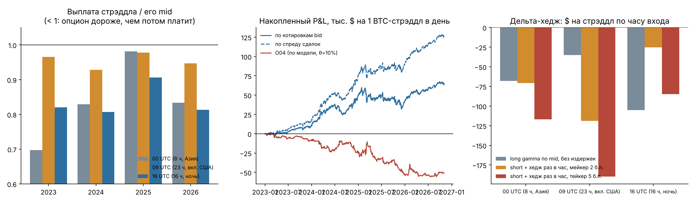

# Суточные опционы Deribit: стрэддлы по модели (O04), внутридневная гамма и продажа в 16:00 (O05)

**02.11.2026.** Данные: все сделки опционов BTC ближайшей экспирации (≤ 32 ч) за 60 минут до каждого входа,
**01.01.2023 – 02.11.2026: 940 тыс. сделок, 4 199 входов, 1 401 экспирация**. Входы в 00:00, 09:00 и 16:00 UTC,
экспирация в 08:00 UTC, то есть до неё 8, 23 и 16 часов. Расчёт по официальной цене поставки Deribit (4 190 из
4 199; 9 последних дней — по 30-минутному TWAP Binance). Код: `studies/o04_straddle.py`, `studies/gamma_intraday.py`,
`studies/o04_report.py`; таблицы: `o04_tables.md`, `o04_grid.csv`, `gamma_intraday_summary.csv`.

## Коротко

1. **O04 (покупать/продавать стрэддл, когда наша модель расходится с ценой ≥ 10%) не работает:** 805 сделок,
   −$62 на стрэддл (t −1,8), сторона покупок −$120 (t −2,0). Прогноз дисперсии лаборатории до экспирации хуже,
   чем подразумеваемая волатильность Deribit: QLIKE 0,285 против 0,216, DM t 3,6. Правило выведено (retired).
   Прибыль 30.10 (+$2,2 тыс.) — это взлом Binance, на следующий день правило вернуло −$2,4 тыс.
2. **Внутридневная гамма: гипотеза подтвердилась, денег нет.** Опционы оценивают одну волатильность на весь день,
   а реальная волатильность внутри дня неровная. Гамма, купленная в 09:00 (захватывает американскую сессию), стоит
   почти справедливо: −$35 на стрэддл по mid без издержек, реализованная дисперсия выше подразумеваемой в 49% дней.
   Гамма на 00:00–08:00 (Азия) и 16:00–08:00 (ночь) переоценена: −$68 и −$105, реализованная выше подразумеваемой
   только в 33–35% дней. Но дельта-хедж перпетуалом стоит $40–180 на стрэддл, и это съедает весь эффект в обе
   стороны: ни один вариант с реальными издержками не в плюсе.
3. **Что осталось — продажа суточного стрэддла в 16:00 UTC без хеджа (новое правило O05, на бумаге).**
   +$46 на 1 BTC-стрэддл в день по котировкам bid (t 2,0), +$90 по спреду реальных сделок (t 3,9). По годам:
   +31 / +106 / −21 / +72 $ в день по котировкам и +50 / +158 / +41 / +115 по спреду сделок. Это классическая
   премия за риск волатильности с толстым хвостом: худший день −$7 тыс., максимальная просадка −$28 тыс.
   на 1 BTC (Sharpe ≈ 1,0 по котировкам, ≈ 2,0 по спреду сделок).

## 1. Механика и формулы

**Стрэддл** = колл + пут на один страйк K. Выплата при экспирации |S_T − K|. Покупатель зарабатывает, если цена
ушла дальше уплаченной премии, продавец — если осталась ближе.

**Цена на входе** (без заглядывания вперёд, только сделки до момента t):
* форвард F_t = индекс Deribit последней сделки × Binance(t) / Binance(время той сделки);
* подразумеваемая волатильность σ: обращаем формулу Блэка-76 по mark-цене каждой сделки, затем локальная
  квадратичная улыбка по лог-денежности ln(K/F) в точке K* (ближайший к F_t страйк, шаг 500);
* mid = C(F, K*, σ, T) + P(F, K*, σ, T), где
  C = F·N(d₁) − K·N(d₂), P = K·N(−d₂) − F·N(−d₁), d₁ = [ln(F/K) + σ²T/2]/(σ√T), d₂ = d₁ − σ√T;
* ask/bid = mid × (1 ± h). Котируемый полуспред h измерен на живой цепочке Deribit лаборатории (29–30.10):
  10% от mid при ≤ 8 ч, 6,5% при 8–24 ч. По сделкам (цена против mark) реальный полуспред 1–4% — это вариант
  «спред сделок» (h × 0,3);
* комиссия 0,03% от спота за ногу, не более 12,5% цены ноги; без комиссии поставки.

**Справедливая цена по модели (O04).** Дисперсия лога цены до экспирации по модели лаборатории
v = уровень × Σ сезонных множителей по минутам, где уровень = 0,5·EWMA(30 мин) + 0,3·среднее за 24 ч + 0,2·за 8 дн
десезонализированных квадратов минутных доходностей. При X ~ N(F, F√v) и μ = F − K:
E|X − K| = sd·√(2/π)·exp(−μ²/2sd²) + μ·(1 − 2N(−μ/sd)).
Правило: покупать, если fair − ask − fee > 0,1·ask; продавать, если bid − fair − fee > 0,1·bid.

**Гамма-трейдинг.** У дельта-нейтрального опциона прирост стоимости за шаг dt (разложение Тейлора / Блэк–Шоулз):
dΠ ≈ ½·Γ·S²·(r² − σ²dt), где r — доходность за шаг, σ — подразумеваемая волатильность.
Сумма до экспирации: P&L ≈ ½ Σ Γ_t S_t² (r_t² − σ² dt), то есть **реализованная дисперсия против
подразумеваемой с весом гаммы**. Покупатель гаммы выигрывает, когда рынок двигается сильнее, чем заложено в цену.
Дельта стрэддла = 2N(d₁) − 1; хедж перпетуалом пересчитывается каждые 5/15/60 минут или при уходе дельты больше
чем на 0,10/0,25 BTC. Хедж прекращается в 07:30 (начало окна расчётного среднего), последняя позиция
закрывается по цене расчёта. Издержки хеджа: 5 б.п. за сторону (тейкер) или 2 б.п. (мейкер) от оборота.

## 2. Кто лучше прогнозирует дисперсию до экспирации

| вход UTC | n | часов | IV, % год. | модель, % | реализ., % | RV/IV (геом.) | QLIKE IV | QLIKE модель | DM t |
|---|---|---|---|---|---|---|---|---|---|
| все | 4 199 | 15,7 | 40,4 | 38,7 | 44,5 | 0,88 | **0,216** | 0,285 | 3,6 |
| 00 | 1 398 | 8 | 37,6 | 32,7 | 39,9 | 0,77 | **0,239** | 0,326 | 1,6 |
| 09 | 1 400 | 23 | 41,0 | 42,0 | 47,3 | 1,02 | **0,202** | 0,273 | 3,9 |
| 16 | 1 401 | 16 | 42,4 | 41,4 | 45,9 | 0,86 | **0,208** | 0,257 | 4,3 |

DM t > 0 означает, что модель хуже. **На горизонте 8–23 часа Deribit прогнозирует лучше нашей модели.** Это не
противоречит главному результату проекта: там часовая лесенка Kalshi обыгрывала Deribit, пересчитанный в часовую
дисперсию по плоской формуле. Здесь же сравниваются суточные опционы на их собственном горизонте.

Среднее реализованной волатильности (44,5%) выше IV (40,4%), а медиана (геом. 0,88) ниже: в обычный день рынок
двигается меньше подразумеваемого, а редкие обвалы двигают его намного сильнее. Отсюда стабильная премия продавцу
и толстый хвост.

## 3. Премия: выплата стрэддла / его mid

| вход | 2023 | 2024 | 2025 | 2026 |
|---|---|---|---|---|
| 00 UTC | 0,70 | 0,83 | 0,98 | 0,83 |
| 09 UTC | 0,97 | 0,93 | 0,98 | 0,95 |
| 16 UTC | 0,82 | 0,81 | 0,91 | 0,81 |

В 09:00 стрэддл почти честный (0,93–0,98), в 16:00 систематически дорогой (0,81–0,91). Опционы оценены одной
волатильностью на сутки, а самые тихие часы — ночь и азиатская сессия.

## 4. O04: результат как есть (θ = 10%, одна сделка на экспирацию)

| выборка | сторона | сделок | $/сделка | % премии | t | 95% ДИ |
|---|---|---|---|---|---|---|
| 2023–2026 | обе | 805 | −62 | −5,1 | −1,8 | [−132; 8] |
| 2023–2026 | покупка | 366 | −120 | −10,5 | −2,0 | [−237; 1] |
| 2023–2026 | продажа | 482 | −17 | −0,2 | −0,5 | [−94; 52] |
| 2023–2024 | обе | 465 | −50 | −5,1 | −1,5 | [−114; 14] |
| 2025–2026 | обе | 340 | −79 | −5,0 | −1,1 | [−214; 58] |

Сигнал «модель выше цены → покупай» убыточен в обеих половинах. Полная сетка (порог 0/5/10/20%, сторона, спред,
час входа): `o04_grid.csv`. Почти все покупки убыточны, продажа без фильтра в 16:00 — лучшая строка.

## 5. Гамма по часу входа (дельта-хедж до экспирации, $ на 1 BTC-стрэддл)

| вход | long по mid без издержек, хедж каждую минуту | short, хедж раз в час: спред сделок, хедж бесплатно | short, хедж раз в час: котировки, мейкер 2 б.п. | то же, тейкер 5 б.п. |
|---|---|---|---|---|
| 00 UTC | −68 (t −12) | +2 | −71 | −117 |
| 09 UTC | −35 (t −3,5) | −21 | −119 | −190 |
| 16 UTC | −105 (t −12) | **+59 (t 5,0)** | −25 | −85 |

* Внутридневная форма волатильности видна: гамма дешевле всего утром, дороже всего на ночь и в азиатскую сессию.
* Купить гамму выгодно нельзя ни в какой час: даже в 09:00 без издержек это −$35.
* Продать гамму на ночь с хеджем выгодно только без издержек хеджа (+$59). Оборот хеджа раз в час ≈ 2–3 BTC за сутки на
  стрэддл: при 2 б.п. это ~$40, при 5 б.п. ~$100, что больше всей премии. Частый хедж ещё хуже: каждую минуту
  при 5 б.п. это −$560 на стрэддл.
* Без хеджа продажа в 16:00 даёт больше (+$46 / +$90), но с хвостом: −$7 тыс. в день 11.10.2025, −$5,9 тыс.
  07.04.2025, −$5,1 тыс. 05.08.2024.

## 6. O05: продажа стрэддла в 16:00 UTC

| | по котировкам bid | по спреду сделок |
|---|---|---|
| сделок (дней) | 1 401 | 1 401 |
| $ в день на 1 BTC-стрэддл | +46 (t 2,0) | +90 (t 3,9) |
| % от премии | +3,7% | +8,2% |
| по годам 2023 / 24 / 25 / 26, $ в день | +31 / +106 / −21 / +72 | +50 / +158 / +41 / +115 |
| итог за 3,8 года | +$64,6 тыс. | +$126,4 тыс. |
| максимальная просадка | −$27,8 тыс. | −$17,9 тыс. |
| худший день | −$7,0 тыс. | −$6,9 тыс. |
| Sharpe в год | 1,0 | 2,0 |

**Как читать.** Это не арбитраж, а продажа страховки: 2 дня из 3 приносят $100–300, а раз в несколько месяцев
один день забирает $5–7 тыс. Решает исполнение: разница между «по bid» и «по спреду сделок» — это вся разница
между t 2 и t 4. Продавать нужно лимитной заявкой внутри спреда, а не по bid.

**Капитал.** Минимальный лот Deribit 0,1 BTC, это ~$4,6–9 в день и худший день −$700. Начальная маржа короткого
стрэддла ~10–15% от номинала, то есть ~$1–1,2 тыс. на 0,1 BTC, но для худшего дня нужен запас ≥ $2–3 тыс.
Реалистичный минимум — $3–5 тыс. капитала на 0,1 BTC. Проверить нужно и то, доступен ли Deribit из твоей
юрисдикции.

**Оговорки.**
1. Выбор «16:00, без хеджа» сделан на той же выборке: это одна из ~50 строк сетки. t 2,0 по котировкам с поправкой
   на множественные проверки — на грани; t 3,9 по спреду сделок устойчив. Правило заморожено (O05) и проверяется
   на бумаге, деньги до 100+ живых дней не ставятся.
2. Спред взят с живой цепочки 29–30.10 (дни взлома), в обычные дни он, вероятно, уже: оценка «по bid»
   консервативна.
3. Подразумеваемая волатильность восстановлена по mark-ценам за 60 минут до входа; ошибка улыбки ± 1 пункт.
4. Хвост можно срезать, купив крылья (короткая бабочка вместо стрэддла). Это стоит ещё два спреда и не проверено.

## 7. Что дальше

* O05 торгуется на бумаге с 03.11 (16:03 UTC, все 4 площадки). Критерий: 100 дней, среднее > 0 при t > 1,5.
* Проверить короткую бабочку (продать стрэддл, купить страйки ±3–5%) — хвост и маржа меньше.
* Продажа лимитом внутри спреда: доля исполнения и цена — в shadow-режиме по живой цепочке.
