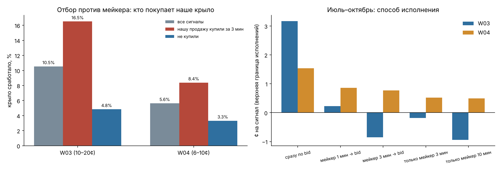

# Аудит O01/O02, связность крыльев и исполнение

**03.11.2026.** Код: `studies/options_arb_audit.py`, `studies/wings_execution.py`, `trader/monitor.py`.
Данные: снимки цепочек опционов Deribit, OKX, Binance, Bybit каждые 10 минут (28.10–02.11, 834 снимка, 331 тыс.
котировок) и минутные тики перпетуалов и фандинга лаборатории. Для крыльев — минутные свечи стакана часовой
лесенки Kalshi за июль–октябрь (2 310 сигналов W03/W04).

## Коротко

| Вопрос | Ответ |
|---|---|
| O02 (паритет колл-пут против перпетуала): +$15 тыс. на бумаге | **Не арбитраж.** Опционы точно согласованы с фьючерсом той же экспирации: 0 сигналов из 19 632 проверок. Вся «прибыль» — это текущий фандинг перпетуала, растянутый на 7 дней вперёд. Все сигналы пришлись на всплеск фандинга утром после взлома 30.10. Заложено 1,8 б.п. за 8 ч, реально было 0,5 → ожидаемо ≈ −$177 на BTC вместо +$32. Правило выведено, все сделки аннулированы. |
| O01 (одна опция на двух биржах) | **Реальный, но ничтожный эффект.** После синхронизации снимков осталось 30 сигналов за 5 дней, медиана $1,9 на опцион. Это котировки Bybit и Binance на дешёвые OTM-опционы по $10–20, разница в один шаг цены $5. Объёмы на этих уровнях неизвестны. Оставлено на бумаге. |
| Крылья: W03 и W05, W04 и W06 — одна сделка? | **Да.** W05 берёт тот же страйк и ту же сторону, что W03, в 100% общих часов; W06 так же совпадает с W04. W03 и W04 в одном часе ставят в одну сторону в 70% случаев. Если W03 проиграла, W04 в том же часе проигрывает с вероятностью 15% против обычных 5,6%. Считать надо по часам, а не по сделкам. |
| Мейкер или тейкер? | **Тейкер сразу.** Мейкерская заявка на крыле исполняется в основном тогда, когда крыло вот-вот сработает: у W03 16,5% против 4,8%, когда нашу заявку не взяли. Схема «пассивно, затем агрессивно» за 1–3 минуты даёт W03 +0,2…−0,9¢ против +3,2¢ при немедленной продаже. |
| Сколько ставить | Критерий Келли по оценке +2,6% к риску за час при σ 23,5% даёт f* ≈ 0,47. С учётом ошибки оценки и толстого хвоста — четверть Келли и меньше: 5–10% капитала на час. |
| Когда поверить | Последовательный тест Вальда (SPRT): ≈ 320 активных часов, если edge есть, и ≈ 220, если его нет. Сейчас 31 час, LLR −0,15 из коридора [−1,56; +2,77] — продолжаем. |

## 1. O02: как «арбитраж» превратился в ставку на фандинг

**Паритет колл-пут.** Покупка колла и продажа пута с одним страйком — это синтетический форвард:
C − P = F − K для линейных опционов (Binance, Bybit, USDT). Для инверсных опционов (Deribit, OKX: премия и выплата
в BTC, выплата колла (S−K)⁺/S) паритет C_btc − P_btc = 1 − K/F, то есть F_syn = K / (1 − (C_btc − P_btc)).
O02 сравнивала F_syn с **перпетуалом** плюс ожидаемый фандинг до экспирации:
`edge = perp − (C_ask − P_bid + K) + funding_rate_сейчас × τ/8ч × S − комиссии`.

**Три стадии проверки** (на BTC, сумма по всем сигналам):

| Стадия | Сигналов | Снимков | Сумма | Что изменилось |
|---|---|---|---|---|
| A. как в лаборатории: снимок опционов против перпетуала через 3 минуты, фильтр «спот сдвинулся ≤ 5 б.п.» | 87 | 5 | +$3 034 | — |
| B. синхронно: перпетуал в ту же секунду, что и снимок | 246 | 16 | +$7 843 | сигналов стало больше: дело не во времени |
| C. хедж фьючерсом Deribit той же экспирации вместо перпетуала | **0** | 0 | 0 | паритет выполняется точно |

Разложение: F_syn − (perp + фандинг) = [F_syn − собственный форвард биржи] + [форвард − perp − фандинг].
Первая часть — это настоящая ошибка опционов. Её медиана 0,7 б.п., межквартильный размах 3,5 б.п. — меньше
спреда и комиссий. Значит, вся «прибыль» O02 — вторая часть, базис между срочным фьючерсом и перпетуалом. 76%
разброса edge одинаковы для всех страйков одной экспирации: это признак ошибки модели форварда, а не цены отдельного
опциона.

**Почему базис был «дешёвым».** Все сигналы покупки синтетики — 30.10 с 08:00 до 11:00 UTC, экспирация 06.11. Фандинг
перпетуала Deribit тогда был 1,8 б.п. за 8 ч (обычно 0,1–0,5), и правило умножило его на 21 период до экспирации:
$300 «гарантированного» дохода от шорта перпетуала. Рынок фьючерсов в такую экстраполяцию не поверил и оказался прав:
средний фандинг за следующие 85 часов — 0,5 б.п. Ожидаемый результат по факту ≈ −$177 на BTC при записанных
+$32. Сигналы продажи синтетики (Bybit, 29.10 в 20:00 UTC) пришлись прямо на час взлома.

**Вывод.** O02 записывала зафиксированную прибыль (INSTANT) по позиции, которая на деле была ставкой на фандинг на
неделю. Это ошибка оценки, а не находка. Правило выведено, все 445 сделок исключены из отчёта (`VOID_ALL`).
Если захочется торговать базис фьючерс–перпетуал, это отдельная гипотеза: фьючерс против перпетуала напрямую
(комиссии вдвое меньше, чем через опционы) и модель фандинга, который возвращается к среднему. Её надо проверять на
истории фандинга за годы, а не за неделю.

## 2. O01: одна опция на двух биржах

| Фильтр | Сигналов | Разных опционов | Сумма на BTC | Медиана |
|---|---|---|---|---|
| все сигналы | 59 | 26 | $608 | $0,6 |
| снимки двух бирж ≤ 30 с друг от друга | 30 | 11 | $65 | $1,9 |
| то же + котировки сдвинуты на Δ·ΔS к одному моменту | 30 | 11 | $65 | $1,9 |

* 24 из 30 — Bybit (ask $10) против Binance (bid $15) на далёких OTM-коллах: шаг цены $5, комиссия ограничена 12,5%
  от цены. Одна и та же «возможность» на колле 92 000 жила 4 часа. На ликвидной бирже реальный арбитраж живёт
  секунды, так что либо объём там символический, либо котировка одной из бирж не исполнима.
* 5 сигналов OKX против Deribit — по одному снимку, $1–8.
* Объёмов на лучших уровнях логгер не пишет, поэтому исполнимость не проверить. Правило оставлено на бумаге, но
  экономического смысла в нём нет: $65 за 5 дней даже при 1 BTC на каждую опцию.

## 3. Крылья: сколько независимых ставок

На июльско-октябрьских свечах (те же правила, тейкер):

| | Значение |
|---|---|
| часов с W03 / W04 | 645 / 1 665 |
| W03 и W04 в одном часе | 560 |
| W05 против W03, W06 против W04: тот же страйк и сторона | 100% общих часов |
| W03 и W04 в одном часе: та же сторона / тот же страйк | 70% / 18% |
| корреляция почасового P&L W03 и W04 | 0,08 |
| P(W04 проиграла \| W03 проиграла в этом часе) | 15% против 5,6% в среднем |
| книга W03+W04 на час: ¢/час, t по часам, t по дням | +2,63¢, 3,7, 3,5 |
| то же, сентябрь–октябрь | +3,28¢, t 3,3 |

В live из 53 сделок крыльев 14 пар «два правила в одном слоте одного часа».

**Что изменено в исполнителе.** Два слота на час: «поздний» (W03/W05) и «ранний» (W04/W06). В каждом слоте — одна
позиция, кто бы её ни открыл. Для контроля книги вклады слотов складываются по часам. Корреляция обычных часов
низкая (0,08), но проигрыши связаны — это обычный хвостовой риск, который лимиты и учитывают.

## 4. Исполнение: почему «сначала пассивно» здесь проигрывает

**Теория.** Мейкер получает спред, но его исполняют выборочно (Glosten–Milgrom 1985, Kyle 1985): заявку берёт тот,
кто знает больше. Ожидание мейкерской заявки
E = P(исполн.)·[(a − π) − f_м − AS], где AS = E[π_после − π | исполнили].
Гибрид «пассивно, затем агрессивно» (Almgren–Chriss, Harris) выгоден, когда AS мал, а сигнал живёт долго.

**Что измерено.** Свечи дают закрывающий стакан и последнюю сделку каждой минуты, поэтому исполнения ограничены
с двух сторон:
* нижняя граница: в одной из следующих минут лучший bid дешёвой стороны ≥ нашей цены. Такое возможно, только
  если нашу заявку уже взяли;
* верхняя граница: плюс любая минута, где последняя сделка прошла по нашей цене с объёмом.

| Правило | P(крыло сработало) | если нашу продажу купили за 3 мин | если не купили | доля «купили» |
|---|---|---|---|---|
| W03 (10–20¢) | 10,5% | **16,5%** | 4,8% | 49% |
| W04 (6–10¢) | 5,6% | **8,4%** | 3,3% | 46% |

Отбор против нас (+6 п.п. вероятности выплаты 1 доллара) стоит ~6¢, а мейкер выигрывает лишь 1¢ спреда и
экономит ~0,5¢ комиссии. Результат по способам исполнения, ¢ на сигнал (июль–октябрь, верхняя граница исполнений):

| Правило | сразу по bid | мейкер 1 мин → bid | мейкер 3 мин → bid | только мейкер 3 мин | только мейкер 10 мин |
|---|---|---|---|---|---|
| W03 | **+3,17** | +0,23 | −0,85 | −0,18 | −0,94 |
| W04 | **+1,54** | +0,86 | +0,77 | +0,52 | +0,49 |

Нижняя граница ещё хуже, верхняя не спасает. Отсюда три решения:
1. **Мейкерские котировки W05/W06 в исполнителе выключены** (`maker_rules = []`). Для W05/W06 исполняются только
   решения отката (`take`). Это согласуется с live: все 14 сделок W05/W06 прошли тейкером, бумажная модель очереди
   ни разу не дала мейкерского исполнения.
2. **Тейкер с защитой цены по уровням стакана.** IOC-лимит на худшем уровне, где edge по пересчитанной справедливой
   цене ещё ≥ порога правила. С каждого уровня берётся ≤ 25% объёма, в пределах бюджета риска. Рыночных заявок нет.
3. **Скорость важнее спреда.** Справедливая цена пересчитывается под спот в момент отправки: для крыла 1 б.п. спота
   ≈ 1¢ цены. Отказ, если спот ушёл > 20 б.п.

## 5. Размер позиции и правило остановки

**Келли.** На часовую книгу (1 контракт на слот) доходность к капиталу под риском μ = +2,6% за активный час,
σ = 23,5% (июль–октябрь; сентябрь–октябрь μ 3,2%, σ 22%). Формально f* = μ/σ² ≈ 0,47–0,65. Но:
* у μ t ≈ 3,5, то есть 95% интервал примерно от 1/3 до 5/3 точечной оценки. При ошибке в два раза полный Келли уже
  уменьшает рост капитала;
* распределение бинарное с толстым левым хвостом: худший день −$3,35 на контракт в слоте, 30% дней в минусе.

Практическое правило — **дробный Келли ≤ 1/4: 5–10% капитала под риском на час**. Это совпадает с заложенным в
исполнитель `risk_per_trade_usd` (по умолчанию $5).

**Последовательный тест (SPRT, Вальд).** H0: 0¢ в час; H1: +3,28¢ (вне выборки), σ 29,9¢. После каждого часа
LLR += (μ₁/σ²)·x − μ₁²/(2σ²). Граница +2,77 — edge подтверждён, −1,56 — идею закрыть (α 5%, β 20%). Ожидаемая
длина: ≈ 320 часов при H1, ≈ 220 при H0, то есть 2–3 недели работы лаборатории вместо месяца. Сейчас: 31 час,
+0,3¢/час, LLR −0,15 → продолжаем. Команды: `python -m trader lab-sprt` для бумаги, `python -m trader report`
для исполнителя.

## 6. Демо: что проверять

Цены демо-биржи ненастоящие, поэтому на демо проверяется только механика:
1. `python -m trader check --mode demo` — подпись ключа, часы, баланс, есть ли на демо рынки KXBTCD.
2. `python -m trader test-order --mode demo` — post-only заявка 1 контракт по 1¢, чтение, отмена.
3. `python -m trader run --mode demo` с `demo_ignore_edge = true` и `demo_contracts = 1` в
   `data/trader/settings.json`: каждое решение лаборатории превращается в IOC-заявку на 1 контракт по демо-цене.
4. Через сутки `python -m trader report --mode demo`: журнал должен совпадать с `GET /portfolio/fills` и
   `/positions`. Расхождение — ошибка, которую надо найти до реальных денег.
Качество самой стратегии меряется в shadow-режиме на настоящем стакане: какая доля решений исполнима по цене
лаборатории и с каким проскальзыванием.
